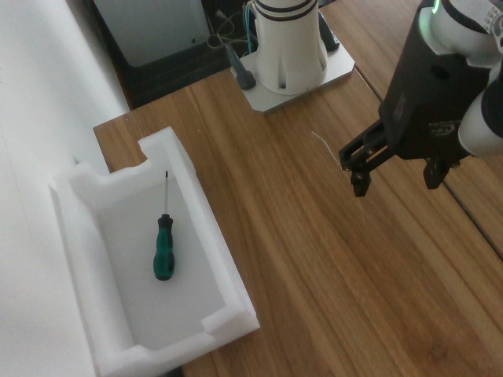

# [ACT](http://arxiv.org/abs/2304.13705) Training Log

*Last updated: July 1, 2026*

---

## Training Objectives

The goal is to train a robotic arm with a two-finger gripper to grasp a screwdriver and place it into a white box. The setup uses two cameras: one mounted on the wrist of the robotic arm and one placed in front of the arm.


Both cameras are Intel RealSense D435 cameras:

- Name: Intel RealSense D435
- Type: RealSense
- Default stream profile:
  - Stream_type: Color
  - Format: rgb8
  - Width: 640
  - Height: 480
  - FPS: 30

The robotic arm is a [Realman RM65](https://github.com/RealManRobot/rm_models/tree/main/RM65), a six-axis robotic arm.

---

## Training Logs

### Training Log 1

#### Dataset Recording

At the beginning, the front camera used a relatively distant viewpoint, which allowed it to capture the entire robotic arm:


However, even after recording more than 150 episodes and trying different hyperparameters, the robotic arm still failed to grasp the screwdriver. A common failure case was that the gripper could not align with the screwdriver.

Therefore, I changed the front camera viewpoint so that the screwdriver and the box were closer and clearer in the image:


Then I recorded a 50-episode dataset with the white box fixed in place:

```bash
TASK_NAME=rm65_aloha_pick_screwdriver_to_fixed_box_close_front
TASK_PROMPT="grasp screwdriver and place it in box"

python repos/lerobot/examples/rm65/passive_record.py \
    --config-path configs/rm65_realsense.yaml \
    --repo-id local/$TASK_NAME \
    --root ./runs/dataset/$TASK_NAME \
    --task "$TASK_PROMPT" \
    --fps 30 \
    --episode-time-s 30 \
    --num-episodes 50 \
    --teleop-active-io 1 \
    --record-button-io 2 \
    --record-button-mode toggle \
    --io-read-source aloha \
    --aloha-target-ip 192.168.1.100 \
    --log-path ./logs/record_$TASK_NAME.log
```

#### Training script

I trained ACT with a batch size of 8, 20,000 training steps, and a chunk size of 100:

```bash
DATASET_ID=rm65_aloha_pick_screwdriver_to_fixed_box_close_front
TRAINING_ID=rm65_act_pick_screwdriver_to_fixed_box_close_front_episodes_50_steps_20000_batch_8_chunck_100

lerobot-train \
    --dataset.repo_id $DATASET_ID \
    --dataset.root ./runs/dataset/$DATASET_ID \
    --policy.type act \
    --policy.device cuda \
    --policy.push_to_hub false \
    --policy.chunk_size 100 \
    --policy.n_action_steps 20 \
    --batch_size 8 \
    --steps 20000 \
    --eval_freq 0 \
    --save_freq 5000 \
    --log_freq 100 \
    --output_dir ./runs/train/$TRAINING_ID \
    --wandb.enable true \
    --wandb.project rm65_lerobot \
    --job_name $TRAINING_ID \
    2>&1 | tee ./logs/train_$TRAINING_ID.log
```

#### Evaluation

- Success rate: 5 / 20
- Successful trial: the robot grasps the screwdriver and places it into the box.

<video controls width="300">
  <source src="assets/act/pick_screwdriver_success_0.mp4" type="video/mp4">
</video>

- Failed trial: the robot fails to grasp the screwdriver.

<video controls width="300">
  <source src="assets/act/pick_screwdriver_fail_0.mp4" type="video/mp4">
</video>

- Experimental phenomena:

  1. The grasping success rate is very low. This may indicate that the policy needs more training data, better hyperparameters, or both. Most successful trials look similar to the successful video above, which suggests that the collected data may have an uneven distribution.
  2. When the gripper misses the screwdriver, the robotic arm does not react quickly. It continues moving for a while before returning and trying again. I think this may be related to ACT's temporal ensembling: previous predicted actions can still influence the actual action at time `t`. For example, the policy may have predicted at time `t-10` that the screwdriver would be successfully grasped at time `t`, but in reality the grasp failed.

- Questions:

  1. In this experiment, `chunk_size=100`. At 30 FPS, this means ACT predicts more than three seconds of future actions each time. Is such a long action horizon really necessary? This is especially important when the object moves or the grasp fails, because the policy should react quickly.
  2. How many demonstrations are enough for this task?

---

### Training Log 2

#### Dataset Recording

I used the same dataset as in [Training Log 1](#training-log-1).

#### Training script

I used the same training hyperparameters as in [Training Log 1](#training-log-1), except that I set `chunk_size=20`. The purpose was to test whether ACT really needs a chunk size of 100, which corresponds to more than three seconds of future actions at 30 FPS.

#### Evaluation

- Success rate: 0 / 20

- Experimental phenomena:

  1. Regardless of the screwdriver's position or orientation, the robotic arm performs a similar movement every time it starts: the sixth axis rotates clockwise and the gripper opens.

- Thinking:

  1. `chunk_size=20` is likely too short for this task at 30 FPS. It only covers about 0.67 seconds of future actions, while grasping a screwdriver and placing it into a box is a multi-stage task: approach, align, close the gripper, lift, move to the box, and release. With such a short horizon, ACT may only learn local short-term motion instead of the full intention of the demonstration.
  2. This phenomenon suggests that the policy relies more on the dataset's average initial action pattern than on visual conditions. This can happen when the dataset is small, object variation is limited, or the visual signal is not strong enough to distinguish different screwdriver poses.
  3. Therefore, reducing `chunk_size` did not make the policy react faster. Instead, it removed useful long-horizon supervision, making the policy more myopic and biased toward common short-term actions.

---

### Training Log 3

#### Dataset Recording

This time, I recorded 50 additional episodes based on the dataset from [Training Log 1](#training-log-1) to test whether the original dataset was too small. The dataset now contains 100 episodes in total. During this round of data collection, I paid more attention to balancing the distribution of the demonstrations, especially for harder screwdriver positions and orientations.

#### Training script

I trained three policies on the 100-episode dataset:

1. One policy used the same hyperparameters as in [Training Log 1](#training-log-1).
2. One policy changed the batch size to 32.
3. One policy changed the chunk size to 50.

#### Evaluation

- Success rate: 
    1. Policy 1: 3 / 20
    2. Policy 2: 2 / 20
    3. Policy 3: 4 / 20

- Experimental phenomena:
    1. Policy 1 still often fails to align the gripper with the screwdriver. In some cases, depending on the screwdriver's position and orientation, the gripper can align with the screwdriver but does not close enough. Whether the robot can grasp the screwdriver then depends on which part of the screwdriver it grasps. If it grasps the widest part, the grasp can succeed; if it grasps a narrower part, the gripper closure is insufficient and the grasp fails. In some other cases, the behavior is similar to [Training Log 2](#training-log-2): the robotic arm performs a similar initial movement every time it starts.
    2. Although Policy 2 has a slightly lower success rate than Policy 1, it appears better qualitatively. The repeated-start-motion phenomenon is significantly reduced. In most situations, I can see the robotic arm trying to align with the screwdriver. However, there are still many cases where the gripper fails to align accurately.
    3. Policy 3 performs better than Policy 1 and Policy 2 in some difficult situations. However, in some easier situations where Policy 1 or Policy 2 can perform reasonably well, Policy 3 chooses a grasp point that is too far from the screwdriver. Similar to Policy 2, the repeated-start-motion phenomenon is significantly reduced compared with Policy 1.
    4. Across all three policies, and also in the previous training logs, the policy often predicts joint angles that exceed the configured `max_relative_target` value. In an earlier rollout test, `max_relative_target=1000.0` had not been applied to the actual config used by `lerobot-rollout`. After setting `max_relative_target=1000.0` in the correct rollout config, another experiment was run based on Policy 2. The success rate became 6 / 20. The behavior became similar to Policy 3, but in most situations the gripper could align with the screwdriver. The remaining failures mainly came from insufficient gripper closure or an incorrect gripper direction. This suggests that `max_relative_target` can strongly affect rollout behavior. When the limit is too small, the executed action may be clipped away from the policy's intended prediction.

- Thinking:
    1. Increasing the dataset from 50 to 100 episodes did not clearly improve success rate, so data quality and coverage may be more important than episode count alone.
    2. The balanced dataset reduced the repeated-start-motion failure mode, suggesting that the earlier dataset had a biased initial action distribution.
    3. Gripper closure appears to be a separate problem from visual alignment. The policy may need better gripper labels or more demonstrations that grasp thinner parts of the screwdriver.
    4. `max_relative_target` strongly affects rollout. If it is too small, actions are clipped and movement becomes slow or inaccurate. A useful next step is to log both raw predicted actions and clipped sent actions.

---

### Training Log 4

#### Dataset Recording
In this experiment, I moved the front camera closer to the screwdriver and the box to test whether a closer and clearer view could improve grasping performance. The new front camera view is:



This dataset was recorded from scratch. I paid close attention to the data distribution. Across these 100 episodes, I tried to cover the whole workspace as evenly as possible. For each area, I also varied the screwdriver orientation as evenly as possible, collecting about 8 to 12 episodes per area.

Corresponding recording script:
```bash
TASK_NAME=rm65_aloha_pick_screwdriver_to_fixed_box_closer_front
TASK_PROMPT="grasp screwdriver and place it in box"

python repos/lerobot/examples/rm65/passive_record.py \
    --config-path configs/rm65_realsense.yaml \
    --repo-id local/$TASK_NAME \
    --root ./runs/dataset/$TASK_NAME \
    --task "$TASK_PROMPT" \
    --fps 30 \
    --episode-time-s 30 \
    --num-episodes 100 \
    --teleop-active-io 1 \
    --record-button-io 2 \
    --record-button-mode toggle \
    --io-read-source aloha \
    --aloha-target-ip 192.168.1.100 \
    --log-path ./logs/record_$TASK_NAME.log
```

#### Training script

I trained ACT with `chunk_size=100`, `batch_size=32`, and 20,000 training steps:
```bash
export HF_HOME=./.cache/huggingface
export HF_LEROBOT_HOME=./.cache/lerobot

DATASET_ID=rm65_aloha_pick_screwdriver_to_fixed_box_closer_front
TRAINING_ID=rm65_act_pick_screwdriver_to_fixed_box_closer_front_episodes_100_steps_20000_batch_32_chunck_100

lerobot-train \
    --dataset.repo_id $DATASET_ID \
    --dataset.root ./runs/dataset/$DATASET_ID \
    --policy.type act \
    --policy.device cuda \
    --policy.push_to_hub false \
    --policy.chunk_size 100 \
    --policy.n_action_steps 1 \
    --batch_size 32 \
    --steps 20000 \
    --eval_freq 0 \
    --save_freq 5000 \
    --log_freq 100 \
    --output_dir ./runs/train/$TRAINING_ID \
    --wandb.enable true \
    --wandb.project rm65_lerobot \
    --job_name $TRAINING_ID \
    2>&1 | tee ./logs/train_$TRAINING_ID.log
```

#### Evaluation

##### Evaluation 1

In this evaluation, rollout `fps` was set to 20.

- Success rate: 3 / 20

- Failure statistics:

| Failure situation | Times | Notes |
| :--- | ---: | :--- |
| Gripper fails to align with the screwdriver | 7 |  |
| Gripper aligns but does not close enough | 5 |  |
| Gripper direction is wrong | 1 |  |
| Gripper does not move down far enough before closing | 4 |  |

##### Evaluation 2

In this evaluation, `canfd_follow` was enabled.

- Success rate: 7 / 20

- Failure statistics:

| Failure situation | Times | Notes |
| :--- | ---: | :--- |
| Gripper fails to align with the screwdriver | 4 |  |
| Gripper aligns but does not close enough | 6 |  |
| Gripper direction is wrong | 3 |  |

##### Thinking

- The experimental results show that although the grasping success rate is still not high, the robot's behavior has improved significantly. The grasp point is almost never far away from the screwdriver. In most trials, the gripper moves directly toward the screwdriver. Even in the 7 alignment failures recorded in [Evaluation 1](#evaluation-1), the gripper is usually close to the screwdriver. For example, the policy sometimes tries to grasp the very end of the screwdriver.
- The main failure cases are insufficient gripper closure and insufficient downward motion before closing. After enabling `canfd_follow`, the insufficient-downward-motion failure disappears, and the overall success rate increases.
- The insufficient gripper closure problem may come from the dataset. During recording, I usually grasped the wider part of the screwdriver. When the robot aligns with a thinner part, the gripper may not close enough because the policy has not learned enough examples of this situation. Therefore, the next step is to record another 100 episodes focused on grasping the thinner parts of the screwdriver. More data may also help reduce the other failure cases.

---

### Training Log 5

#### Dataset Recording

In this experiment, I added 100 more episodes based on [Training Log 4](#training-log-4), bringing the dataset to 200 episodes in total. The recording method was the same as in Log 4: I kept the data distribution as balanced as possible across workspace areas and screwdriver orientations. The main difference is that, in the new 100 episodes, I intentionally focused on grasping the thinner parts of the screwdriver.

#### Training script

I trained ACT with `chunk_size=100`, `batch_size=32`, and 40,000 training steps:
```bash
export HF_HOME=./.cache/huggingface
export HF_LEROBOT_HOME=./.cache/lerobot

DATASET_ID=rm65_aloha_pick_screwdriver_to_fixed_box_closer_front
TRAINING_ID=rm65_act_pick_screwdriver_to_fixed_box_closer_front_episodes_200_steps_40000_batch_32_chunck_100

lerobot-train \
    --dataset.repo_id $DATASET_ID \
    --dataset.root ./runs/dataset/$DATASET_ID \
    --policy.type act \
    --policy.device cuda \
    --policy.push_to_hub false \
    --policy.chunk_size 100 \
    --policy.n_action_steps 1 \
    --batch_size 32 \
    --steps 40000 \
    --eval_freq 0 \
    --save_freq 10000 \
    --log_freq 100 \
    --output_dir ./runs/train/$TRAINING_ID \
    --wandb.enable true \
    --wandb.project rm65_lerobot \
    --job_name $TRAINING_ID \
    2>&1 | tee ./logs/train_$TRAINING_ID.log
```

#### Evaluation

##### Evaluation 1

In this evaluation, `canfd_follow` was enabled and rollout `fps` was set to 20.

- Success rate: 16 / 25

- Failure statistics:

| Failure situation | Times | Notes |
| :--- | ---: | :--- |
| Gripper fails to align with the screwdriver | 1 |  |
| Gripper aligns but does not close enough | 8 |  |

- Thinking

  1. The result improves clearly compared with [Training Log 4](#training-log-4): the success rate increased from 7 / 20 to 16 / 25. The extra 100 episodes, especially the thin-part grasping demonstrations, were useful.
  2. There was only 1 alignment failure, which suggests that the policy can usually localize the screwdriver and move the gripper to the correct area.
  3. The main remaining problem is gripper closure. Most failures happen after the gripper has already aligned with the screwdriver but does not close enough. I printed the predicted angles during rollout, and the gripper does reach the correct thin-grasp value. The problem looks more like timing: the arm is still moving while the gripper is closing. From the log, when the gripper changes from open to closed: `380 -> 357 -> 329 -> 286 -> 223 -> 176 -> 139 -> 125 -> 116 -> 114`, the joint angles are also changing continuously. This means the policy is closing the gripper during a moving transition, not during a stable "stop and grasp" phase.
  4. I think there are two methods to improve problems mentioned at point 3:
      - First, we can add more episodes with a clear pause while grasping the thinnest part of the screwdriver, so the policy learns to slow down or pause before closing the gripper.
      - Second, the dataset was recorded at 30 FPS with `chunk_size=100`, which means the policy predicts about 3.3 seconds of future actions during training. During rollout, the target FPS is 20, so the same chunk can cover about 5 seconds of future actions. Because actual FPS can fluctuate below 20, this horizon can be even longer. Since one grasp-and-place episode takes about 5-7 seconds, the policy may effectively predict almost the whole task each time. With temporal ensembling, a prediction from about 5 seconds earlier can still influence the current behavior. If that old prediction assumed that the screwdriver had already been grasped successfully, but the actual grasp failed, it may cause the timing problem described above.

##### Evaluation 2

In this evaluation, `canfd_follow` was enabled and rollout `fps` was set to 20.
For a quick test, I cut the predicted action chunk to 50 during rollout, even though this policy was trained with `chunk_size=100`. The goal was to test whether a long action horizon hurts performance.

- Success rate: 13 / 25

- Failure statistics:

| Failure situation | Times | Notes |
| :--- | ---: | :--- |
| Gripper fails to align with the screwdriver | 1 |  |
| Gripper aligns but does not close enough | 10 |  |
| Drops the screwdriver during transport | 1 |  |

- Thinking
  1. Even though the success rate is lower than [Evaluation 1](#evaluation-1), there are two positive signs:
      - The robotic arm will pause briefly when preparing to grasp.
      - When a grasp fails, the policy can react quickly and attempt to grasp again, although the retry success rate is still very low and succeeded only once in this evaluation.
  2. These signs suggest that a smaller chunk size may be the right direction. The remaining performance limitation may come from the fact that this policy was trained with `chunk_size=100`.

---

### Training Log 6

#### Dataset Recording

In this experiment, I added 50 more episodes based on [Training Log 5](#training-log-5), bringing the dataset to 250 episodes in total. These new episodes focus on thin-part grasping. During recording, I intentionally paused after the gripper reached the screwdriver and before closing, so the policy could learn a clearer stop-and-grasp phase.

#### Training script

I trained ACT with `chunk_size=50`, `batch_size=32`, and 40,000 training steps:
```bash
export HF_HOME=./.cache/huggingface
export HF_LEROBOT_HOME=./.cache/lerobot

DATASET_ID=rm65_aloha_pick_screwdriver_to_fixed_box_closer_front
TRAINING_ID=rm65_act_pick_screwdriver_to_fixed_box_closer_front_episodes_250_steps_40000_batch_32_chunck_50

lerobot-train \
    --dataset.repo_id $DATASET_ID \
    --dataset.root ./runs/dataset/$DATASET_ID \
    --policy.type act \
    --policy.device cuda \
    --policy.push_to_hub false \
    --policy.chunk_size 50 \
    --policy.n_action_steps 1 \
    --batch_size 32 \
    --steps 40000 \
    --eval_freq 0 \
    --save_freq 10000 \
    --log_freq 100 \
    --output_dir ./runs/train/$TRAINING_ID \
    --wandb.enable true \
    --wandb.project rm65_lerobot \
    --job_name $TRAINING_ID \
    2>&1 | tee ./logs/train_$TRAINING_ID.log
```

#### Evaluation

In this evaluation, `canfd_follow` was enabled and rollout `fps` was set to 20.

- Success rate: 24 / 25

- Failure statistics:

| Failure situation | Times | Notes |
| :--- | ---: | :--- |
| Gripper fails to align with the screwdriver | 1 |  |

- Thinking
  1. Compared with [Training Log 5](#training-log-5), the policy now shows an obvious slowdown and pause before grasping. This matches the new demonstrations and makes the grasp phase more stable.
  2. From the rollout log, the predicted gripper angle is smaller than before. This likely comes from the additional thin-part grasping demonstrations. It improves grasp success, but the command value should still be monitored to avoid unnecessary over-closing on the gripper hardware.
  3. This result suggests that both changes were useful: adding clearer pause-before-close demonstrations and reducing `chunk_size` from 100 to 50.

- Video of successful grasp and placement:
<video controls width="300">
  <source src="assets/act/pick_screwdriver_success_1.mp4" type="video/mp4">
</video>

---

## Conclusion

These experiments show that successfully training ACT for the RM65 grasping task depends more on data quality, action timing, and rollout consistency than on episode count alone. The best result in this log is [Training Log 6](#training-log-6): 250 episodes, `chunk_size=50`, `batch_size=32`, 40,000 training steps, `canfd_follow` enabled, and rollout `fps=20`, reaching 24 / 25 successful trials.

The most important practices are:

1. Use camera views where the screwdriver, gripper, and box are clear. Moving the front camera closer made the visual signal much stronger.
2. Keep the dataset balanced across workspace positions and screwdriver orientations. This reduced repeated initial-motion behavior.
3. Record the task as clear stages: approach, align, move down, pause, close the gripper, hold, lift, move to the box, and release.
4. Include enough demonstrations for thin-part grasping. Gripper closure is a separate skill from visual alignment, so it needs direct examples.
5. Match the action horizon to the real task speed. A very large `chunk_size` can make the policy slow to react, especially with temporal ensembling and lower rollout FPS.
6. Diagnose failures by category instead of only tracking success rate. Separating alignment, downward motion, gripper closure, and transport failures made it much easier to choose the next experiment.
