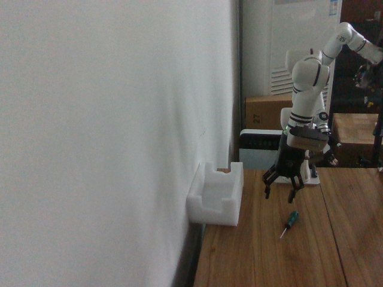
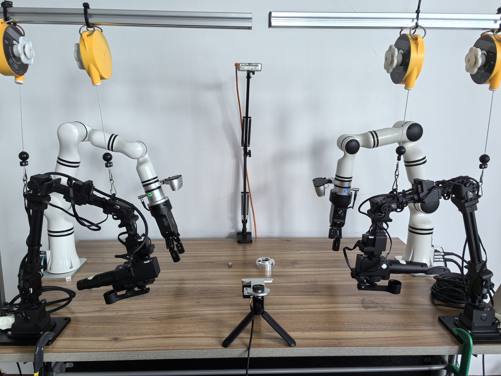
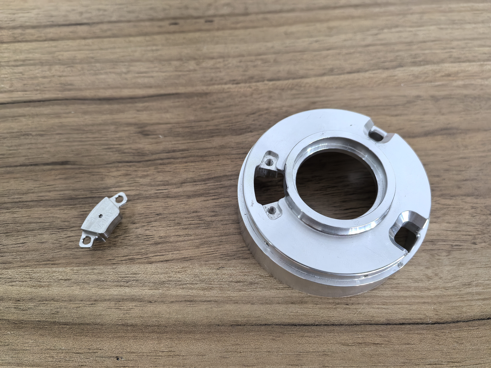
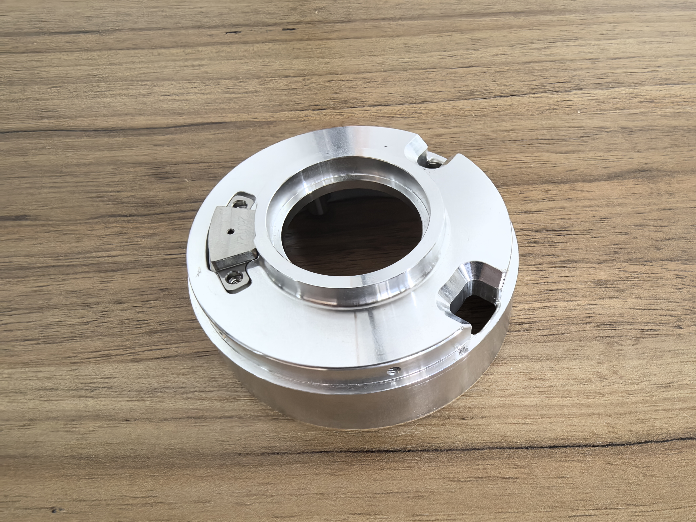
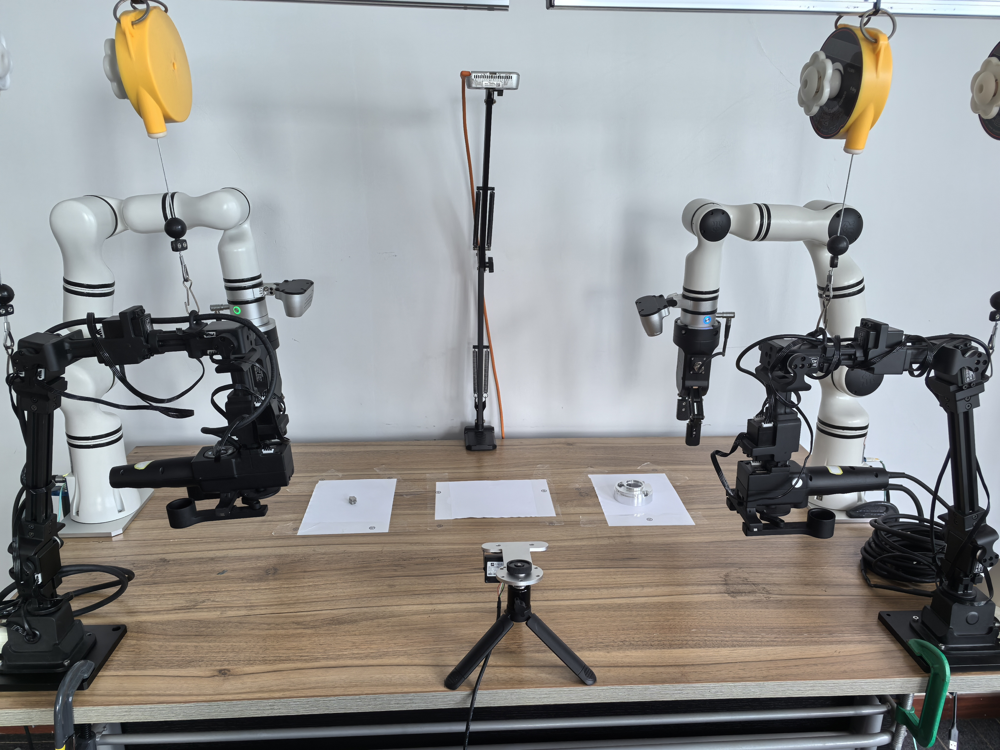
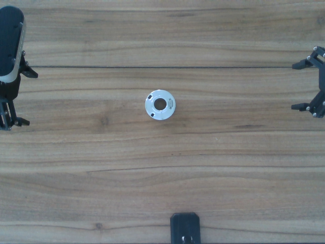
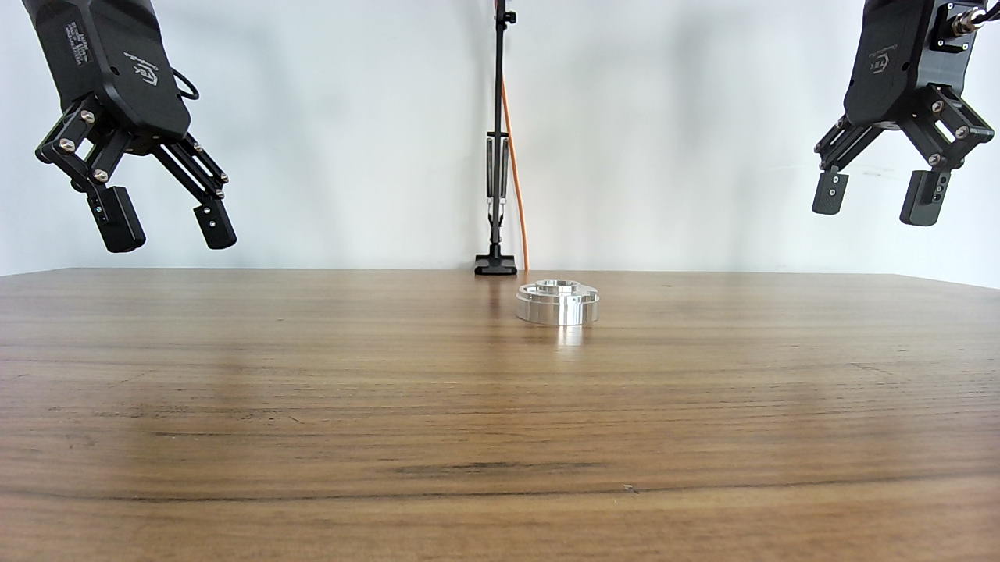
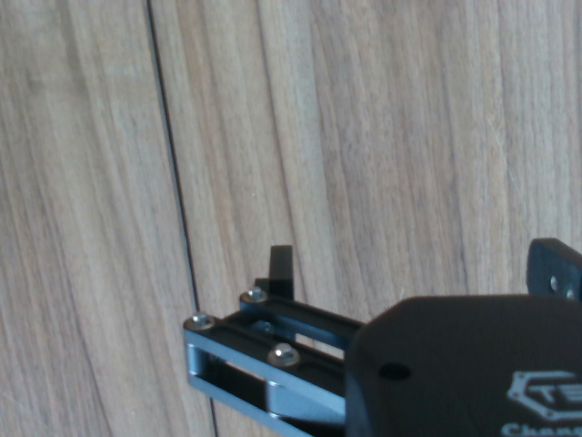
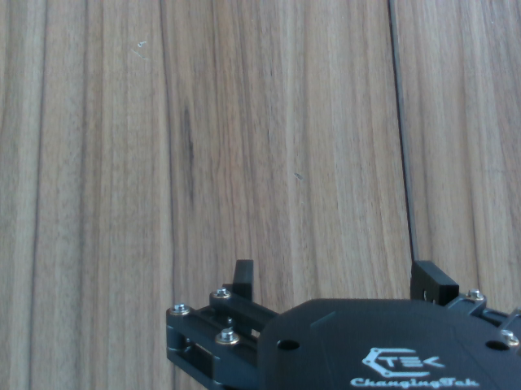
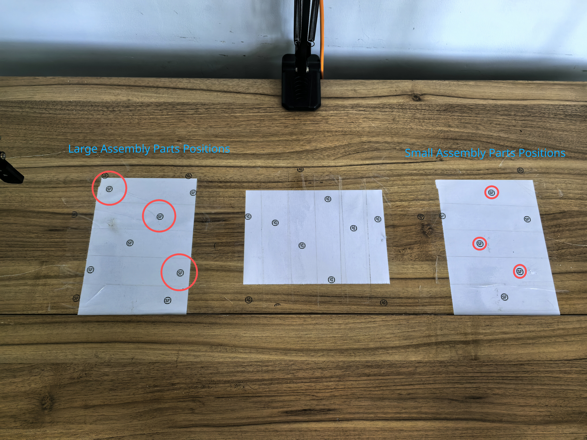

# [ACT](http://arxiv.org/abs/2304.13705) Training Log

*Last updated: July 14, 2026*

---

## Training Objective 1: RM65 Screwdriver-to-Box Task

The goal is to train a ACT policy to control robotic arm with a two-finger gripper to grasp a screwdriver and place it into a white box. The setup uses two cameras: one mounted on the wrist of the robotic arm and one placed in front of the arm.


Both cameras are Intel RealSense D435 cameras:

- Name: Intel RealSense D435
- Type: RealSense
- Default stream profile:
  - Stream_type: Color
  - Format: rgb8
  - Width: 640
  - Height: 480
  - FPS: 30

The robotic arm is a [Realman RM65](https://github.com/RealManRobot/rm_models/tree/main/RM65), a six-axis robotic arm.

---

### Training Log 1 of Objective 1

#### Dataset Recording

At the beginning, the front camera used a relatively distant viewpoint, which allowed it to capture the entire robotic arm:



However, even after recording more than 150 episodes and trying different hyperparameters, the robotic arm still failed to grasp the screwdriver. A common failure case was that the gripper could not align with the screwdriver.

Therefore, I changed the front camera viewpoint so that the screwdriver and the box were closer and clearer in the image:


Then I recorded a 50-episode dataset with the white box fixed in place:

I used a passive recording script instead of the standard `lerobot-record` workflow because the master arm controls the RM65 directly, but its joint/action data is not available to LeRobot. In this setup, LeRobot can only read the RM65 state and camera observations. Therefore, the dataset records the RM65's executed joint positions as actions while the external master arm performs the control.

```bash
TASK_NAME=rm65_aloha_pick_screwdriver_to_fixed_box_close_front
TASK_PROMPT="grasp screwdriver and place it in box"

python repos/lerobot/examples/rm65/passive_record.py \
    --config-path configs/rm65_wrist_front.yaml \
    --repo-id local/$TASK_NAME \
    --root ./runs/dataset/$TASK_NAME \
    --task "$TASK_PROMPT" \
    --fps 30 \
    --episode-time-s 30 \
    --num-episodes 50 \
    --teleop-active-io 1 \
    --record-button-io 2 \
    --record-button-mode toggle \
    --io-read-source aloha \
    --aloha-target-ip 192.168.1.100 \
    --log-path ./logs/record_$TASK_NAME.log
```

#### Training Configuration

I trained ACT with a batch size of 8, 20,000 training steps, and a chunk size of 100:

Dataset: `rm65_aloha_pick_screwdriver_to_fixed_box_close_front`

Output policy: `rm65_act_pick_screwdriver_to_fixed_box_close_front_episodes_50_steps_20000_batch_8_chunck_100`

| Parameter | Configured value | Default value |
|---|---:|---:|
| `policy.push_to_hub` | `false` | `true` |
| `policy.n_action_steps` | `20` | `100` |
| `steps` | `20,000` | `100,000` |
| `eval_freq` | `0` (disabled) | `20,000` |
| `save_freq` | `5,000` | `20,000` |
| `log_freq` | `100` | `200` |
| `wandb.enable` | `true` | `false` |
| `wandb.project` | `lerobot_rm65_act` | `lerobot` |

> **Note:** `policy.chunk_size=100` and `batch_size=8` use the ACT and training-pipeline defaults. All other unlisted parameters also use their default values.

#### Evaluation

- Success rate: 5 / 20
- Successful trial: the robot grasps the screwdriver and places it into the box.

<video controls width="400">
  <source src="assets/act/ob_1_grasp_screwdriver_success_0.mp4" type="video/mp4">
</video>

- Failed trial: the robot fails to grasp the screwdriver.

<video controls width="400">
  <source src="assets/act/ob_1_grasp_screwdriver_fail_0.mp4" type="video/mp4">
</video>

- Experimental phenomena:

  1. The grasping success rate is very low. This may indicate that the policy needs more training data, better hyperparameters, or both. Most successful trials look similar to the successful video above, which suggests that the collected data may have an uneven distribution.
  2. When the gripper misses the screwdriver, the robotic arm does not react quickly. It continues moving for a while before returning and trying again. I think this may be related to ACT's temporal ensembling: previous predicted actions can still influence the actual action at time `t`. For example, the policy may have predicted at time `t-10` that the screwdriver would be successfully grasped at time `t`, but in reality the grasp failed.

- Questions:

  1. In this experiment, `chunk_size=100`. At 30 FPS, this means ACT predicts more than three seconds of future actions each time. Is such a long action horizon really necessary? This is especially important when the object moves or the grasp fails, because the policy should react quickly.
  2. How many demonstrations are enough for this task?

---

### Training Log 2 of Objective 1

#### Dataset Recording

I used the same dataset as in [Training Log 1](#training-log-1).

#### Training Configuration

I used the same training hyperparameters as in [Training Log 1](#training-log-1), except that I set `chunk_size=20`. The purpose was to test whether ACT really needs a chunk size of 100, which corresponds to more than three seconds of future actions at 30 FPS.

| Parameter | Configured value | Default value |
|---|---:|---:|
| `policy.push_to_hub` | `false` | `true` |
| `policy.chunk_size` | `20` | `100` |
| `policy.n_action_steps` | `20` | `100` |
| `steps` | `20,000` | `100,000` |
| `eval_freq` | `0` (disabled) | `20,000` |
| `save_freq` | `5,000` | `20,000` |
| `log_freq` | `100` | `200` |
| `wandb.enable` | `true` | `false` |
| `wandb.project` | `lerobot_rm65_act` | `lerobot` |

> **Note:** Parameters not listed in this table use their default values.

#### Evaluation

- Success rate: 0 / 20

- Experimental phenomena:

  1. Regardless of the screwdriver's position or orientation, the robotic arm performs a similar movement every time it starts: the sixth axis rotates clockwise and the gripper opens.

- Thinking:

  1. `chunk_size=20` is likely too short for this task at 30 FPS. It only covers about 0.67 seconds of future actions, while grasping a screwdriver and placing it into a box is a multi-stage task: approach, align, close the gripper, lift, move to the box, and release. With such a short horizon, ACT may only learn local short-term motion instead of the full intention of the demonstration.
  2. This phenomenon suggests that the policy relies more on the dataset's average initial action pattern than on visual conditions. This can happen when the dataset is small, object variation is limited, or the visual signal is not strong enough to distinguish different screwdriver poses.
  3. Therefore, reducing `chunk_size` did not make the policy react faster. Instead, it removed useful long-horizon supervision, making the policy more myopic and biased toward common short-term actions.

---

### Training Log 3 of Objective 1

#### Dataset Recording

This time, I recorded 50 additional episodes based on the dataset from [Training Log 1](#training-log-1) to test whether the original dataset was too small. The dataset now contains 100 episodes in total. During this round of data collection, I paid more attention to balancing the distribution of the demonstrations, especially for harder screwdriver positions and orientations.

#### Training Configuration

I trained three policies on the 100-episode dataset:

1. Policy 1 used the same hyperparameters as in [Training Log 1](#training-log-1).
2. Policy 2 changed the batch size to 32.
3. Policy 3 changed the chunk size to 50.

| Parameter | Policy 1 | Policy 2 | Policy 3 | Default value |
|---|---:|---:|---:|---:|
| `policy.push_to_hub` | `false` | `false` | `false` | `true` |
| `policy.chunk_size` | `100` | `100` | `50` | `100` |
| `policy.n_action_steps` | `20` | `20` | `20` | `100` |
| `batch_size` | `8` | `32` | `8` | `8` |
| `steps` | `20,000` | `20,000` | `20,000` | `100,000` |
| `eval_freq` | `0` | `0` | `0` | `20,000` |
| `save_freq` | `5,000` | `5,000` | `5,000` | `20,000` |
| `log_freq` | `100` | `100` | `100` | `200` |
| `wandb.enable` | `true` | `true` | `true` | `false` |
| `wandb.project` | `lerobot_rm65_act` | `lerobot_rm65_act` | `lerobot_rm65_act` | `lerobot` |

> **Note:** Parameters not listed in this table use their default values.

#### Evaluation

- Success rate: 
    1. Policy 1: 3 / 20
    2. Policy 2: 2 / 20
    3. Policy 3: 4 / 20

- Experimental phenomena:
    1. Policy 1 still often fails to align the gripper with the screwdriver. In some cases, depending on the screwdriver's position and orientation, the gripper can align with the screwdriver but does not close enough. Whether the robot can grasp the screwdriver then depends on which part of the screwdriver it grasps. If it grasps the widest part, the grasp can succeed; if it grasps a narrower part, the gripper closure is insufficient and the grasp fails. In some other cases, the behavior is similar to [Training Log 2](#training-log-2): the robotic arm performs a similar initial movement every time it starts.
    2. Although Policy 2 has a slightly lower success rate than Policy 1, it appears better qualitatively. The repeated-start-motion phenomenon is significantly reduced. In most situations, I can see the robotic arm trying to align with the screwdriver. However, there are still many cases where the gripper fails to align accurately.
    3. Policy 3 performs better than Policy 1 and Policy 2 in some difficult situations. However, in some easier situations where Policy 1 or Policy 2 can perform reasonably well, Policy 3 chooses a grasp point that is too far from the screwdriver. Similar to Policy 2, the repeated-start-motion phenomenon is significantly reduced compared with Policy 1.
    4. Across all three policies, and also in the previous training logs, the policy often predicts joint angles that exceed the configured `max_relative_target` value. In an earlier rollout test, `max_relative_target=1000.0` had not been applied to the actual config used by `lerobot-rollout`. After setting `max_relative_target=1000.0` in the correct rollout config, another experiment was run based on Policy 2. The success rate became 6 / 20. The behavior became similar to Policy 3, but in most situations the gripper could align with the screwdriver. The remaining failures mainly came from insufficient gripper closure or an incorrect gripper direction. This suggests that `max_relative_target` can strongly affect rollout behavior. When the limit is too small, the executed action may be clipped away from the policy's intended prediction.

- Thinking:
    1. Increasing the dataset from 50 to 100 episodes did not clearly improve success rate, so data quality and coverage may be more important than episode count alone.
    2. The balanced dataset reduced the repeated-start-motion failure mode, suggesting that the earlier dataset had a biased initial action distribution.
    3. Gripper closure appears to be a separate problem from visual alignment. The policy may need better gripper labels or more demonstrations that grasp thinner parts of the screwdriver.
    4. `max_relative_target` strongly affects rollout. If it is too small, actions are clipped and movement becomes slow or inaccurate. A useful next step is to log both raw predicted actions and clipped sent actions.

---

### Training Log 4 of Objective 1

#### Dataset Recording
In this experiment, I moved the front camera closer to the screwdriver and the box to test whether a closer and clearer view could improve grasping performance. The new front camera view is:


This dataset was recorded from scratch. I paid close attention to the data distribution. Across these 100 episodes, I tried to cover the whole workspace as evenly as possible. For each area, I also varied the screwdriver orientation as evenly as possible, collecting about 8 to 12 episodes per area.

Corresponding recording script:
```bash
TASK_NAME=rm65_aloha_pick_screwdriver_to_fixed_box_closer_front
TASK_PROMPT="grasp screwdriver and place it in box"

python repos/lerobot/examples/rm65/passive_record.py \
    --config-path configs/rm65_wrist_front.yaml \
    --repo-id local/$TASK_NAME \
    --root ./runs/dataset/$TASK_NAME \
    --task "$TASK_PROMPT" \
    --fps 30 \
    --episode-time-s 30 \
    --num-episodes 100 \
    --teleop-active-io 1 \
    --record-button-io 2 \
    --record-button-mode toggle \
    --io-read-source aloha \
    --aloha-target-ip 192.168.1.100 \
    --log-path ./logs/record_$TASK_NAME.log
```

#### Training Configuration

I trained ACT with `chunk_size=100`, `batch_size=32`, and 20,000 training steps.

Dataset: `rm65_aloha_pick_screwdriver_to_fixed_box_closer_front`

Output policy: `rm65_act_pick_screwdriver_to_fixed_box_closer_front_episodes_100_steps_20000_batch_32_chunck_100`

| Parameter | Configured value | Default value |
|---|---:|---:|
| `policy.push_to_hub` | `false` | `true` |
| `policy.n_action_steps` | `1` | `100` |
| `batch_size` | `32` | `8` |
| `steps` | `20,000` | `100,000` |
| `eval_freq` | `0` (disabled) | `20,000` |
| `save_freq` | `5,000` | `20,000` |
| `log_freq` | `100` | `200` |
| `wandb.enable` | `true` | `false` |
| `wandb.project` | `lerobot_rm65_act` | `lerobot` |

> **Note:** `policy.chunk_size=100` uses the ACT default. All other unlisted parameters also use their default values.

#### Evaluation

##### Evaluation 1

In this evaluation, rollout `fps` was set to 20.

- Success rate: 3 / 20

- Failure statistics:

| Failure situation | Times | Notes |
| :--- | ---: | :--- |
| Gripper fails to align with the screwdriver | 7 |  |
| Gripper aligns but does not close enough | 5 |  |
| Gripper direction is wrong | 1 |  |
| Gripper does not move down far enough before closing | 4 |  |

##### Evaluation 2

In this evaluation, `canfd_follow` was enabled.

- Success rate: 7 / 20

- Failure statistics:

| Failure situation | Times | Notes |
| :--- | ---: | :--- |
| Gripper fails to align with the screwdriver | 4 |  |
| Gripper aligns but does not close enough | 6 |  |
| Gripper direction is wrong | 3 |  |

##### Thinking

- The experimental results show that although the grasping success rate is still not high, the robot's behavior has improved significantly. The grasp point is almost never far away from the screwdriver. In most trials, the gripper moves directly toward the screwdriver. Even in the 7 alignment failures recorded in [Evaluation 1](#evaluation-1), the gripper is usually close to the screwdriver. For example, the policy sometimes tries to grasp the very end of the screwdriver.
- The main failure cases are insufficient gripper closure and insufficient downward motion before closing. After enabling `canfd_follow`, the insufficient-downward-motion failure disappears, and the overall success rate increases although running fps frop from ~30 HZ to ~20 HZ.
- The insufficient gripper closure problem may come from the dataset. During recording, I usually grasped the wider part of the screwdriver. When the robot aligns with a thinner part, the gripper may not close enough because the policy has not learned enough examples of this situation. Therefore, the next step is to record another 100 episodes focused on grasping the thinner parts of the screwdriver. More data may also help reduce the other failure cases.

---

### Training Log 5 of Objective 1

#### Dataset Recording

In this experiment, I added 100 more episodes based on [Training Log 4](#training-log-4), bringing the dataset to 200 episodes in total. The recording method was the same as in Log 4: I kept the data distribution as balanced as possible across workspace areas and screwdriver orientations. The main difference is that, in the new 100 episodes, I intentionally focused on grasping the thinner parts of the screwdriver.

#### Training Configuration

I trained ACT with `chunk_size=100`, `batch_size=32`, and 40,000 training steps.

Dataset: `rm65_aloha_pick_screwdriver_to_fixed_box_closer_front`

Output policy: `rm65_act_pick_screwdriver_to_fixed_box_closer_front_episodes_200_steps_40000_batch_32_chunck_100`

| Parameter | Configured value | Default value |
|---|---:|---:|
| `policy.push_to_hub` | `false` | `true` |
| `policy.n_action_steps` | `1` | `100` |
| `batch_size` | `32` | `8` |
| `steps` | `40,000` | `100,000` |
| `eval_freq` | `0` (disabled) | `20,000` |
| `save_freq` | `10,000` | `20,000` |
| `log_freq` | `100` | `200` |
| `wandb.enable` | `true` | `false` |
| `wandb.project` | `lerobot_rm65_act` | `lerobot` |

> **Note:** `policy.chunk_size=100` uses the ACT default. All other unlisted parameters also use their default values.

#### Evaluation

##### Evaluation 1

In this evaluation, `canfd_follow` was enabled and rollout `fps` was set to 20.

- Success rate: 16 / 25

- Failure statistics:

| Failure situation | Times | Notes |
| :--- | ---: | :--- |
| Gripper fails to align with the screwdriver | 1 |  |
| Gripper aligns but does not close enough | 8 |  |

- Thinking

  1. The result improves clearly compared with [Training Log 4](#training-log-4): the success rate increased from 7 / 20 to 16 / 25. The extra 100 episodes, especially the thin-part grasping demonstrations, were useful.
  2. There was only 1 alignment failure, which suggests that the policy can usually localize the screwdriver and move the gripper to the correct area.
  3. The main remaining problem is gripper closure. Most failures happen after the gripper has already aligned with the screwdriver but does not close enough. I printed the predicted angles during rollout, and the gripper does reach the correct thin-grasp value. The problem looks more like timing: the arm is still moving while the gripper is closing. From the log, when the gripper changes from open to closed: `380 -> 357 -> 329 -> 286 -> 223 -> 176 -> 139 -> 125 -> 116 -> 114`, the joint angles are also changing continuously. This means the policy is closing the gripper during a moving transition, not during a stable "stop and grasp" phase.
  4. I think there are two methods to improve problems mentioned at point 3:
      - First, we can add more episodes with a clear pause while grasping the thinnest part of the screwdriver, so the policy learns to slow down or pause before closing the gripper.
      - Second, the dataset was recorded at 30 FPS with `chunk_size=100`, which means the policy predicts about 3.3 seconds of future actions during training. During rollout, the target FPS is 20, so the same chunk can cover about 5 seconds of future actions. Because actual FPS can fluctuate below 20, this horizon can be even longer. Since one grasp-and-place episode takes about 5-7 seconds, the policy may effectively predict almost the whole task each time. With temporal ensembling, a prediction from about 5 seconds earlier can still influence the current behavior. If that old prediction assumed that the screwdriver had already been grasped successfully, but the actual grasp failed, it may cause the timing problem described above.

##### Evaluation 2

In this evaluation, `canfd_follow` was enabled and rollout `fps` was set to 20.
For a quick test, I cut the predicted action chunk to 50 during rollout, even though this policy was trained with `chunk_size=100`. The goal was to test whether a long action horizon hurts performance.

- Success rate: 13 / 25

- Failure statistics:

| Failure situation | Times | Notes |
| :--- | ---: | :--- |
| Gripper fails to align with the screwdriver | 1 |  |
| Gripper aligns but does not close enough | 10 |  |
| Drops the screwdriver during transport | 1 |  |

- Thinking
  1. Even though the success rate is lower than [Evaluation 1](#evaluation-1), there are two positive signs:
      - The robotic arm will pause briefly when preparing to grasp.
      - When a grasp fails, the policy can react quickly and attempt to grasp again, although the retry success rate is still very low and succeeded only once in this evaluation.
  2. These signs suggest that a smaller chunk size may be the right direction. The remaining performance limitation may come from the fact that this policy was trained with `chunk_size=100`.

---

### Training Log 6 of Objective 1

#### Dataset Recording

In this experiment, I added 50 more episodes based on [Training Log 5](#training-log-5), bringing the dataset to 250 episodes in total. These new episodes focus on thin-part grasping. During recording, I intentionally paused after the gripper reached the screwdriver and before closing, so the policy could learn a clearer stop-and-grasp phase.

#### Training Configuration

I trained ACT with `chunk_size=50`, `batch_size=32`, and 40,000 training steps.

Dataset: `rm65_aloha_pick_screwdriver_to_fixed_box_closer_front`

Output policy: `rm65_act_pick_screwdriver_to_fixed_box_closer_front_episodes_250_steps_40000_batch_32_chunck_50`

| Parameter | Configured value | Default value |
|---|---:|---:|
| `policy.push_to_hub` | `false` | `true` |
| `policy.chunk_size` | `50` | `100` |
| `policy.n_action_steps` | `1` | `100` |
| `batch_size` | `32` | `8` |
| `steps` | `40,000` | `100,000` |
| `eval_freq` | `0` (disabled) | `20,000` |
| `save_freq` | `10,000` | `20,000` |
| `log_freq` | `100` | `200` |
| `wandb.enable` | `true` | `false` |
| `wandb.project` | `lerobot_rm65_act` | `lerobot` |

> **Note:** Parameters not listed in this table use their default values.

#### Evaluation

In this evaluation, `canfd_follow` was enabled and rollout `fps` was set to 20.

Robot config: `configs/rm65_wrist_front.yaml`

Checkpoint: `rm65_act_pick_screwdriver_to_fixed_box_closer_front_episodes_250_steps_40000_batch_32_chunck_50/checkpoints/last/pretrained_model`

Task: `pick screwdriver and put it in box`

| Parameter | Configured value | Default value |
|---|---:|---:|
| `robot.single_arm.canfd_follow` | `true` | `false` |
| `robot.single_arm.max_relative_target` | `1000.0` | `10.0` |
| `policy.temporal_ensemble_coeff` | `0.01` | `None` |
| `policy.n_action_steps` | `1` | `100` |
| `fps` | `20` | `30` |
| `duration` | `20` | `0` (unlimited) |
| `return_to_initial_position` | `false` | `true` |

> **Note:** `strategy.type=base` and `inference.type=sync` use the rollout defaults. All other unlisted parameters also use their default values.

- Success rate: 24 / 25

- Failure statistics:

  | Failure situation | Times | Notes |
  | :--- | ---: | :--- |
  | Gripper fails to align with the screwdriver | 1 |  |

- Thinking
  1. Compared with [Training Log 5](#training-log-5), the policy now shows an obvious slowdown and pause before grasping. This matches the new demonstrations and makes the grasp phase more stable.
  2. From the rollout log, the predicted gripper angle is smaller than before. This likely comes from the additional thin-part grasping demonstrations. It improves grasp success, but the command value should still be monitored to avoid unnecessary over-closing on the gripper hardware.
  3. This result suggests that both changes were useful: adding clearer pause-before-close demonstrations and reducing `chunk_size` from 100 to 50.

- Video of successful grasp and placement:

  <video controls width="400">
    <source src="assets/act/ob_1_grasp_screwdriver_success_1.mp4" type="video/mp4">
  </video>

---

### Conclusion of Training Objective 1

These experiments show that successfully training ACT for the RM65 grasping task depends more on data quality, action timing, and rollout consistency than on episode count alone. The best result in this log is [Training Log 6](#training-log-6): 250 episodes, `chunk_size=50`, `batch_size=32`, 40,000 training steps, `canfd_follow` enabled, and rollout `fps=20`, reaching 24 / 25 successful trials.

The most important practices are:

1. Use camera views where the screwdriver, gripper, and box are clear. Moving the front camera closer made the visual signal much stronger.
2. Keep the dataset balanced across workspace positions and screwdriver orientations. This reduced repeated initial-motion behavior.
3. Record the task as clear stages: approach, align, move down, pause, close the gripper, hold, lift, move to the box, and release.
4. Include enough demonstrations for thin-part grasping. Gripper closure is a separate skill from visual alignment, so it needs direct examples.
5. Match the action horizon to the real task speed. A very large `chunk_size` can make the policy slow to react, especially with temporal ensembling and lower rollout FPS.
6. Diagnose failures by category instead of only tracking success rate. Separating alignment, downward motion, gripper closure, and transport failures made it much easier to choose the next experiment.

---

## Training Objective 2: Bimanual Assembly-Part Grasping

The goal is to train an ACT policy to control two RM65 robotic arms at the same time. Each arm has a two-finger gripper. The task is to grasp two different assembly parts separately and move them toward the center assembly area:



The two parts have different sizes and are designed to fit together:

<table>
  <tr>
    <td></td>
    <td></td>
  </tr>
</table>

To simplify the first version of the task, the two assembly parts are placed in fixed white areas on the left and right sides of the workspace. The two arms need to grasp the parts simultaneously and place them in the middle white area:



The bimanual hardware setup uses two Realman RM65 arms:

- Left arm: `192.168.1.18:8080`
- Right arm: `192.168.1.19:8080`

The LeRobot action and observation keys are prefixed by arm side:

- Left arm: `left_joint_1.pos` to `left_joint_6.pos`, plus `left_gripper.pos`
- Right arm: `right_joint_1.pos` to `right_joint_6.pos`, plus `right_gripper.pos`

The setup uses four cameras. The two wrist cameras observe each gripper and local grasp area, while the top and front cameras provide global workspace context:

<table>
  <tr>
    <td align="center">
      <br>
      <b>Top Camera</b><br>
      <sub>Looking down at the workspace</sub>
    </td>
    <td align="center">
      <br>
      <b>Front Camera</b><br>
      <sub>Facing the robot/task from the front</sub>
    </td>
  </tr>
  <tr>
    <td align="center">
      <br>
      <b>Right Wrist Camera</b><br>
      <sub>Mounted on the right arm end effector</sub>
    </td>
    <td align="center">
      <br>
      <b>Left Wrist Camera</b><br>
      <sub>Mounted on the left arm end effector</sub>
    </td>
  </tr>
</table>

Camera configuration:

| Camera key | Type | Resolution | FPS | Role |
| :--- | :--- | :--- | ---: | :--- |
| `left_wrist` | Intel RealSense | 640 x 480 | 30 | Mounted on the left arm end effector. |
| `right_wrist` | Intel RealSense | 640 x 480 | 30 | Mounted on the right arm end effector. |
| `front` | OpenCV camera | 640 x 480 | 30 | External front view of the task. |
| `top` | Intel RealSense | 640 x 480 | 30 | Overhead workspace view. |

The corresponding robot configuration is:

```text
configs/rm65_left_right_wrist_front_top.yaml
```

---

### Training Log 1 of Objective 2

#### Dataset Recording

For the first bimanual dataset, I intentionally simplified the task setup. The large assembly part was placed at a fixed location because it is round, so its rotation does not change the grasp target significantly. The small assembly part was also placed at a fixed location and kept upright. The main variable in this dataset is the orientation of the small assembly part.

I recorded 20 episodes covering different orientations of the small assembly part:

```bash
CONFIG_PATH=configs/rm65_left_right_wrist_front_top.yaml
TASK_NAME=rm65_bimanual_grasp_and_place
TASK_PROMPT="grasp two assembly parts and place them in the center"

python repos/lerobot/examples/rm65/passive_record.py \
    --config-path $CONFIG_PATH \
    --repo-id local/$TASK_NAME \
    --root runs/dataset/$TASK_NAME \
    --task "$TASK_PROMPT" \
    --fps 30 \
    --num-episodes 20 \
    --io-read-source aloha \
    --teleop-active-io 1 \
    --record-button-io 2 \
    --record-button-mode toggle
```

#### Training Configuration

I set `chunk_size=50`, `n_action_steps=1`, `batch_size=16`, and 20,000 training steps.

Dataset: `rm65_bimanual_grasp_and_place`

Output policy: `rm65_act_bimanual_grasp_and_place_episodes_20_steps_20000_batch_16_chunk_50`

| Parameter | Configured value | Default value |
|---|---:|---:|
| `policy.push_to_hub` | `false` | `true` |
| `policy.chunk_size` | `50` | `100` |
| `policy.n_action_steps` | `1` | `100` |
| `batch_size` | `16` | `8` |
| `steps` | `20,000` | `100,000` |
| `eval_freq` | `0` (disabled) | `20,000` |
| `save_freq` | `5,000` | `20,000` |
| `log_freq` | `100` | `200` |
| `wandb.enable` | `true` | `false` |
| `wandb.project` | `lerobot_rm65_act` | `lerobot` |

> **Note:** Parameters not listed in this table use their default values.

#### Evaluation

In this evaluation, `canfd_follow` was disabled. The actual rollout speed was about 10 FPS; when `canfd_follow` was enabled, the arms showed noticeable lag. Therefore, rollout `fps` was set to 10 to better match the real execution speed.

Robot config: `configs/rm65_left_right_wrist_front_top.yaml`

Checkpoint: `rm65_act_bimanual_grasp_and_place_episodes_20_steps_20000_batch_16_chunk_50/checkpoints/last/pretrained_model`

Task: `grasp two assembly parts and place them in the center`

| Parameter | Configured value | Default value |
|---|---:|---:|
| `robot.left_arm.max_relative_target` | `1000.0` | `10.0` |
| `robot.right_arm.max_relative_target` | `1000.0` | `10.0` |
| `policy.temporal_ensemble_coeff` | `0.01` | `None` |
| `policy.n_action_steps` | `1` | `100` |
| `fps` | `10` | `30` |
| `duration` | `20` | `0` (unlimited) |
| `return_to_initial_position` | `false` | `true` |

> **Note:** `strategy.type=base`, `inference.type=sync`, and both arms' `canfd_follow=false` use their defaults. All other unlisted parameters also use their default values.

- Success rate: 8 / 8

- Thinking
  1. Although the success rate is high, two problems remain. First, in the recorded demonstrations, the grippers usually grasp the small assembly part along its length because the part is approximately cuboid. During rollout, about half of the attempts do not follow this alignment, although the policy can still grasp successfully. Second, when the right arm grasps the small assembly part, the gripper sometimes lightly contacts the table.
  2. These problems are likely related to limited data quantity and imperfect demonstration quality. The alignment issue may improve with more demonstrations that consistently grasp the small assembly part along its length. The table-contact issue may come from the demonstrations themselves, because some recorded trajectories also contain slight table contact while I was still becoming familiar with bimanual operation.
  3. Successful grasp-and-place video:

      <video controls width="400">
        <source src="assets/act/ob_2_grasp_and_place_success_0.mp4" type="video/mp4">
      </video>

---

### Training Log 2 of Objective 2

This experiment uses the same training setting as [Training Log 1 of Objective 2](#training-log-1-of-objective-2), but increases the scene variation. Instead of using only one small assembly part and one large assembly part, the workspace now contains 3 small assembly parts and 3 large assembly parts. Their positions are fixed: the small assembly parts are placed at fixed candidate positions on one side of the workspace, and the large assembly parts are placed at fixed candidate positions on the other side. The variation comes from visibility: in each episode, a random number of parts may be removed, so the policy must select and grasp from the currently visible parts.



#### Dataset Recording

To avoid ambiguous demonstrations, I use a fixed selection rule: always grasp the nearest visible large assembly part with the left arm and the nearest visible small assembly part with the right arm, then place both parts in the center. This rule is important because multiple valid parts may appear in the same camera view, and ACT does not have a high-level planner to decide which one should be selected.

Because the part positions are fixed and the main variation is which parts are visible, I record demonstrations with different visible-part subsets. I decide to start with 20 episodes for each visibility setting.

For preliminary testing, I first record a dataset where all six assembly parts are present:

```bash
CONFIG_PATH=configs/rm65_left_right_wrist_front_top.yaml
TASK_NAME=rm65_bimanual_nearest_assembly_parts_to_center
TASK_PROMPT="grasp the nearest large assembly part with the left arm and the nearest small assembly part with the right arm, then place both parts in the center"

python repos/lerobot/examples/rm65/passive_record.py \
    --config-path $CONFIG_PATH \
    --repo-id local/$TASK_NAME \
    --root runs/dataset/$TASK_NAME \
    --task "$TASK_PROMPT" \
    --fps 30 \
    --num-episodes 20 \
    --log-path logs/record_$TASK_NAME.log \
    --io-read-source aloha \
    --teleop-active-io 1 \
    --record-button-io 2 \
    --record-button-mode toggle
```

Dataset information:

  | Task name | Record FPS | Total episodes | Total frames |
  | :---: | :---: | :---: | :---: |
  | rm65_bimanual_nearest_assembly_parts_to_center | 30 | 20 | 16756 |

#### Training Configuration

Compared with [Training Objective 1](#training-objective-1-rm65-screwdriver-to-box-task), each demonstration is much longer, taking about 30 seconds. Therefore, I kept the ACT default `chunk_size=100` so the policy predicts a longer future action sequence.

Dataset: `rm65_bimanual_nearest_assembly_parts_to_center`

Output policy: `rm65_act_bimanual_nearest_assembly_parts_to_center_episodes_20_steps_20000_batch_8_chunk_100`

| Parameter | Configured value | Default value |
|---|---:|---:|
| `policy.push_to_hub` | `false` | `true` |
| `policy.n_action_steps` | `1` | `100` |
| `steps` | `20,000` | `100,000` |
| `eval_freq` | `0` (disabled) | `20,000` |
| `save_freq` | `5,000` | `20,000` |
| `log_freq` | `100` | `200` |
| `wandb.enable` | `true` | `false` |
| `wandb.project` | `lerobot_act_rm65` | `lerobot` |

> **Note:** `policy.chunk_size=100` and `batch_size=8` use their defaults. All other unlisted parameters also use their default values.

#### Evaluation

- Success rate: 0 / 6

- Failure statistics:

  | Failure situation | Times | Notes |
  | :--- | ---: | :--- |
  | Failed to align with the selected part | 3 | One or both arms approached the selected part, but the grasp pose was inaccurate. |
  | Failed to grasp all required parts | 3 | One or both arms either missed the part, contacted the table, or did not close the gripper sufficiently. |

- Phenomenon
  1. Some failure scenarios repeat almost exactly. For example, the right arm often fails to grasp the first small assembly part and then contacts the table when moving toward the second one. Similarly, the left arm often fails around the third large assembly part and contacts the table during the later grasp.
  2. When both arms fail to grasp the first target part, they do not retry that part. Instead, they continue to the next step in the demonstrated sequence and place the next grasped part into the center location where the first part should have been placed.
  3. The policy is sensitive to small position changes. When the first large assembly part is not placed exactly at its expected fixed position, the left arm still moves toward the nominal position rather than the actual part position.
  4. The grasp sequence remains almost the same as the demonstrations, even when the current scene state has changed because an earlier grasp failed.

- Analysis
  1. The policy has not learned a robust visual selection strategy yet. With only 20 episodes and all six parts always visible, ACT mainly memorizes a fixed grasp sequence and fixed target positions instead of learning the nearest-visible-part rule.
  2. The repeated table-contact failures suggest that the demonstrations or the learned trajectories do not leave enough vertical clearance. This should be improved by recording demonstrations with a clearer lift-before-transfer motion and by avoiding any table contact during recording.
  3. ACT does not perform closed-loop task recovery. If the first grasp fails, the policy still follows the next action in the recorded sequence, so later actions become misaligned with the real scene. This is expected for ACT because it predicts action chunks from the current observation but does not explicitly reason about retrying failed subgoals.
  4. This dataset is not enough for the new task complexity. The next dataset should include more visibility settings, more episodes per setting, and stricter demonstration quality. In particular, the dataset should include cases with one, two, and three visible parts on each side, while always following the same nearest-visible-part rule.

--- 

### Training Log 3 of Objective 2

Same environment setting as [log 2](#training-log-2-of-objective-2).

#### Dataset Recording

Based on [log 2](#training-log-2-of-objective-2), I need more demonstrations which has different situations to let policy learn concept about grasping assembly parts in sequence instead of mechanical repetition.

For convience, I change grasp sequence from [log 2](#training-log-2-of-objective-2) (always nearest assembly parts) to from farthest to closest relative to the front camera.

Dataset information:

  | Situation ID | Situation Describtion | Record FPS | Total episodes | Total frames |
  | :---: | :---: | :---: | :---: | :---: |
  | 1 | 1 visible part on each side | 30 | 40 | 13095 |
  | 2 | 2 visible parts on each side | 30 | 60 | 34977 |
  | 3 | 3 visible parts on each side | 30 | 80 | 67884 |
  | 4 | Mixed visibility between left and right sides | 30 | 60 | 32852 |

The final combined dataset is named:

```text
rm65_bimanual_farthest_to_closest_assembly_parts_to_center
```

#### Training Configuration

Because each episode is relatively long, I kept the ACT default `chunk_size=100` so the policy can predict a longer future action sequence. I trained for 60,000 steps with batch size 8.

Dataset: `rm65_bimanual_farthest_to_closest_assembly_parts_to_center`

Output policy: `rm65_act_bimanual_assembly_parts_to_center_episodes_240_steps_60000_batch_8_chunk_100`

| Parameter | Configured value | Default value |
|---|---:|---:|
| `policy.push_to_hub` | `false` | `true` |
| `policy.n_action_steps` | `1` | `100` |
| `steps` | `60,000` | `100,000` |
| `eval_freq` | `0` (disabled) | `20,000` |
| `save_freq` | `5,000` | `20,000` |
| `log_freq` | `100` | `200` |
| `wandb.enable` | `true` | `false` |
| `wandb.project` | `lerobot_act_rm65` | `lerobot` |

> **Note:** `policy.chunk_size=100` and `batch_size=8` use their defaults. All other unlisted parameters also use their default values.

#### Evaluation

The rollout uses the `highlight` strategy so the rollout process can be recorded as a LeRobot dataset. I use temporal ensembling with `policy.temporal_ensemble_coeff=0.01` and keep `policy.n_action_steps=1`. The rollout dataset is resumed when its output directory already exists.

Robot config: `configs/rm65_left_right_wrist_front_top.yaml`

Checkpoint: `rm65_act_bimanual_assembly_parts_to_center_episodes_240_steps_60000_batch_8_chunk_100/checkpoints/last/pretrained_model`

Task: `grasp the visible assembly parts from farthest to closest relative to the front camera, and place each pair in the center`

| Parameter | Configured value | Default value |
|---|---:|---:|
| `strategy.type` | `highlight` | `base` |
| `robot.left_arm.max_relative_target` | `1000.0` | `10.0` |
| `robot.right_arm.max_relative_target` | `1000.0` | `10.0` |
| `policy.temporal_ensemble_coeff` | `0.01` | `None` |
| `policy.n_action_steps` | `1` | `100` |
| `dataset.push_to_hub` | `false` | `true` |
| `fps` | `10` | `30` |
| `duration` | `360` | `0` (unlimited) |
| `return_to_initial_position` | `false` | `true` |

> **Note:** `inference.type=sync` and both arms' `canfd_follow=false` use their defaults. All other unlisted parameters also use their default values.

- Success rate: 9 / 20

- Failure statistics:

  | Failure situation | Failure / Total Times | Notes |
  | :---: | :---: | :---: |
  | Situation 1 | 1 / 2 | Both arms failed to align with the selected parts. |
  | Situation 2 | 9 / 13 | Both arms often failed to align with the selected parts. |
  | Situation 4 | 1 / 2 | The right arm failed to align with the selected small part. |

- Phenomenon and Analysis
  - Situation 1:
    1. The right arm sometimes grasps the tip of the small assembly part instead of the center area. This makes the grasp unstable, even when the part is technically picked up.

  - Situation 2:
    1. Both arms often fail to align with the center of the selected parts, which leads to unstable grasping or missed grasps.
    2. When the right arm fails to grasp the first small assembly part, it sometimes returns and attempts to grasp again. However, the second grasp point can be far away from the actual part, sometimes falling between two visible parts. This suggests that the predicted target may be inconsistent across consecutive action chunks, and temporal ensembling may average conflicting predictions.
    3. In some rollouts, the retry behavior still succeeds and the policy can grasp both assembly parts.
    4. Situation 2 failure rollout video:

        <video controls width="600">
          <source src="assets/act/ob_2_log_3_rollout_1.mp4" type="video/mp4">
        </video>

    5. Situation 2 successful rollout video with retry:

        <video controls width="600">
          <source src="assets/act/ob_2_log_3_rollout_2.mp4" type="video/mp4">
        </video>

  - Situation 3:
    1. The right arm can align with the length direction of the small assembly part, but the grasp point is sometimes not centered and may move toward the end of the part. The grasp can still succeed because the gripper is large enough.
    2. The left arm shows a similar issue: it sometimes grasps away from the center of the large assembly part. During the final grasp, the gripper may lightly contact the table.
    3. The low rollout frequency, `chunk_size=100`, and disabled `canfd_follow` may jointly contribute to these alignment and timing errors.
    4. Situation 3 successful rollout video:

        <video controls width="600">
          <source src="assets/act/ob_2_log_3_rollout_0.mp4" type="video/mp4">
        </video>

  - Situation 4:
    1. The main failure is right-arm alignment. The right arm can move through the correct sequence, but the final grasp point is not accurate enough for stable pickup.

  - Overall behavior:
    1. The two arms follow the farthest-to-closest grasp sequence in all tested situations.
    2. The placement location is consistent with the demonstrations once the parts are successfully grasped.
    3. The main weakness is not high-level sequence learning, but low-level grasp precision.

  - Analysis:
    1. The policy has learned the task structure better than in Log 2. It can follow the intended grasp order and move the parts toward the demonstrated center placement area.
    2. The low success rate mainly comes from grasp-point accuracy. Many failures happen because the gripper reaches the correct part but does not align with the part center or length direction accurately enough.
    3. The rollout frequency is usually lower than 10 Hz, while the dataset was recorded at 30 FPS. This mismatch may make the executed motion less smooth than the demonstrations.
    4. `chunk_size=100` may be too long for this setting. It gives the policy a long prediction horizon, but when visual targets are close together, different chunks may predict slightly different grasp points. With temporal ensembling, these inconsistent predictions can be averaged into a point between two parts.
    5. For the next experiment, I should test a smaller `chunk_size`, such as 50, and compare rollout behavior under the same dataset. If possible, improving rollout frequency and enabling smoother robot-side following should also help.


--- 

### Training Log 4 of Objective 2

This experiment uses the same environment setting as [Training Log 2 of Objective 2](#training-log-2-of-objective-2).

#### Dataset Recording

I reuse the dataset recorded in [Training Log 3 of Objective 2](#training-log-3-of-objective-2).

Dataset information:

  | Situation ID | Situation Description | Record FPS | Total episodes | Total frames |
  | :---: | :---: | :---: | :---: | :---: |
  | 1 | 1 visible part on each side | 30 | 40 | 13095 |
  | 2 | 2 visible parts on each side | 30 | 60 | 34977 |
  | 3 | 3 visible parts on each side | 30 | 80 | 67884 |
  | 4 | Mixed visibility between left and right sides | 30 | 60 | 32852 |

#### Training Configuration

Based on the analysis in [Training Log 3 of Objective 2](#training-log-3-of-objective-2), I tested smaller action chunk sizes to reduce the long-horizon averaging problem. I trained three policies with `policy.chunk_size` values of 40, 30, and 20. Each policy used 60,000 training steps and batch size 8.

| Parameter | Policy 1 | Policy 2 | Policy 3 | Default value |
|---|---:|---:|---:|---:|
| `policy.push_to_hub` | `false` | `false` | `false` | `true` |
| `policy.chunk_size` | `20` | `30` | `40` | `100` |
| `policy.n_action_steps` | `1` | `1` | `1` | `100` |
| `steps` | `60,000` | `60,000` | `60,000` | `100,000` |
| `eval_freq` | `0` | `0` | `0` | `20,000` |
| `log_freq` | `100` | `100` | `100` | `200` |
| `wandb.enable` | `true` | `true` | `true` | `false` |
| `wandb.project` | `lerobot_act_rm65` | `lerobot_act_rm65` | `lerobot_act_rm65` | `lerobot` |

> **Note:** `batch_size=8` and `save_freq=20,000` use the training-pipeline defaults. All other unlisted parameters also use their default values.

#### Evaluation

For rollout, I tuned temporal ensembling separately for each chunk size:

| Parameter | `policy.chunk_size=20` | `policy.chunk_size=30` | `policy.chunk_size=40` | Default value |
|---|---:|---:|---:|---:|
| `policy.temporal_ensemble_coeff` | `0.1` | `0.05` | `0.03` | `None` |

> **Note:** Parameters not listed in this table use the same rollout configuration as Training Log 3 or their default values.

- Success rate: 4 / 8

    I stopped the evaluation early because the rollout performance was poor.

- Phenomenon
  - The three trained policies with `chunk_size` values of 40, 30, and 20 show similar overall performance.

  - Situation 3:
    1. Similar to Log 3, both arms can grasp and place the parts successfully, but the grasp point is sometimes not centered on the part. Increasing `temporal_ensemble_coeff` improves this issue. For example, with `chunk_size=20` and `temporal_ensemble_coeff=0.02`, the policy may grasp the tip of the assembly part, while `temporal_ensemble_coeff=0.1` makes the grasp point closer to the center.

  - Situation 1/2/4:
    1. Similar to Situation 3, increasing `temporal_ensemble_coeff` improves grasp-point accuracy.
    2. When the farthest position is empty, the policy often degrades sharply. This happens for both the small and large assembly parts. The farthest position is also the first target in the demonstrated sequence when a part is present, so this failure suggests that the policy strongly depends on the demonstrated motion order.
        - Sometimes the arms still execute the grasp-and-place motion even though the target position is empty:

          <video controls width="600">
            <source src="assets/act/ob_2_log_4_rollout_0.mp4" type="video/mp4">
          </video>

        - Sometimes the motion becomes very slow, the arms fail to align with the visible part, or the gripper does not descend enough to grasp:

          <video controls width="600">
            <source src="assets/act/ob_2_log_4_rollout_1.mp4" type="video/mp4">
          </video>

        - Sometimes the arms get stuck and appear unable to decide the next motion.
          
          <video controls width="600">
            <source src="assets/act/ob_2_log_4_rollout_2.mp4" type="video/mp4">
          </video>

        However, when the farthest position on both sides contains an assembly part, the policy usually performs normally. This suggests that the policy has not reliably learned to recognize the visible part and select the correct target. Instead, it mainly imitates the trajectory pattern from the demonstrations.
    3. The `chunk_size=40` policy performs slightly better than the `chunk_size=20` and `chunk_size=30` policies. It is less likely to show the slow-motion failure, but the performance is still below expectation.

- Analysis:
  1. The main limitation is no longer only the number of demonstrations. The dataset already contains the target visibility variations, but ACT still often follows a fixed sequence and fixed position prior. When the farthest position is empty, the policy does not reliably switch to the next visible part.
  2. This indicates weak visual grounding. The policy can reproduce demonstrated trajectories when the scene matches the common demonstration pattern, but it struggles to use the image observation to decide whether a part is actually present at the expected target position.
  3. Smaller `chunk_size` does not solve this issue. It can reduce some action-averaging problems, and a larger `temporal_ensemble_coeff` can improve grasp-point centering, but the core failure is target selection under changing visibility.
  4. For this kind of task, ACT with a randomly trained ResNet image encoder may be insufficient. A stronger pretrained visual backbone, such as DINOv2, may provide better visual tokens for object presence and part localization. Another direction is to move to a VLA policy such as SmolVLA, where language-conditioned visual grounding may better match this multi-object selection problem.

---

### Conclusion of Training Objective 2

Training Objective 2 shows that ACT is effective when the task has a stable visual layout and a consistent action sequence. In the first bimanual grasp-and-place setting, where each side has one target assembly part, ACT can learn coordinated two-arm control from a relatively small dataset. The policy learns the overall motion structure, including approaching the parts, closing the grippers, transferring the parts, and placing them in the center area. This confirms one important advantage of ACT: it can model smooth continuous action trajectories and imitate coordinated bimanual demonstrations well when the scene distribution is simple.

However, the later experiments also show ACT's limitations. When multiple assembly parts are visible and the target must be selected according to a rule, ACT becomes much less reliable. Even after recording more demonstrations with different visibility settings, the policy often follows a fixed position prior or a memorized action sequence. When the farthest target position is empty, the policy may still execute the grasp motion at that empty position, move very slowly, or get stuck. This suggests that the policy has not truly learned the high-level concept of "find the visible part and grasp it in order." Instead, it mainly learns a trajectory pattern that works when the scene is close to the demonstrations.

The experiments with different `chunk_size` values also clarify the role of ACT's action chunking. A larger `chunk_size` gives smoother long-horizon behavior, but it can make grasp-point prediction less precise when several visual targets are close together. A smaller `chunk_size` reduces some long-horizon averaging effects, but it does not solve the core visual selection problem. Temporal ensembling is useful for stabilizing grasp points: increasing `temporal_ensemble_coeff` made the gripper grasp closer to the center of the part in several rollouts. But this only improves low-level execution stability. It does not make the policy understand whether the expected target position actually contains a part.

Overall, ACT is suitable for tasks where the target object, order, and scene layout are mostly fixed, or where the visual variation is small enough that direct imitation is sufficient. Its main weakness in this objective is visual grounding and conditional target selection. For a complex bimanual scene with multiple possible objects, missing objects, and a required selection rule, ACT tends to memorize demonstration priors instead of reasoning from the current image observation. This limitation is especially clear when the correct behavior requires skipping an empty position and selecting the next visible part.

For future work, improving ACT would likely require a stronger visual representation or an explicit target-selection mechanism. Replacing the randomly trained ResNet visual encoder with a pretrained vision model such as DINOv2 may help the policy recognize object presence and part location more reliably. Another direction is to use a VLA policy such as SmolVLA, where language-conditioned visual grounding may better match this type of multi-object, rule-conditioned manipulation task.
