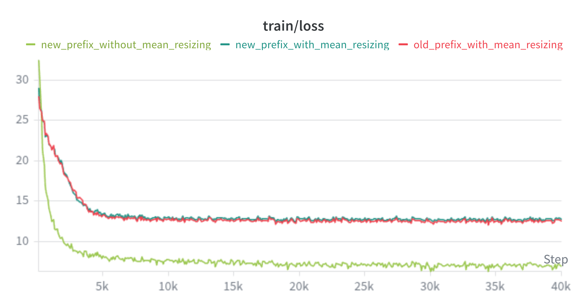
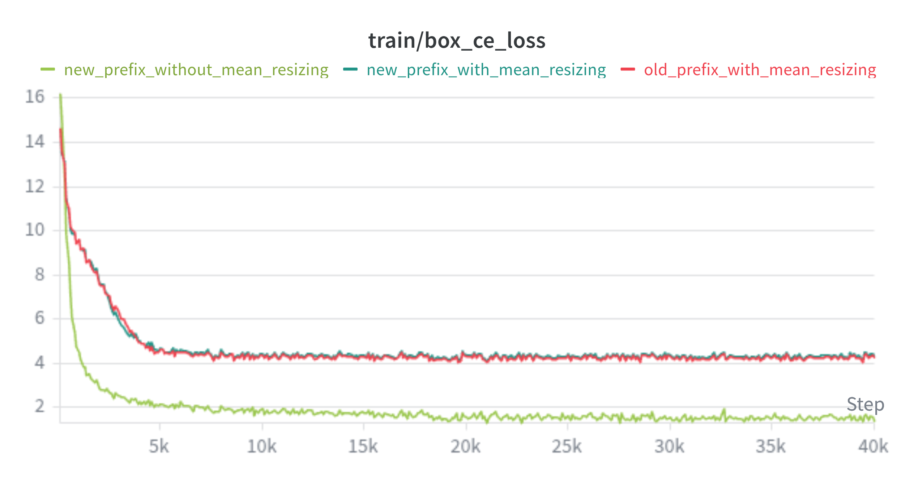
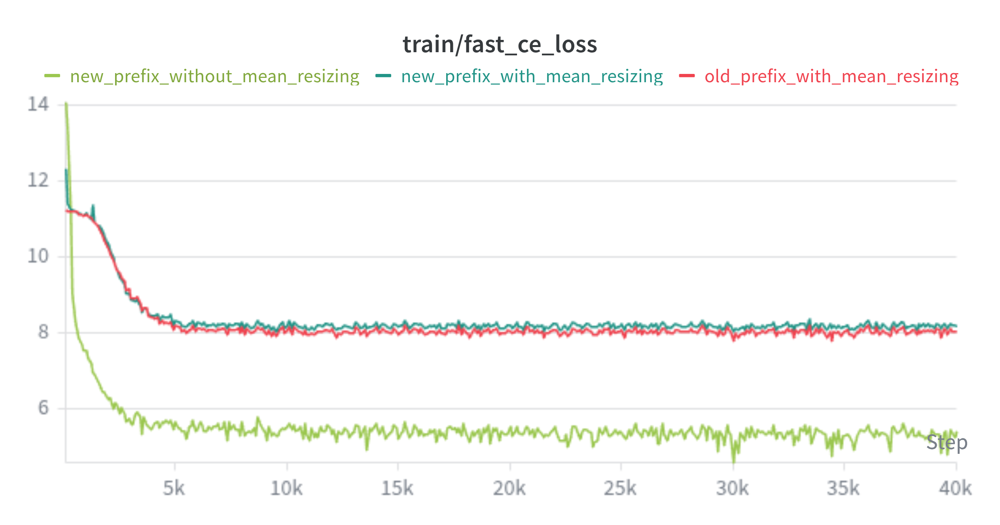
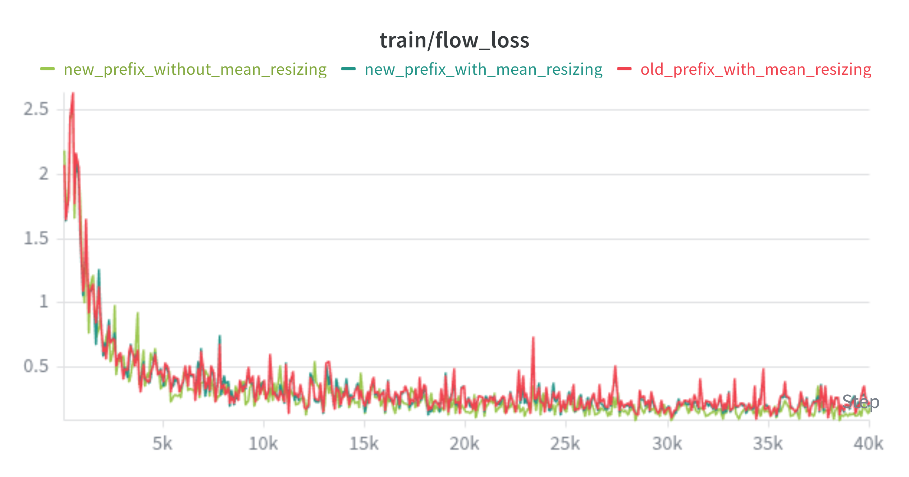
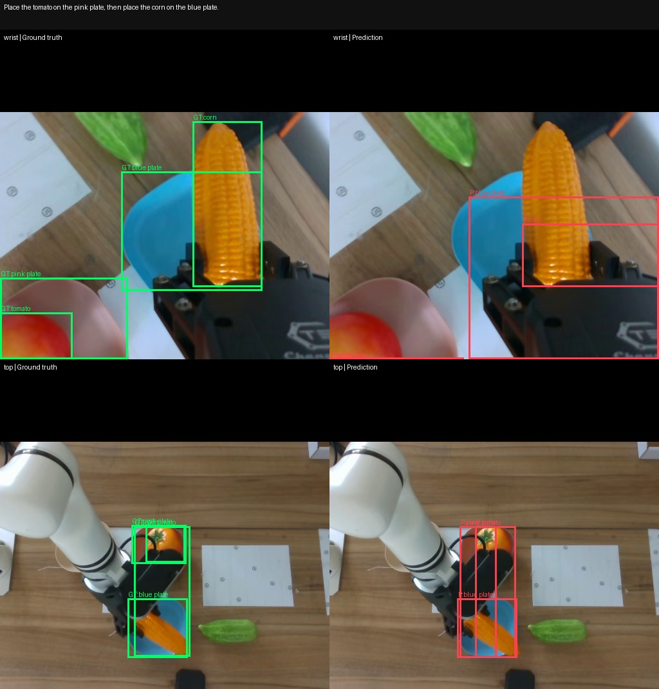
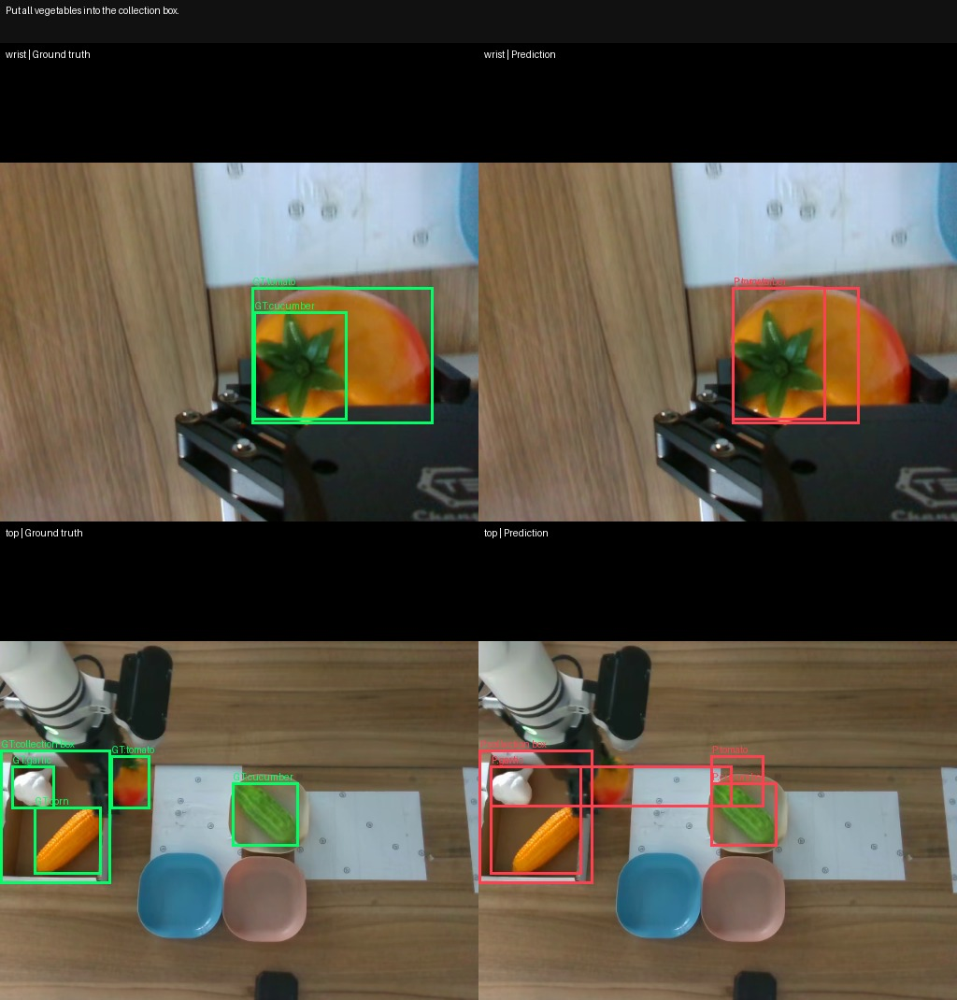
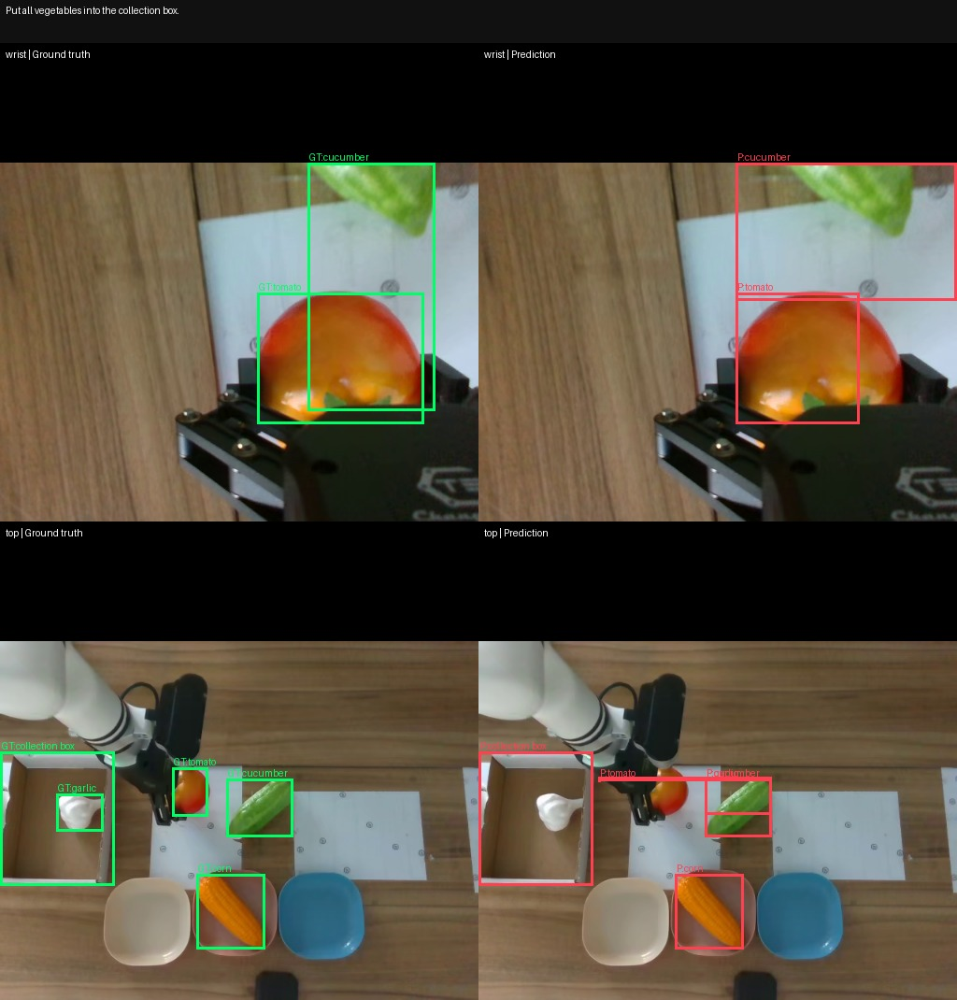

# Action Flow Training Log

*Last updated: July 23, 2026*

---

## Action Flow V1

`action_flow_v1` is a first experimental LeRobot policy for combining an ACT-style robot control interface with a SmolVLA-style flow matching training objective.

### Design Starting Point

The starting point is the RM65 arm imitation-learning setup where the desired policy input/output contract is close to ACT:

- Input: current camera image observations and the current robot state.
- Output: a chunk of continuous robot actions, normally joint angles or action targets in the same format as the dataset `action` feature.
- Runtime behavior: return one action at a time through `select_action`, while internally predicting a chunk and consuming it from an action queue.

ACT is a good reference for this boundary because it already fits common robot datasets in LeRobot: it encodes images with a ResNet backbone, adds robot state conditioning, uses a transformer encoder/decoder, and predicts a fixed action chunk. This makes it easy to plug into `lerobot-train`, existing dataset metadata, normalization, and evaluation scripts.

The weak point of plain ACT for this experiment is the direct regression target. ACT predicts the action chunk directly and is usually trained with an L1 loss against the demonstration action. `action_flow_v1` keeps the same continuous action interface, but changes the learning target: it learns a vector field over action chunks. During training, the model sees an interpolated noisy action chunk and predicts the direction from the clean demonstration action toward Gaussian noise. During inference, it starts from Gaussian noise and integrates the learned velocity field back toward a clean action chunk.

This design borrows the core idea from SmolVLA flow matching while avoiding the full vision-language model stack. For RM65 experiments, this gives a practical middle ground:

- Keep ACT's simple image/state/action data contract.
- Keep continuous angle/action outputs, so no action tokenization is required.
- Use flow matching for action generation, which may model multimodal action chunks better than one-shot regression.
- Leave clear replacement points for future competition changes.

### Policy Structure

The policy package contains separate configuration, modeling, processor, and registration modules.

The policy is registered as:

```text
policy.type=action_flow_v1
```

It is also registered with LeRobot's policy factory, which creates the config, model class, and
pre/post processors.

#### Configuration

`ActionFlowV1Config` defines the model and training defaults:

- `chunk_size`: number of future action steps generated at once.
- `n_action_steps`: number of generated actions executed before sampling a new chunk.
- `vision_backbone`: torchvision ResNet backbone, default `resnet18`.
- `dim_model`, `n_heads`, `n_encoder_layers`, `n_decoder_layers`: transformer architecture parameters.
- `num_inference_steps`: Euler integration steps used to transform noise into actions during inference.
- `time_sampling_alpha`, `time_sampling_beta`: Beta distribution parameters for training timestep sampling.
- `optimizer_lr`, `optimizer_lr_backbone`: separate learning rates for the main policy and image backbone.
- `scheduler_warmup_steps`, `scheduler_decay_steps`, `scheduler_decay_lr`: the default cosine decay schedule.

The config requires at least one conditioning input: image, robot state, or environment state. For the intended RM65 setup, the normal input is two camera features plus `observation.state`; the output is the dataset `action` feature.

#### Pre/Post Processing

`processor_action_flow_v1.py` mirrors the ACT processor:

1. Rename observations using the configured rename map.
2. Add a batch dimension when needed.
3. Move tensors to the policy device.
4. Normalize input observations and training actions using dataset statistics.
5. After inference, unnormalize the predicted action and move it back to CPU.

This is important because the flow model is trained in normalized action space, not raw joint-angle space. At runtime, LeRobot's postprocessor converts the normalized sampled action back to the dataset/robot action scale.

#### Condition Encoder

The condition encoder builds one transformer encoder sequence from all available observations:

- A learned condition token is always added.
- If `observation.state` exists, it is projected by a linear layer into `dim_model`.
- If an environment state exists, it is projected in the same way.
- Each camera image is passed through the ResNet backbone.
- The final ResNet feature map is projected to `dim_model` with a `1x1` convolution.
- A 2D sinusoidal position embedding is added for image feature-map tokens.
- Learned 1D position embeddings are used for condition/state tokens.

The resulting token sequence is passed through the reused ACT transformer encoder.

#### Flow Action Decoder

The action side of the model operates on full action chunks:

```text
noisy action chunk: (batch, chunk_size, action_dim)
timestep:           (batch,)
condition tokens:   encoder output from images/state
```

The noisy action chunk is projected into the transformer dimension. The scalar flow timestep is converted to a sinusoidal embedding, passed through a small MLP, and added to every action token. A learned positional embedding identifies each step in the action chunk. The ACT decoder attends from action tokens to the encoded observation tokens, and the final linear head predicts velocity with the same shape as the action chunk.

### Training Objective

For each training batch:

```python
actions = batch["action"]
noise = torch.randn_like(actions)
t = sample_time(batch_size)
x_t = t * noise + (1 - t) * actions
target_velocity = noise - actions
pred_velocity = model(x_t, t, observations)
loss = mse(pred_velocity, target_velocity)
```

If `action_is_pad` is present, padded action steps are excluded from the MSE.

The important difference from ACT is that the model does not directly predict `actions`. It predicts the velocity field at an interpolated point `x_t`. In other words, it learns "which direction should this noisy action chunk move" for the current visual and robot-state condition.

### Inference Path

Inference starts from random Gaussian action noise:

```python
x_1 = torch.randn(batch, chunk_size, action_dim)
```

Then the model integrates from `t=1` to `t=0` using a simple Euler solver:

```python
dt = -1.0 / num_inference_steps
for step in range(num_inference_steps):
    t = 1.0 + step * dt
    velocity = model(x_t, t, observations)
    x_t = x_t + dt * velocity
```

The final `x_t` is treated as the normalized action chunk. `select_action` stores the first `n_action_steps` actions in a queue and returns one action per control step, matching ACT's deployment behavior.

---

## Training Objective 1: Bimanual Assembly-Part Grasping

This experiment uses the same task and hardware setup as [ACT Training Objective 2](./act.md#training-objective-2-bimanual-assembly-part-grasping), so the result can be compared directly with the ACT baseline.

### Training Log 1 of Objective 1

#### Dataset Recording

I used the dataset recorded for [ACT Training Objective 2, Log 1](./act.md#training-log-1-of-objective-2).

#### Training Configuration

I used the same setting as [ACT Training Objective 2, Log 1](./act.md#training-log-1-of-objective-2):

| Parameter | Configured value | Default value |
|---|---:|---:|
| `policy.push_to_hub` | `false` | `true` |
| `policy.n_action_steps` | `1` | `10` |
| `batch_size` | `16` | `8` |
| `steps` | `20,000` | `100,000` |
| `eval_freq` | `0` (disabled) | `20,000` |
| `save_freq` | `5,000` | `20,000` |
| `log_freq` | `100` | `200` |
| `wandb.enable` | `true` | `false` |
| `wandb.project` | `lerobot_rm65_act` | `lerobot` |

> **Note:** `policy.chunk_size=50` uses the Action Flow V1 default. All other unlisted parameters also use their default values.

#### Evaluation

In this evaluation, `canfd_follow` was disabled. The actual rollout speed was about 10 FPS; when `canfd_follow` was enabled, the arms showed noticeable lag. Therefore, rollout `fps` was set to 10 to better match the real execution speed. The rollout dataset was resumed when its output directory already existed.

Task: `grasp two assembly parts and place them in the center`

| Parameter | Configured value | Default value |
|---|---:|---:|
| `strategy.type` | `highlight` | `base` |
| `robot.left_arm.max_relative_target` | `1000.0` | `10.0` |
| `robot.right_arm.max_relative_target` | `1000.0` | `10.0` |
| `policy.temporal_ensemble_coeff` | `0.01` | `None` |
| `policy.n_action_steps` | `1` | `10` |
| `dataset.push_to_hub` | `false` | `true` |
| `fps` | `10` | `30` |
| `duration` | `120` | `0` (unlimited) |
| `return_to_initial_position` | `false` | `true` |

> **Note:** `inference.type=sync` and both arms' `canfd_follow=false` use their defaults. All other unlisted parameters also use their default values.

- Success rate: 8 / 8

- Phenomenon and Analysis
  1. Its whole performance is similar to [ACT Training Objective 2, Log 1](./act.md#training-log-1-of-objective-2): the grippers do not always grasp the small assembly part along its length, and the gripper sometimes lightly contacts the table while grasping. Unlike ACT, this table contact mainly appears when grasping the large assembly part rather than the small assembly part.
  2. I used ACT-style temporal ensembling during rollout. Without it, `policy.n_action_steps=10` caused unstable motion: before moving toward the assembly part, the arms often moved a short distance in the opposite direction, producing visible twitching. During placement, this instability sometimes caused one part to be released while the other remained gripped and stuck. If increase `policy.n_action_steps` like 20 or more, It will reduce the frequency of twitching and move more smoothly, but it also increases risk of contacting the table. With `policy.n_action_steps=1`, both arms tended to get stuck near the beginning of the rollout.
  3. `policy.n_action_steps=10` rollout video:
    
        <video controls width="300">
        <source src="assets/action_flow/ob_1_grasp_and_place_fail_0.mp4" type="video/mp4">
        </video>
  4. This behavior is likely caused by inconsistency between consecutive action chunks. ActionFlow samples each chunk from fresh random noise, so two neighboring predictions can disagree even when the observation changes only slightly. With `n_action_steps=10`, the policy executes the first 10 actions from one sampled chunk, then replans from a newly sampled chunk; if the new chunk starts with a different local direction, the arm can briefly move backward before continuing forward. With `n_action_steps=1`, the policy replans every step, which makes it more reactive but also more sensitive to sampling noise and small observation changes. Temporal ensembling reduces this problem by averaging overlapping predictions across successive chunks.
  5. I think add more better demonstrations will improve `Action Flow V1` performence, 20 episodes is very small for bimanual control.

---

### Training Log 2 of Objective 1

#### Dataset Recording

This experiment uses the same dataset as [ACT Training Log 4 of Objective 2](act.md#training-log-4-of-objective-2).

Dataset information:

  | Situation ID | Situation Description | Record FPS | Total episodes | Total frames |
  | :---: | :---: | :---: | :---: | :---: |
  | 1 | 1 visible part on each side | 30 | 40 | 13095 |
  | 2 | 2 visible parts on each side | 30 | 60 | 34977 |
  | 3 | 3 visible parts on each side | 30 | 80 | 67884 |
  | 4 | Mixed visibility between left and right sides | 30 | 60 | 32852 |

#### Training Configuration

Similar to [ACT Training Log 4 of Objective 2](act.md#training-log-4-of-objective-2), I trained Action Flow V1 with `policy.chunk_size` values of 20, 30, and 40. The saved training configurations show that each policy was trained for 40,000 steps with batch size 8.

| Parameter | Policy 1 | Policy 2 | Policy 3 | Default value |
|---|---:|---:|---:|---:|
| `policy.push_to_hub` | `false` | `false` | `false` | `true` |
| `policy.chunk_size` | `20` | `30` | `40` | `50` |
| `policy.n_action_steps` | `1` | `1` | `1` | `10` |
| `steps` | `40,000` | `40,000` | `40,000` | `100,000` |
| `eval_freq` | `0` | `0` | `0` | `20,000` |
| `log_freq` | `100` | `100` | `100` | `200` |
| `wandb.enable` | `true` | `true` | `true` | `false` |
| `wandb.project` | `lerobot_action_flow_rm65` | `lerobot_action_flow_rm65` | `lerobot_action_flow_rm65` | `lerobot` |

> **Note:** `batch_size=8` and `save_freq=20,000` use the training-pipeline defaults. All other unlisted parameters also use their default values.

#### Evaluation

In this rollout evaluation, I enabled Real-Time Chunking (RTC). RTC is more suitable than ACT-style temporal ensembling for this flow-matching policy because it explicitly reuses the unexecuted part of the previous chunk during the next denoising process.

| Parameter | Configured value | Default value |
|---|---:|---:|
| `inference.type` | `rtc` | `sync` |
| `inference.queue_threshold` | `10` | `30` |

> **Note:** `inference.rtc.execution_horizon=10`, `inference.rtc.max_guidance_weight=10`, and `inference.rtc.prefix_attention_schedule=LINEAR` use their defaults. All other unlisted parameters also use their default values.

Some individual rollouts changed the flow integration step count:

| Parameter | Tested values | Default value |
|---|---:|---:|
| `policy.num_inference_steps` | `5`, `7` | `10` |

- Phenomenon
    1. All three policies show different degrees of discontinuity between the current executed action and the next predicted chunk. Both arms often fail to align with the assembly parts. In some cases, the robot successfully grasps a part, but the gripper command is not stable: it slightly opens and closes during transfer, causing the part to drop.

        Rollout video with `chunk_size=20`:

        <video controls width="600">
            <source src="assets/action_flow/ob_1_log_2_rollout_0.mp4" type="video/mp4">
        </video>

        Rollout video with `chunk_size=30`:

        <video controls width="600">
            <source src="assets/action_flow/ob_1_log_2_rollout_1.mp4" type="video/mp4">
        </video>

        Rollout video with `chunk_size=40`:

        <video controls width="600">
            <source src="assets/action_flow/ob_1_log_2_rollout_2.mp4" type="video/mp4">
        </video>

    2. Compared with [ACT](./act.md#training-log-4-of-objective-2), `Action Flow V1` shows one encouraging behavior: it does not follow the fixed sequence and fixed position prior as strongly as ACT. This suggests that `Action Flow V1` may rely more on visual information. However, its grasp success rate is still almost zero because the grasp point is not accurate and the executed actions are not stable enough.
    3. Although the default `num_inference_steps` is 10, reducing it significantly improves grasp-point accuracy and gripper-command stability. This suggests that more denoising steps do not necessarily produce better real-robot rollout behavior. In this task, 10 inference steps may over-refine the action chunk or increase chunk-to-chunk inconsistency, while 7 or 5 steps produce smoother and more stable grasp targets. However, the grasp point is still not accurate enough for consistently successful pickup:

        Successful rollout video with `chunk_size=40` and `num_inference_step=7`:

        <video controls width="600">
            <source src="assets/action_flow/ob_1_log_2_rollout_3.mp4" type="video/mp4">
        </video>

        Fail rollout video with `chunk_size=40` and `num_inference_step=7`:

        <video controls width="600">
            <source src="assets/action_flow/ob_1_log_2_rollout_4.mp4" type="video/mp4">
        </video>

        Nearly successful rollout video with `chunk_size=40` and `num_inference_step=5`:

        <video controls width="600">
            <source src="assets/action_flow/ob_1_log_2_rollout_5.mp4" type="video/mp4">
        </video>

    4. Similar to ACT, `Action Flow V1` still has difficulty handling empty target positions. In the demonstrations, when one side has no visible part, the corresponding arm remains still. However, during rollout, if the right-side target position is empty while the left side still has visible assembly parts, the right arm may still try to grasp the empty position and then execute the place motion toward the center. This motion is noticeably slower than normal, but it still shows that the policy has not fully learned the conditional behavior of skipping an empty side.

- Analysis:
    1. `Action Flow V1` improves some low-level rollout behavior compared with ACT, especially after tuning `num_inference_steps`, but it does not fully solve the high-level conditional behavior problem. Like ACT, it can still execute a memorized empty-position grasp when one side has no visible part.
    2. The best low-level improvement comes from reducing `num_inference_steps`. This indicates that rollout quality is sensitive to the inference-time flow integration setting. In this task, the default value of 10 may generate action chunks that are too sharp or less consistent across consecutive RTC updates. Fewer inference steps make the action sequence smoother and make the gripper command more stable.
    3. Even after this improvement, grasp-point precision remains a bottleneck. The policy can often move toward the correct part, but the final grasp point is still slightly offset from the part center or length direction. For small assembly parts, this small error is enough to cause missed grasps, unstable grasps, or dropped parts during transfer.
    4. The empty-side failure suggests that the policy has not learned a reliable conditional rule: if no part is visible on one side, that arm should stay still. This is not mainly an RTC or `num_inference_steps` issue, because the same type of behavior also appears in ACT. It is more likely a limitation of visual grounding and action-condition learning in the current dataset/model setup.
    5. The next improvement should focus on object localization, centered grasp prediction, and explicit empty-side behavior. Possible directions include testing `num_inference_steps` values around 5 and 7 more systematically, adding gripper-specific smoothing or loss weighting, improving the visual encoder, adding more demonstrations that emphasize centered grasps, and adding more clear examples where one arm must remain still because its side is empty.

---

## Action Flow V2

### Design Motivation

Action Flow V1 uses a visual encoder without language conditioning. Its evaluation showed that a policy can reproduce smooth demonstrated trajectories while still relying on fixed object locations and action-order priors. Action Flow V2 is designed to make target selection depend more directly on the task prompt and current camera observations.

The policy therefore combines a vision-language model (VLM), a continuous flow-matching action expert, and an auxiliary spatial-grounding head. The grounding objective is intended to improve the shared visual-language representation. It does not replace the VLM representation with a detector output.

### Policy Structure

~~~text
camera images + task prompt
            |
            v
       shared VLM
            |
            +----------------------------+
            |                            |
            v                            v
prompt-conditioned tokens        spatial-grounding head
            |                            |
robot state + noisy actions              v
            |                    relevance prediction
            v
 flow-matching action expert
            |
            v
 continuous action chunk
~~~

The VLM processes all camera images and the task prompt while retaining camera identity and image token locations. The action expert combines these prompt-conditioned tokens with the robot state and noisy actions to predict a continuous action flow. The grounding head reads the same prompt-conditioned image tokens and predicts which image regions are relevant to the instruction.

The relevance prediction is auxiliary: it can be visualized during inference, but it is not directly fed back into the action expert. This makes it possible to test whether spatial supervision improves the shared representation without changing the policy's action interface. Future experiments may use other grounding targets or explicitly condition actions on the predicted spatial output.

### Auxiliary Data Record Pipeline

Action Flow V2 starts from a normal LeRobot demonstration dataset containing camera observations, robot state, actions, and task prompts. Spatial labels are generated as a separate, frame-aligned annotation source and then merged with the demonstrations before training.

~~~text
task prompts + camera videos
            |
            v
 identify prompt-relevant entities
            |
            v
 propose and review target locations
            |
            v
 track entities through each video
            |
            v
 build per-camera spatial targets
            |
            v
merge with robot observations and actions
            |
            v
 train action loss + grounding loss
~~~

Automatic detectors or grounding models are used only to initialize annotations. Their proposals must be reviewed, after which a video segmentation or tracking model propagates each accepted entity through the episode. Separate entity tracks are retained so later experiments can derive different targets, such as binary relevance, source and destination regions, or phase-dependent labels.

Annotation validity is stored separately from target visibility. A camera can have a valid empty target when no relevant entity is visible, while uncertain or incorrect annotations must be excluded from the grounding loss. Exact detectors, tracking settings, target formats, loss functions, resolutions, and model-freezing choices are experiment-specific and are documented in the corresponding training log.

### Training Objective 1: Single-Arm Table Preparation and Bussing

The task design and demonstration-recording plan follow [PI0 Training Objective 1](./pi_0.md#training-objective-1-single-arm-table-preparation-and-bussing).

#### Objective

The first Action Flow V2 experiment uses the single-arm table-preparation and table-bussing task.
The policy must use the language prompt to select the relevant vegetables, plates, or collection box instead of reproducing a fixed object-position trajectory.

The experiment has two connected objectives:

1. Predict continuous RM65 joint and gripper action chunks with the SmolVLA-style flow action expert.
2. Predict a task-relevance heatmap for the top and wrist cameras from the shared prompt-conditioned VLM tokens.

The main question is whether auxiliary spatial supervision improves target recognition and action accuracy without directly passing the predicted heatmap into the action expert.

### Training Log 1 of Objective 1

#### Dataset

The cleaned dataset contains 203 successful episodes, 92,545 frames, and 52 prompt variants recorded at 30 FPS. Each frame contains:

- `observation.images.top`: 640 x 480 overhead workspace image.
- `observation.images.wrist`: 640 x 480 end-effector image.
- `observation.state`: six RM65 joint angles and one continuous gripper position.
- `action`: six recorded future joint-angle labels and one continuous gripper label.

| Task | Prompt template | Episodes | Total frames |
|---|---|---:|---:|
| Place one vegetable | `Place the {vegetable} on the {plate_color} plate.` | 48 | 16,212 |
| Arrange two vegetables | `Place the {vegetable_1} on the {plate_color_1} plate, then place the {vegetable_2} on the {plate_color_2} plate.` | 36 | 20,196 |
| Clear a specified plate | `Put the vegetable from the {plate_color} plate into the collection box.` | 72 | 22,149 |
| Bus the table | `Put all vegetables into the collection box.` | 47 | 33,988 |
| **Total** | **52 prompt variants** | **203** | **92,545** |

#### Relevance Annotation

This experiment uses one binary relevance channel per camera. The target is the union of every entity needed to interpret the complete prompt:

- A place-one prompt includes the manipulated vegetable and destination plate.
- A clear-plate prompt includes the source vegetable, source plate, and collection box.
- A table-bussing prompt includes all vegetables and the collection box.
- A multi-step prompt includes every named vegetable and destination plate for the full episode.

The target does not distinguish source from destination and does not change between task phases.
It is not used as a grasp-point or trajectory label.

Grounding DINO receives detector-oriented text instead of the literal dataset entity name when a
more visually specific description is needed:

| Dataset entity | Grounding DINO query | Usage |
|---|---|---|
| `tomato` | `tomato` | Source vegetable |
| `garlic` | `white garlic` | Source vegetable; the color reduces confusion with the table and paper |
| `corn` | `corn` | Source vegetable |
| `cucumber` | `green cucumber` | Source vegetable |
| `pink plate` | `pink square bowl` | Source or destination container |
| `yellow plate` | `cream square bowl` | Source or destination container; `cream` better matches its observed color |
| `blue plate` | `blue square bowl` | Source or destination container |
| `collection box` | `brown cardboard box` | Destination container |
| `vegetable on the {color} plate` | Plate query plus all four vegetable queries | Detect the specified plate and the vegetables separately, then select the vegetable whose box lies inside the plate box |

The annotations were generated as follows:

1. Parse each task prompt into deterministic entity IDs, names, roles, and detector queries.
2. Run [IDEA-Research/grounding-dino-tiny](https://huggingface.co/IDEA-Research/grounding-dino-tiny) on sampled top- and wrist-camera frames to propose one initialization box for each entity.
3. Review the selected boxes and replace incorrect or missing proposals manually.
4. Use each accepted box to initialize a separate [facebook/sam2.1-hiera-small](https://huggingface.co/facebook/sam2.1-hiera-small) object track.
5. Run SAM2 on every third frame and assign the nearest tracked mask to intermediate frames.
6. Merge the requested per-object tracks into one union relevance mask for each camera frame.
7. Join the frame-aligned masks to the LeRobot data by `episode_index`, `frame_index`, and camera.

The reviewed Grounding DINO proposals and separate SAM2 object tracks are retained for inspection.
Keeping each object as a separate track preserves entity identity for future source/destination or
phase-dependent experiments. Full-resolution union masks are stored in a separate annotation
dataset containing one Parquet file per episode and camera. Each row stores the episode and frame
indices, camera name, image dimensions, compressed union mask, and annotation validity weight.

For training, the union masks are merged with the robot dataset and resized to the VLM image-token
grid. The merged dataset adds:

- `observation.relevance_mask` with shape `(2, 8, 8)`, ordered as wrist then top.
- `observation.relevance_loss_weight` with shape `(2,)`.

An all-zero mask is a valid label when no relevant entity is visible. A zero validity weight is used only when the annotation is uncertain or intentionally excluded.

#### Policy and Loss Design

The policy is initialized from the SmolVLA base checkpoint and uses the
`SmolVLM2-500M-Video-Instruct` backbone. A learned camera embedding is added to each camera's image
tokens before the shared multimodal transformer.

For each camera, the relevance head applies:

```text
LayerNorm -> Linear(hidden_size, 256) -> GELU -> Linear(256, 1)
```

The output token logits are reshaped to an 8 x 8 grid. The experiment trains:

```text
L_total = L_flow + 0.1 * (L_BCE + L_Dice)
```

The relevance loss is computed independently for each camera, multiplied by `observation.relevance_loss_weight`, and normalized over valid camera frames. BCE provides per-patch classification supervision, while Dice reduces the dominance of background patches when relevant regions are small.

The complete VLM and action expert remain trainable so the relevance loss can modify features shared with action prediction. Two otherwise identical policies are required for the intended ablation:

- Grounding policy: `policy.relevance_loss_weight=0.1`.
- Action-only ablation: `policy.relevance_loss_weight=0.0`.

#### Training Configuration

| Parameter | Configured value | Action Flow V2 default |
|---|---:|---:|
| `dataset.return_uint8` | `true` | `false` |
| `policy.type` | `action_flow_v2` | Not set |
| `policy.device` | `cuda` | Automatically selected |
| `policy.input_features` | `null` (infer from dataset) | `{}` |
| `policy.output_features` | `null` (infer from dataset) | `{}` |
| `policy.n_action_steps` | `1` | `10` |
| `policy.relevance_loss_weight` | `0.1` (grounding) / `0.0` (ablation) | `0.1` |
| `policy.optimizer_lr` | `3e-5` | `1e-4` |
| `policy.scheduler_decay_steps` | `40,000` | `30,000` |
| `policy.push_to_hub` | `false` | `true` |
| `steps` | `40,000` | `100,000` |
| `eval_freq` | `0` (disabled) | `20,000` |
| `save_freq` | `10,000` | `20,000` |
| `log_freq` | `100` | `200` |
| `wandb.enable` | `true` | `false` |
| `wandb.project` | `lerobot_action_flow_v2_rm65` | `lerobot` |
| `wandb.disable_artifact` | `true` | `false` |

> **Note:** Parameters not listed in the table use their defaults. Important retained defaults are
> `policy.chunk_size=50`, `batch_size=8` per process, `policy.freeze_vision_encoder=false`,
> `policy.train_expert_only=false`, `policy.load_vlm_weights=true`,
> `policy.relevance_bce_weight=1.0`, `policy.relevance_dice_weight=1.0`, and
> `policy.relevance_target_size=[8, 8]`. Both policies used BF16 mixed precision on one GPU process,
> giving an effective batch size of 8.

The lower learning rate of `3e-5` reduces the risk of damaging the pretrained VLM while the newly initialized camera embeddings and relevance head learn the RM65 workspace.

During training, log at least:

- `flow_loss`
- `relevance_loss`
- `relevance_bce_loss`
- `relevance_dice_loss`
- `relevance_valid_camera_fraction`

Training should be stopped and inspected if the weighted relevance loss dominates the flow loss, or if heatmap quality improves while rollout action quality degrades.

#### Evaluation

The grounding policy (`relevance_loss_weight=0.1`) and action-only ablation
(`relevance_loss_weight=0.0`) were evaluated with the same five prompts and object layouts. Each
prompt was tested twice per policy, producing 20 paired rollouts. The policies used identical
training and rollout settings apart from the relevance-loss weight.

##### Rollout Configuration

| Parameter | Configured value | Default value |
|---|---:|---:|
| `strategy.type` | `episodic` | `base` |
| `inference.type` | `rtc` | `sync` |
| `inference.rtc.execution_horizon` | `15` | `10` |
| `inference.rtc.max_guidance_weight` | `15` | `10` |
| `inference.queue_threshold` | `25` | `30` |
| `policy.num_steps` | `5` | `10` |
| `robot.single_arm.max_relative_target` | `1000.0` | `100.0` in the robot YAML |
| `fps` | `20` | `30` |

> **Note:** `inference.rtc.prefix_attention_schedule=LINEAR`,
> `robot.single_arm.canfd_follow=false`, and `return_to_initial_position=true` use their
> defaults. All other unlisted parameters use their defaults. RTC calls `predict_action_chunk`
> directly and manages its own queue, so `policy.n_action_steps` is not an effective rollout
> parameter in this evaluation.

##### Results

The grounding policy's heatmaps are visualizations of an upsampled 8 x 8 relevance grid. They
should be interpreted as coarse relevant regions rather than precise segmentation boundaries.

| Prompt | Trials per policy | `0.1` successes | `0.0` successes | Paired observation |
|---|---:|---:|---:|---|
| `Place the tomato on the pink plate.` | 2 | 0 | 0 | Both policies approached the target but failed to complete the grasp and transfer. The ablation did not approach unrelated objects in these two trials. |
| `Place the cucumber on the blue plate.` | 2 | 1 | 0 | The grounding policy reacted more quickly after the cucumber slipped and attempted a more accurate re-grasp. The ablation continued the original trajectory longer and recovered less precisely. |
| `Put the vegetable from the blue plate into the collection box.` | 2 | 0 | 0 | Both policies failed, but the grounding policy showed slightly better target localization and corrective behavior. Gripper closure and grasp alignment remained unreliable. |
| `Put the vegetable from the yellow plate into the collection box.` | 2 | 0 | 0 | Both policies selected the same incorrect target, showing that the dominant grounding error was shared by both models. |
| `Place the tomato on the pink plate, then place the garlic on the blue plate.` | 2 | 0 | 0 | Both policies attempted incorrect targets. The behavior was slightly less severe with the grounding policy, but neither completed the first step reliably. |
| **Total** | **10 each** | **1 (10%)** | **0 (0%)** | **The grounding policy was slightly quicker and more precise, but the main failure modes were similar.** |

This remains a small qualitative comparison. The auxiliary relevance objective provides a modest
behavioral improvement in these paired trials, but it does not produce a reliable task policy.

##### Rollout Videos

**Place the tomato on the pink plate**

<table>
<tr><th colspan="2"><code>relevance_loss_weight=0.1</code></th></tr>
<tr>
    <td align="center">
    <video controls width="100%">
        <source src="assets/action_flow/v2_ob_1_log_1_rollout_0.mp4" type="video/mp4">
    </video>
    <p><em>Trial 1: broad relevance and failed grasp.</em></p>
    </td>
    <td align="center">
    <video controls width="100%">
        <source src="assets/action_flow/v2_ob_1_log_1_rollout_1.mp4" type="video/mp4">
    </video>
    <p><em>Trial 2: unstable relevance and failed transfer.</em></p>
    </td>
</tr>
<tr><th colspan="2"><code>relevance_loss_weight=0.0</code></th></tr>
<tr>
    <td align="center">
    <video controls width="100%">
        <source src="assets/action_flow/v2_ob_1_log_1_rollout_10.mp4" type="video/mp4">
    </video>
    <p><em>Trial 1: target approach followed by grasp failure.</em></p>
    </td>
    <td align="center">
    <video controls width="100%">
        <source src="assets/action_flow/v2_ob_1_log_1_rollout_11.mp4" type="video/mp4">
    </video>
    <p><em>Trial 2: target approach followed by transfer failure.</em></p>
    </td>
</tr>
</table>

**Place the cucumber on the blue plate**

<table>
<tr><th colspan="2"><code>relevance_loss_weight=0.1</code></th></tr>
<tr>
    <td align="center">
    <video controls width="100%">
        <source src="assets/action_flow/v2_ob_1_log_1_rollout_2.mp4" type="video/mp4">
    </video>
    <p><em>Trial 1: successful with the pink plate removed.</em></p>
    </td>
    <td align="center">
    <video controls width="100%">
        <source src="assets/action_flow/v2_ob_1_log_1_rollout_3.mp4" type="video/mp4">
    </video>
    <p><em>Trial 2: failed with the pink plate present.</em></p>
    </td>
</tr>
<tr><th colspan="2"><code>relevance_loss_weight=0.0</code></th></tr>
<tr>
    <td align="center">
    <video controls width="100%">
        <source src="assets/action_flow/v2_ob_1_log_1_rollout_12.mp4" type="video/mp4">
    </video>
    <p><em>Trial 1: slow response after the cucumber slipped.</em></p>
    </td>
    <td align="center">
    <video controls width="100%">
        <source src="assets/action_flow/v2_ob_1_log_1_rollout_13.mp4" type="video/mp4">
    </video>
    <p><em>Trial 2: inaccurate recovery and failed re-grasp.</em></p>
    </td>
</tr>
</table>

**Put the vegetable from the blue plate into the collection box**

<table>
<tr><th colspan="2"><code>relevance_loss_weight=0.1</code></th></tr>
<tr>
    <td align="center">
    <video controls width="100%">
        <source src="assets/action_flow/v2_ob_1_log_1_rollout_4.mp4" type="video/mp4">
    </video>
    <p><em>Trial 1: insufficient gripper closure.</em></p>
    </td>
    <td align="center">
    <video controls width="100%">
        <source src="assets/action_flow/v2_ob_1_log_1_rollout_5.mp4" type="video/mp4">
    </video>
    <p><em>Trial 2: misaligned grasp.</em></p>
    </td>
</tr>
<tr><th colspan="2"><code>relevance_loss_weight=0.0</code></th></tr>
<tr>
    <td align="center">
    <video controls width="100%">
        <source src="assets/action_flow/v2_ob_1_log_1_rollout_14.mp4" type="video/mp4">
    </video>
    <p><em>Trial 1: failed target approach and grasp.</em></p>
    </td>
    <td align="center">
    <video controls width="100%">
        <source src="assets/action_flow/v2_ob_1_log_1_rollout_15.mp4" type="video/mp4">
    </video>
    <p><em>Trial 2: weak correction and failed grasp.</em></p>
    </td>
</tr>
</table>

**Put the vegetable from the yellow plate into the collection box**

<table>
<tr><th colspan="2"><code>relevance_loss_weight=0.1</code></th></tr>
<tr>
    <td align="center">
    <video controls width="100%">
        <source src="assets/action_flow/v2_ob_1_log_1_rollout_6.mp4" type="video/mp4">
    </video>
    <p><em>Trial 1: selected an incorrect target.</em></p>
    </td>
    <td align="center">
    <video controls width="100%">
        <source src="assets/action_flow/v2_ob_1_log_1_rollout_7.mp4" type="video/mp4">
    </video>
    <p><em>Trial 2: selected the same incorrect target.</em></p>
    </td>
</tr>
<tr><th colspan="2"><code>relevance_loss_weight=0.0</code></th></tr>
<tr>
    <td align="center">
    <video controls width="100%">
        <source src="assets/action_flow/v2_ob_1_log_1_rollout_16.mp4" type="video/mp4">
    </video>
    <p><em>Trial 1: repeated the grounding policy's target error.</em></p>
    </td>
    <td align="center">
    <video controls width="100%">
        <source src="assets/action_flow/v2_ob_1_log_1_rollout_17.mp4" type="video/mp4">
    </video>
    <p><em>Trial 2: repeated the same incorrect grasp behavior.</em></p>
    </td>
</tr>
</table>

**Place the tomato on the pink plate, then place the garlic on the blue plate**

<table>
<tr><th colspan="2"><code>relevance_loss_weight=0.1</code></th></tr>
<tr>
    <td align="center">
    <video controls width="100%">
        <source src="assets/action_flow/v2_ob_1_log_1_rollout_8.mp4" type="video/mp4">
    </video>
    <p><em>Trial 1: the initial grasp failed.</em></p>
    </td>
    <td align="center">
    <video controls width="100%">
        <source src="assets/action_flow/v2_ob_1_log_1_rollout_9.mp4" type="video/mp4">
    </video>
    <p><em>Trial 2: attempted an incorrect target.</em></p>
    </td>
</tr>
<tr><th colspan="2"><code>relevance_loss_weight=0.0</code></th></tr>
<tr>
    <td align="center">
    <video controls width="100%">
        <source src="assets/action_flow/v2_ob_1_log_1_rollout_18.mp4" type="video/mp4">
    </video>
    <p><em>Trial 1: attempted an incorrect target.</em></p>
    </td>
    <td align="center">
    <video controls width="100%">
        <source src="assets/action_flow/v2_ob_1_log_1_rollout_19.mp4" type="video/mp4">
    </video>
    <p><em>Trial 2: stronger incorrect-target behavior than the grounding policy.</em></p>
    </td>
</tr>
</table>

##### Relevance Annotation Quality

The top-camera relevance annotations are generally usable, but many wrist-camera annotations are
not reliable. In placement tasks, the initialization box was sometimes selected from a late frame
after the object had already been placed on the destination plate. At that point, the object and
plate overlap in the wrist view, so the initialization proposal can cover them as one combined
region.

This is problematic even though the final training target is a union mask. The object and plate
move independently during most of the episode, but SAM2 receives a single fused initialization
region from the contact phase. When that region is propagated through the episode, the track may
follow only one entity, include surrounding plate pixels, or fail when the object separates from
the plate. The resulting wrist labels can therefore be broad, inconsistent, or attached to the
wrong entity. Repeated errors of this type teach the relevance head incorrect spatial
correspondence.

##### Analysis

1. **The relevance objective provides only a modest benefit.** The grounding policy completed one
   trial, reacted more quickly to a dropped object, and produced slightly more accurate approaches
   and re-grasps. The ablation completed no trials. This direction is favorable, but the difference
   between one success and zero successes is too small to establish a reliable improvement.

2. **Both policies retain the same dominant failure modes.** They often approach the correct
   region but fail to align or close the gripper, continue a demonstrated trajectory after losing
   the object, or select the same incorrect target. The identical error in the yellow-plate task
   is especially important: the auxiliary loss did not overcome the shared scene-layout or
   object-co-occurrence prior.

3. **The action expert does not directly follow the predicted heatmap.** The heatmap is an
   auxiliary output rather than an action input. Consequently, an incorrect heatmap and incorrect
   motion indicate weak shared visual-language features; the heatmap is not directly commanding
   the robot to grasp an unrelated object.

4. **Wrist-camera label noise limits the grounding policy.** Many initialization boxes contain an
   already combined object-and-plate region, producing inconsistent wrist targets. The similar
   failures of the action-only ablation show that this noise is not the only problem, but it can
   weaken or misdirect the additional supervision and hide its potential benefit.

5. **Distractors expose weak language-to-entity binding.** The only successful rollout occurred
   when the pink plate was removed from the cucumber-to-blue-plate scene. With distractors present,
   both policies relied more strongly on learned scene priors than on the requested object and
   destination.

6. **The current relevance target cannot represent execution order.** A single union mask
   highlights every source and destination throughout a multi-step episode. It teaches general
   task relevance but does not distinguish entity roles, the active subtask, or whether the policy
   should execute the first or second placement.

7. **Spatial grounding and manipulation remain separate bottlenecks.** The 8 x 8 grid is coarse
   for small vegetables and precise grasp points, while correct target selection can still fail
   through grasp misalignment, insufficient gripper closure, or poor recovery. Improving the
   relevance target alone will not guarantee successful manipulation.

Before retraining, wrist initialization frames should be chosen while the source object and
destination plate are visibly separated. They should be initialized as separate object tracks,
with negative clicks used to exclude overlapping plate or background pixels. Uncertain fused
tracks should be corrected manually or assigned `loss_weight=0`; the wrist image can remain a
policy input even when its relevance loss is disabled for those frames.

The next evaluation should report task success, grasp success, and held-out heatmap Dice/IoU
separately. It should use more repeated paired scenes with and without distractors and log
predicted gripper commands to determine whether closure failures originate in the policy output or
the physical gripper execution.

### Training Log 2 of Objective 1

#### Relevance Annotation

The second annotation pass replaces open-vocabulary text grounding with
[YOLOE](https://docs.ultralytics.com/models/yoloe/) visual prompting. This change addresses two
problems observed in Training Log 1: text queries sometimes select semantically related but
incorrect objects, and a box around an already combined object-and-plate region can initialize a
fused SAM2 track. YOLOE is used only to obtain reviewed positive initialization points; SAM2 still
generates the frame-level segmentation masks.

##### Visual Reference

YOLOE is initialized once from a 640 x 480 top-camera reference image containing clear examples of
the task objects. Each bounding box is assigned a stable visual-prompt class:

| Class ID | Reference class | Dataset entity |
|---:|---|---|
| 0 | `blue_plate` | `blue plate` |
| 1 | `yellow_plate` | `yellow plate` |
| 2 | `pink_plate` | `pink plate` |
| 3 | `garlic` | `garlic` |
| 4 | `tomato` | `tomato` |
| 5 | `cucumber` | `cucumber` |
| 6 | `corn` | `corn` |
| 7 | `collection_box` | `collection box` |

The reference definition stores this visual class mapping. It is not a text-query mapping: the task
parser still determines which entities are relevant to each instruction, but only those
corresponding YOLOE classes are retained for review and SAM2 initialization.

##### YOLOE Proposal Generation

The YOLOE proposal-generation pass scans the top and wrist videos and stores its detections for
review.

| Parameter | Value |
|---|---|
| Model | `yoloe-26x-seg.pt` |
| Cameras | `top`, `wrist` |
| Frame selection | Every episode frame |
| Input size | `640` |
| Confidence threshold | `0.15` |
| IoU threshold | `0.7` |
| Candidates per entity | `3` |
| Candidate quality threshold | `0.3` |
| YOLOE mask threshold | `0.5` |
| Inference batch size | `4` |

For every prompt-relevant entity, YOLOE predicts a box and segmentation mask. A positive point is
chosen at the mask pixel farthest from its boundary, which places it inside the object rather than
on an uncertain edge. The box center is used only when YOLOE provides no usable mask.

Candidates are ranked using detection confidence, visible area, border clearance, and image
sharpness. Source objects receive a penalty for late frames so that their initialization is
preferably captured before manipulation. Up to three temporally separated candidates are retained
for each `(episode, camera, object_id)` item.

##### Point Review

The YOLOE result is reviewed with an interactive interface. Unlike the first annotation workflow,
review corrections are not transcribed into a Markdown table and then repeated manually in the
SAM2 interface. The reviewer operates directly on the original video frames:

| Review action | Saved result | SAM2 behavior |
|---|---|---|
| Leave unchanged | No explicit override | Use the selected YOLOE point |
| Select a candidate and use its point | `candidate_point` | Use that candidate's frame and positive point |
| Click the correct target in any frame | `manual_point` | Use the clicked frame and coordinates as a positive point |
| Mark `Not visible` | `not_visible` | Produce an all-zero track for that entity and camera |

Each action is saved immediately in a resumable review-decision record.

If an absent target is not marked `not_visible`, a missing YOLOE proposal leaves the
episode-camera pair unresolved and batch SAM2 skips it. More seriously, an unreviewed false
positive is treated as the target and produces an incorrect track. Therefore, every absent target
and every false positive must be corrected during review.

##### SAM2 Tracking

The SAM2 annotation pass loads the review decisions with `prompt_source=yoloe`. Untouched targets
use the selected YOLOE points, while explicit decisions override them before the SAM2 session is
constructed.

| Parameter | Value |
|---|---|
| Model | `sam2.1-hiera-small` |
| Prompt type | One positive point per visible entity |
| Frame stride | `2` |
| Intermediate frames | Mask from the nearest directly tracked frame |
| Top-camera range | Propagate forward and backward to cover the full episode |
| Wrist-camera range | Begin at the reviewed reference-point frame |
| Missing reviewed target | Skip the unresolved episode-camera pair |
| `not_visible` target | Save an all-zero per-object track |

Reference-point frames are always processed even when they are not divisible by the frame stride.
SAM2 tracks each entity independently, after which the per-object masks are unioned into one binary
task-relevance mask per frame.

The workflow retains separate object tracks, resumable workspaces, a batch report, and preview
videos. Full-resolution union masks and frame validity weights are stored separately from the
source robot data. Each annotation row is aligned by `episode_index`, `frame_index`, and camera,
and contains the image size, compressed binary mask, and `loss_weight`.

##### Dense Training Dataset

For policy training, the merge step joins the YOLOE/SAM2 sidecar with the original LeRobot dataset.
The native-resolution SAM2 masks remain unchanged in the sidecar dataset. The merged copies are
resized to 512 x 512 using the same aspect-ratio-preserving resize and left/top padding convention
as the policy images. This retains dense spatial supervision instead of reducing each mask to the
VLM's 8 x 8 image-token grid.

The camera order is wrist then top. The merged dataset adds:

- `observation.relevance_mask`: `uint8[2, 512, 512]`.
- `observation.relevance_loss_weight`: `float32[2]`.

The resulting training dataset contains 203 episodes and 92,545 frames at 30 FPS.

#### Policy and Loss Design

This experiment uses Action Flow V2.1. It keeps the prompt-conditioned SmolVLA action-flow
pipeline from Action Flow V2 but replaces the 8 x 8 relevance classifier with a learned dense
decoder. For each camera, the decoder reshapes the corresponding image tokens to their spatial
grid and applies six learned 2x upsampling stages:

```text
8 x 8 -> 16 x 16 -> 32 x 32 -> 64 x 64 -> 128 x 128 -> 256 x 256 -> 512 x 512
```

The decoder channels are `(256, 128, 64, 32, 16, 8)`, followed by a one-channel output projection.
The relevance target size matches the 512 x 512 policy image size, so the prediction and target
remain spatially aligned.

The training objective is:

```text
L_total = L_flow + 0.1 * (L_BCE + L_Dice)
```

BCE supervises each output pixel, while Dice reduces the dominance of background pixels when the
relevant objects occupy a small image region. `observation.relevance_loss_weight` excludes invalid
camera annotations without treating a valid empty mask as missing data.

The policy is initialized from the SmolVLA base checkpoint and the
`SmolVLM2-500M-Video-Instruct` backbone. The VLM, action expert, state projection, camera
embeddings, and dense relevance decoder are all trainable. The successful startup reports
405 million learnable parameters out of 452 million total parameters.

#### Training Configuration

| Parameter | Configured value | Action Flow V2.1 default |
|---|---:|---:|
| `dataset.return_uint8` | `true` | `false` |
| `policy.input_features` | `null` (infer from dataset) | `{}` |
| `policy.output_features` | `null` (infer from dataset) | `{}` |
| `policy.n_action_steps` | `1` | `10` |
| `policy.optimizer_lr` | `3e-5` | `1e-4` |
| `policy.scheduler_warmup_steps` | `2,000` | `1,000` |
| `policy.scheduler_decay_steps` | `40,000` | `30,000` |
| `policy.push_to_hub` | `false` | `true` |
| `steps` | `40,000` | `100,000` |
| `eval_freq` | `0` (disabled) | `20,000` |
| `save_freq` | `10,000` | `20,000` |
| `log_freq` | `100` | `200` |
| `wandb.enable` | `true` | `false` |
| `wandb.project` | `lerobot_action_flow_v2_rm65` | `lerobot` |
| `wandb.disable_artifact` | `true` | `false` |
| `accelerate --mixed_precision` | `bf16` | `no` |

> **Note:** Parameters not listed in the table use their Action Flow V2.1 defaults. Important
> retained values are `policy.chunk_size=50`, `batch_size=8`,
> `policy.relevance_loss_weight=0.1`, `policy.relevance_bce_weight=1.0`,
> `policy.relevance_dice_weight=1.0`, `policy.relevance_target_size=[512, 512]`,
> `policy.freeze_vision_encoder=false`, `policy.train_expert_only=false`,
> `policy.train_state_proj=true`, and `policy.load_vlm_weights=true`. Training uses one GPU
> process, giving an effective batch size of 8.

#### Evaluation

The dense-segmentation policy was evaluated on five prompts, with two trials per prompt. The
evaluation tested target selection, grasping, transfer, placement, and multi-step execution while
recording dense heatmap overlays from the wrist and top cameras. None of the ten trials completed
the requested task.

##### Rollout Configuration

| Parameter | Configured value | Default value |
|---|---:|---:|
| `strategy.type` | `episodic` | `base` |
| `inference.type` | `rtc` | `sync` |
| `inference.rtc.execution_horizon` | `15` | `10` |
| `inference.rtc.max_guidance_weight` | `15` | `10` |
| `inference.rtc.prefix_attention_schedule` | `LINEAR` | `LINEAR` |
| `inference.queue_threshold` | `25` | `30` |
| `policy.num_steps` | `5` | `10` |
| `robot.single_arm.max_relative_target` | `1000.0` | `100.0` in the robot YAML |
| `fps` | `20` | `30` |
| Heatmap overlay alpha | `0.45` | `0.45` |

> **Note:** `robot.single_arm.canfd_follow=false` and
> `return_to_initial_position=true`. Heatmaps were recorded for both policy cameras. Parameters not
> listed above use their defaults. RTC calls `predict_action_chunk` directly and manages its own
> queue, so `policy.n_action_steps` is not an effective rollout parameter in this evaluation.

##### Results

The dense decoder produces substantially sharper spatial predictions than the upsampled 8 x 8
heatmaps from Training Log 1. However, improved boundary quality does not imply correct semantic
grounding. The policy frequently highlights nearly every vegetable and sometimes unrelated plates,
which makes the requested source and destination difficult to distinguish.

| Prompt | Trials | Successes | Main observations |
|---|---:|---:|---|
| `Place the tomato on the pink plate.` | 2 | 0 | One trial followed an incorrect wrist-camera region. The other approached the correct target but remained misaligned and failed during grasping or transfer. |
| `Place the cucumber on the blue plate.` | 2 | 0 | One trial produced incorrect heatmaps in both views. The other grasped and transferred the cucumber but failed to place and release it on the blue plate. |
| `Put the vegetable from the blue plate into the collection box.` | 2 | 0 | The policy either hovered above the relevant region without progressing or followed redundant heatmap regions into an incorrect grasp. |
| `Put the vegetable from the yellow plate into the collection box.` | 2 | 0 | Both trials highlighted many vegetables instead of isolating the object on the yellow plate, leading to incorrect target selection. |
| `Place the tomato on the pink plate, then place the garlic on the blue plate.` | 2 | 0 | Redundant and unstable relevance predictions caused poor alignment, and neither trial completed the first placement reliably. |
| **Total** | **10** | **0 (0%)** | **Dense segmentation improved visualization quality but did not produce reliable grounding or manipulation.** |

##### Rollout Videos

**Place the tomato on the pink plate**

<table>
<tr>
    <td align="center">
    <video controls width="100%">
        <source src="assets/action_flow/v2_ob_1_log_2_rollout_0.mp4" type="video/mp4">
    </video>
    <p><em>Trial 1: a redundant wrist-camera heatmap led to an incorrect grasp.</em></p>
    </td>
    <td align="center">
    <video controls width="100%">
        <source src="assets/action_flow/v2_ob_1_log_2_rollout_1.mp4" type="video/mp4">
    </video>
    <p><em>Trial 2: mostly correct relevance, but unstable alignment caused grasp and transfer failure.</em></p>
    </td>
</tr>
</table>

**Place the cucumber on the blue plate**

<table>
<tr>
    <td align="center">
    <video controls width="100%">
        <source src="assets/action_flow/v2_ob_1_log_2_rollout_2.mp4" type="video/mp4">
    </video>
    <p><em>Trial 1: incorrect relevance predictions in both camera views.</em></p>
    </td>
    <td align="center">
    <video controls width="100%">
        <source src="assets/action_flow/v2_ob_1_log_2_rollout_3.mp4" type="video/mp4">
    </video>
    <p><em>Trial 2: successful grasp and transfer, followed by failed placement and redundant relevance.</em></p>
    </td>
</tr>
</table>

**Put the vegetable from the blue plate into the collection box**

<table>
<tr>
    <td align="center">
    <video controls width="100%">
        <source src="assets/action_flow/v2_ob_1_log_2_rollout_4.mp4" type="video/mp4">
    </video>
    <p><em>Trial 1: hovered above the target without progressing, while unrelated regions remained active.</em></p>
    </td>
    <td align="center">
    <video controls width="100%">
        <source src="assets/action_flow/v2_ob_1_log_2_rollout_5.mp4" type="video/mp4">
    </video>
    <p><em>Trial 2: redundant relevance predictions led to an incorrect grasp.</em></p>
    </td>
</tr>
</table>

**Put the vegetable from the yellow plate into the collection box**

<table>
<tr>
    <td align="center">
    <video controls width="100%">
        <source src="assets/action_flow/v2_ob_1_log_2_rollout_6.mp4" type="video/mp4">
    </video>
    <p><em>Trial 1: the heatmap highlighted nearly every vegetable.</em></p>
    </td>
    <td align="center">
    <video controls width="100%">
        <source src="assets/action_flow/v2_ob_1_log_2_rollout_7.mp4" type="video/mp4">
    </video>
    <p><em>Trial 2: redundant relevance predictions led to an incorrect grasp.</em></p>
    </td>
</tr>
</table>

**Place the tomato on the pink plate, then place the garlic on the blue plate**

<table>
<tr>
    <td align="center">
    <video controls width="100%">
        <source src="assets/action_flow/v2_ob_1_log_2_rollout_8.mp4" type="video/mp4">
    </video>
    <p><em>Trial 1: redundant relevance predictions caused unstable target alignment.</em></p>
    </td>
    <td align="center">
    <video controls width="100%">
        <source src="assets/action_flow/v2_ob_1_log_2_rollout_9.mp4" type="video/mp4">
    </video>
    <p><em>Trial 2: unstable relevance prevented reliable completion of the first placement.</em></p>
    </td>
</tr>
</table>

##### Analysis

1. **Higher output resolution improved localization detail but not language-conditioned
   selectivity.** The dense decoder creates more coherent object-shaped regions than direct 8 x 8
   prediction. Nevertheless, it often activates on most vegetables and several plates. The decoder
   is therefore learning generic task-scene saliency more reliably than the prompt-specific source
   and destination identities.

2. **A 512 x 512 output does not restore information absent from the 8 x 8 image-token grid.** The
   dense decoder starts from the same coarse SmolVLM image-token features and learns six upsampling
   stages. It can sharpen boundaries from training priors, but precise grasp geometry and separation
   of nearby objects still depend on the quality of those coarse, prompt-conditioned features.

3. **The auxiliary segmentation output does not directly control the action expert.** Action Flow
   V2.1 shares VLM features between the relevance decoder and action branch, but the predicted mask
   is not passed into the flow expert as an explicit input. Correct segmentation can therefore
   coexist with misaligned motion, an unstable grasp, or an incorrect release trajectory. This was
   visible in trials where the gripper approached the correct object but could not align or maintain
   a stable grasp.

4. **Grasp retention is a separate action-quality failure.** During transfer, the predicted gripper
   command fluctuated around `539-560`. Even this relatively small opening variation can reduce
   contact force when the command is near the object's grasp width. RTC can reduce disagreement at
   chunk boundaries, but it cannot remove gripper variation already present inside each predicted
   chunk.

5. **The policy does not represent task phase explicitly.** In one cucumber trial, the policy
   successfully grasped the object and moved it above the correct plate, but then failed to place or
   release it and appeared unable to select the next action. The union segmentation target marks all
   relevant entities throughout the episode; it does not indicate whether the active phase is
   approach, grasp, transfer, placement, release, or transition to a second object.

6. **The evaluation runtime adds a continuity confounder.** The rollout log repeatedly reports that
   RTC's wall-clock delay estimate differs by one action from the number of actions actually
   consumed. The control loop also occasionally falls below the requested 20 FPS while recording
   camera and heatmap videos. These timing differences may amplify chunk-boundary and gripper
   instability, although they do not explain the persistent incorrect segmentation of distractors.

7. **The experiment does not support increasing segmentation loss alone.** A larger relevance-loss
   weight might strengthen the dense decoder, but it could also divert shared VLM capacity from
   action learning without fixing task phase or establishing a direct grounding-to-action path. The
   next design should make entity identity and role explicit and evaluate grounding independently
   from grasp and placement success.

##### Conclusion

Action Flow V2.1 demonstrates that dense relevance prediction can produce cleaner spatial outputs,
but this experiment achieved `0/10` task successes. Its main limitation is not mask resolution
alone: the policy still lacks reliable prompt-to-entity binding, precise grasp control, stable
gripper retention, and phase-aware placement behavior. The result motivates Action Flow V2.2's
structured source/destination boxes and knowledge-insulated training, while also showing that
grounding supervision must eventually influence action generation more explicitly and be paired
with improved gripper and task-progress modeling.

---

### Training Log 3 of Objective 1

#### Motivation

Action Flow V2 and V2.1 train the VLM and continuous action expert jointly. The flow-matching loss
therefore changes the pretrained VLM weights directly, while the relevance objective supervises
spatial understanding through a separate heatmap head. Training Log 3 instead proposes **Action
Flow V2.2**, a knowledge-insulated policy inspired by
[pi0.5-KI](https://www.pi.website/download/pi05_KI.pdf).

The experiment has three objectives:

1. Represent future RM65 joint commands as offsets from the current joint state so that the policy
   learns motion relative to the current pose rather than memorizing absolute workspace poses.
2. Train the VLM autoregressively to predict prompt-relevant target boxes and FAST-discretized
   action tokens.
3. Train a separate action expert to predict continuous actions through flow matching while
   preventing the flow loss from changing the VLM.

Target boxes replace the dense segmentation objective in this experiment. They provide explicit
camera, entity, role, visibility, and location supervision through the VLM token stream. They are
intended to improve language-to-entity binding, but they remain coarse grounding labels rather
than grasp-point labels.

#### Policy Structure

The implemented policy has one trainable VLM branch and one trainable continuous-action branch:

```text
wrist/top images + prompt + current state
                    |
                 SmolVLM
              /             \
     target-box tokens     FAST action tokens
          box CE loss        FAST CE loss
              \             /
          per-layer VLM prefix K/V
                    |
             stop-gradient
                    |
       flow-matching action expert
       + noisy actions + timestep
                    |
       continuous relative actions
```

The VLM receives gradients from target-box and FAST-token prediction. The action expert receives
gradients from flow matching. The flow loss must not update the vision encoder, connector,
language model, token embeddings, LM head, state projection, or camera embeddings.

Action Flow V2.2 is implemented in a separate policy package containing:

| File | Responsibility |
|---|---|
| `configuration_action_flow_v2_2.py` | Token vocabulary, relative-action, loss-weight, model, and inference configuration |
| `data_contracts_action_flow_v2_2.py` | Structured box sidecars, feature metadata, model-batch keys, and schema validation |
| `processor_action_flow_v2_2.py` | Relative-action conversion, normalization, box serialization, and FAST tokenization |
| `modeling_action_flow_v2_2.py` | Autoregressive VLM branch, detached prefix cache, flow expert, losses, and inference |
| `__init__.py` | Policy exports and registration |

Action Flow V2 and V2.1 must remain unchanged so their checkpoints and ablation results stay
reproducible.

##### Relative Action Representation

Only the six RM65 joint targets are converted to relative values. The continuous gripper target
remains absolute:

```text
delta_joint[t, k, d] = absolute_joint[t + k, d] - current_joint[t, d]
gripper_target[t, k] = absolute_gripper[t + k]
```

Here, `k` indexes the future step in a chunk and `d` indexes one of the six joints. This is a
current-state-relative action chunk, not a sequence of frame-to-frame differences.
`observation.state` remains the current absolute robot state.

The preprocessing order must be:

```text
absolute action
-> relative joint conversion
-> normalization with relative-action statistics
-> shared normalized action chunk
   -> FAST tokenizer
   -> flow-matching target
```

The FAST and flow branches must receive the same normalized relative action values. The original
absolute-action statistics cannot be reused for joint deltas. Relative-action statistics must be
computed after conversion and saved with the policy preprocessor. During rollout, the continuous
prediction is unnormalized and converted back to an absolute RM65 command:

```text
absolute_joint[k] = current_joint + predicted_delta_joint[k]
```

The gripper value passes through without the relative offset.

##### Target-Box Labels

The box dataset is derived from the reviewed, entity-specific SAM2 tracks initialized by YOLOE.

The union relevance masks used by V2 and V2.1 are not sufficient because a token sequence must
associate each box with one entity. For every frame, the V2.2 sidecar stores one structured
record per prompt-relevant entity and camera:

```text
(camera, entity_name, entity_role, visibility, x1, y1, x2, y2, loss_weight)
```

The first experiment keeps all entities required by the complete prompt active throughout the
episode; it does not yet use phase-dependent or next-subtask labels.

| Task type | Box entities |
|---|---|
| Place one vegetable | Source vegetable and destination plate |
| Arrange two vegetables | Both source vegetables and both destination plates |
| Clear a specified plate | Source vegetable, source plate, and collection box |
| Bus the table | All task vegetables and the collection box |

Each native-image box is transformed with exactly the same aspect-ratio-preserving resize and
left/top padding used for the corresponding VLM image. Coordinates are then normalized in the
512 x 512 policy image and quantized into 256 bins:

```text
location_token = round(clamp(coordinate / 511, 0, 1) * 255)
```

A target that is validly absent from a camera uses `<not_visible>`. An uncertain or incorrect
annotation uses `loss_weight=0` and is excluded from the box loss. These two cases must remain
distinct.

The completed training dataset contains 203 episodes and 92,545 frames. It adds the following
frame-aligned features in wrist-then-top camera order:

| Feature | Shape | Meaning |
|---|---:|---|
| `observation.target_boxes` | `(2, 8, 4)` | Normalized `xyxy` boxes in padded policy-image coordinates |
| `observation.target_box_bins` | `(2, 8, 4)` | Coordinates quantized into `[0, 255]` |
| `observation.target_box_visibility` | `(2, 8)` | Per-camera entity visibility |
| `observation.target_box_loss_weight` | `(2, 8)` | Zero excludes an invalid annotation |
| `observation.target_entity_ids` | `(8,)` | Dataset-wide entity IDs |
| `observation.target_entity_roles` | `(8,)` | Source, destination, or container roles |
| `observation.target_entity_valid` | `(8,)` | Valid prompt entities versus padding |

Entities are serialized in deterministic order:

1. Camera order follows the policy image features: wrist, then top.
2. Entities explicitly named in the instruction follow prompt order.
3. Entities implied by `all vegetables` follow a fixed dataset class order.
4. Source precedes destination when two entries otherwise have the same order.

An example teacher-forced target is:

```text
<grounding>
<camera> wrist
<source> tomato <box> <loc_071> <loc_106> <loc_138> <loc_201>
<destination> pink plate <not_visible>
</camera>
<camera> top
<source> tomato <box> <loc_083> <loc_119> <loc_141> <loc_188>
<destination> pink plate <box> <loc_176> <loc_074> <loc_239> <loc_146>
</camera>
</grounding>
<action> <fast_...> ... <action_end>
```

##### SmolVLM Token Vocabulary

The PaliGemma-specific reverse token mapping in the existing PI0-FAST processor must not be copied
unchanged. Action Flow uses SmolVLM2, so Action Flow V2.2 extends the SmolVLM tokenizer and LM
head with non-colliding tokens:

- 256 coordinate tokens: `<loc_000>` through `<loc_255>`.
- Structural tokens for grounding, cameras, roles, boxes, visibility, actions, and sequence ends.
- One dedicated `<fast_N>` language-model token for each FAST tokenizer symbol.

The FAST tokenizer still performs DCT, quantization, and BPE compression. A fixed one-to-one table
maps each FAST symbol to its added SmolVLM token ID. The extended tokenizer, mapping table, resized
input embeddings, and resized LM head must be saved with every checkpoint.

##### Autoregressive VLM Branch

The VLM is trained with teacher forcing on one autoregressive target sequence containing the box
span followed by the FAST-action span. Separate token masks compute independent mean losses:

```text
L_box  = mean cross-entropy over valid target-box tokens
L_FAST = mean cross-entropy over valid FAST-action tokens
```

The target-box and FAST losses are normalized independently so that a longer FAST sequence cannot
silently dominate the shorter grounding sequence. The prefix and target-token attention rules are:

| Query tokens | Allowed keys/values |
|---|---|
| Image, prompt, and state prefix | Valid prefix tokens only |
| Target-box tokens | Complete prefix and earlier/current autoregressive tokens |
| FAST tokens | Complete prefix, target-box tokens, and earlier/current FAST tokens |
| Padding tokens | Masked |

The prefix cannot attend to teacher-forced output tokens. This prevents ground-truth boxes and
future actions from leaking into the VLM representation consumed by the action expert.

##### Knowledge-Insulated Flow Branch

After the prefix pass, the model retains the VLM key/value tensors for every transformer layer.
The action expert receives detached copies:

```text
expert_prefix_k[layer] = vlm_prefix_k[layer].detach()
expert_prefix_v[layer] = vlm_prefix_v[layer].detach()
```

The noisy continuous-action suffix may attend to the detached prefix and to the action-expert
suffix according to the configured expert attention pattern. It must not attend to target-box or
FAST target tokens. Conversely, autoregressive target tokens must not attend to continuous-action
tokens.

The two-stream attention requirements are:

| Query stream | Prefix K/V | Autoregressive K/V | Expert K/V |
|---|---:|---:|---:|
| VLM prefix | Yes | No | No |
| Box/FAST autoregressive stream | Yes | Causal self-attention | No |
| Continuous action expert | Yes, detached | No | Expert attention |

Detaching only the final prefix output is not the implementation target. Gradient insulation must
cover every prefix key/value path used by every expert attention layer.

##### Training Loss and Parameter Ownership

The implemented objective is:

```text
L_VLM    = lambda_box * L_box + lambda_FAST * L_FAST
L_expert = L_flow
L_total  = L_VLM + lambda_flow * L_expert
```

All three losses are reduced independently before weighting. The default weights are
`lambda_box=1`, `lambda_FAST=1`, and `lambda_flow=1`; changing a weight must be documented in the
training configuration.

| Parameter group | Box CE | FAST CE | Flow loss |
|---|---:|---:|---:|
| Vision encoder and connector | Yes | Yes | No |
| VLM transformer | Yes | Yes | No |
| Token embeddings and LM head | Yes | Yes | No |
| State projection | Yes | Yes | No |
| Action expert transformer | No | No | Yes |
| Action input/output and timestep projections | No | No | Yes |

The total scalar loss may be backpropagated once, but the graph must enforce this ownership. A
flow-only backward pass must produce no gradients for any VLM-side parameter.

##### Inference

Standard rollout does not autoregressively decode target boxes or FAST actions. It performs:

```text
images + prompt + current state
-> VLM prefix and per-layer K/V cache
-> continuous action expert denoising
-> unnormalize relative actions
-> convert joint deltas to absolute RM65 commands
```

This preserves the fast continuous-action inference path. A separate diagnostic method may decode
target boxes for visualization and grounding evaluation, but those predicted tokens are not fed
back into the action expert in the first V2.2 experiment. Conditioning the expert on generated box
tokens would add autoregressive latency and error propagation and should be evaluated separately
only after the insulated baseline works.

#### Training Configuration

This run jointly fine-tunes the VLM branch and continuous action expert on the 203-episode
target-box dataset. The observation contains a seven-dimensional robot state and two RGB views,
`wrist` and `top`, at 480 x 640 resolution. The action contains six joint positions and one
continuous gripper position. Local dataset, tokenizer, checkpoint, and output paths are omitted
because these artifacts are not version-controlled.

| Parameter | Configured value | Action Flow V2.2 default |
|---|---:|---:|
| `dataset.return_uint8` | `true` | `false` |
| `policy.input_features` | State `(7)`; wrist and top images `(3, 480, 640)` | `{}` |
| `policy.output_features` | Action `(7)` | `{}` |
| `policy.n_action_steps` | `1` | `10` |
| `policy.optimizer_lr` | `3e-5` | `1e-4` |
| `policy.scheduler_warmup_steps` | `2,000` | `1,000` |
| `policy.scheduler_decay_steps` | `40,000` | `30,000` |
| `policy.push_to_hub` | `false` | `true` |
| `steps` | `40,000` | `100,000` |
| `eval_freq` | `0` (disabled) | `20,000` |
| `save_freq` | `10,000` | `20,000` |
| `log_freq` | `100` | `200` |
| `wandb.enable` | `true` | `false` |
| `wandb.project` | `lerobot_action_flow_v2_rm65` | `lerobot` |
| `wandb.disable_artifact` | `true` | `false` |
| `accelerate --mixed_precision` | `bf16` | `no` |

> **Note:** Parameters not listed in the table use their Action Flow V2.2 defaults. Important
> retained values are `policy.chunk_size=50`, `batch_size=8`, `policy.num_steps=10`,
> `policy.vlm_model_name=HuggingFaceTB/SmolVLM2-500M-Video-Instruct`,
> `policy.resize_imgs_with_padding=[512, 512]`,
> `policy.freeze_vision_encoder=false`, `policy.train_expert_only=false`,
> `policy.train_state_proj=true`, `policy.load_vlm_weights=true`,
> `policy.use_relative_actions=true`, `policy.relative_exclude_joints=["gripper"]`,
> `policy.box_loss_weight=1.0`, `policy.fast_loss_weight=1.0`,
> `policy.flow_loss_weight=1.0`, `policy.knowledge_insulation=true`, and
> `policy.detach_expert_prefix_kv=true`. Training uses one GPU process, so the global batch size is
> 8.

#### Evaluation

The Action Flow V2.2 policy was evaluated on five prompts, with two trials per prompt. All ten
trials failed. Compared with Action Flow V2.1, the policy showed substantially less coherent,
goal-directed behavior and usually did not establish a clear source object or next manipulation
step. Only one trial selected and approached the requested source object, but the gripper did not
close sufficiently to secure it.

##### Rollout Configuration

| Parameter | Configured value | Default value |
|---|---:|---:|
| `strategy.type` | `episodic` | `base` |
| `inference.type` | `rtc` | `sync` |
| `inference.rtc.execution_horizon` | `15` | `10` |
| `inference.rtc.max_guidance_weight` | `15` | `10` |
| `inference.rtc.prefix_attention_schedule` | `LINEAR` | `LINEAR` |
| `inference.queue_threshold` | `25` | `30` |
| `policy.num_steps` | `5` | `10` |
| `robot.single_arm.max_relative_target` | `1000.0` | `100.0` in the robot YAML |
| `fps` | `20` | `30` |

> **Note:** `robot.single_arm.canfd_follow=false` and
> `return_to_initial_position=true` were retained. RTC calls `predict_action_chunk` directly, so
> `policy.n_action_steps` is not an effective rollout parameter in this evaluation.

##### Results

| Prompt | Trials | Successes | Main observations |
|---|---:|---:|---|
| `Place the tomato on the pink plate.` | 2 | 0 | One trial approached the wrong object; the other produced no coherent task progression. |
| `Place the cucumber on the blue plate.` | 2 | 0 | The policy selected an incorrect initial target or moved without a clear manipulation objective. |
| `Put the vegetable from the blue plate into the collection box.` | 2 | 0 | One trial approached the correct source but failed to close the gripper sufficiently. The other confused the destination with the source and did not recover. |
| `Put the vegetable from the yellow plate into the collection box.` | 2 | 0 | One trial grasped empty space. The other transferred a tomato to the box, but the tomato was unrelated to the requested source plate. |
| `Place the tomato on the pink plate, then place the garlic on the blue plate.` | 2 | 0 | Both trials selected the wrong first target and did not complete the first subtask. |
| **Total** | **10** | **0 (0%)** | **Only one trial approached the requested source; no requested object was grasped successfully.** |

##### Offline Grounding Evaluation

To separate grounding failure from continuous-control failure, the trained VLM box decoder was
evaluated on every frame of all 203 episodes. This covered 92,545 frames without temporal
subsampling.

| Metric | Result |
|---|---:|
| Parsed grounding sequences | `0 / 92,545` (`0%`) |
| Exact generated sequences | `0%` |
| Target recall | `0%` |
| Visible-box recall at IoU 0.25 / 0.50 | `0% / 0%` |
| First generated token | `<box>` on all 92,545 frames |
| Teacher-forced token accuracy | `33.77%` |
| Teacher-forced structural-token accuracy | `28.13%` |
| Teacher-forced text-token accuracy | `99.999%` |
| Teacher-forced coordinate-token accuracy | `0%` |
| Teacher-forced exact-sequence accuracy | `0%` |
| Teacher-forced weighted NLL | `4.295` |

**Metric definitions:** Free-running metrics decode from the observation prefix without supplying
the expected grounding output. Teacher-forced metrics instead supply every preceding ground-truth
token, so they diagnose local next-token learning rather than autonomous sequence generation.

- **Parsed grounding sequences:** Number of generated sequences accepted by the grounding parser as
  complete, structurally valid records containing the expected cameras, entities, roles,
  visibility states, and box coordinates where applicable. This measures syntax, not box accuracy.
- **Exact generated sequences:** Fraction of free-running generated token sequences that exactly
  match the complete ground-truth sequence, including structure, text, visibility, and coordinates.
- **Target recall:** Number of ground-truth targets matched by the same camera, entity name, and
  entity role in the parsed prediction, divided by the total number of ground-truth targets. It does
  not by itself require correct visibility or coordinates.
- **Visible-box recall at IoU 0.25 / 0.50:** Fraction of visible ground-truth targets that have a
  matching visible prediction whose box intersection-over-union reaches the stated threshold.
- **First generated token:** First token selected by the model after the shared observation prefix;
  it should start the expected grounding grammar.
- **Teacher-forced token accuracy:** Exact next-token accuracy over all valid ground-truth grounding
  tokens while the correct preceding tokens are supplied.
- **Teacher-forced structural-token accuracy:** Teacher-forced accuracy restricted to grammar tokens
  such as grounding, camera, role, visibility, box, and closing markers.
- **Teacher-forced text-token accuracy:** Teacher-forced accuracy restricted to ordinary tokenizer
  tokens used for camera names and entity names, excluding structural and coordinate tokens.
- **Teacher-forced coordinate-token accuracy:** Teacher-forced accuracy restricted to quantized
  location tokens; four coordinate tokens encode each visible bounding box.
- **Teacher-forced exact-sequence accuracy:** Fraction of samples for which every valid grounding
  target token is predicted correctly under teacher forcing.
- **Teacher-forced weighted NLL:** Mean negative log-likelihood of the ground-truth grounding tokens,
  weighted by their annotation loss weights. Lower is better; zero would mean full confidence in all
  weighted target tokens.

The required first output was `<grounding>`, but the policy selected `<box>` for every frame. The
decoder therefore produced no valid sequence that could be parsed into camera, entity, visibility,
and coordinate records. Almost perfect text-token accuracy only means that the VLM can reproduce
the entity words when all preceding ground-truth tokens are supplied; it does not demonstrate
free-running target recognition or localization. Zero coordinate-token accuracy confirms that the
box objective itself was not learned.

##### Rollout Videos

**Place the tomato on the pink plate**

<table>
<tr>
    <td align="center">
    <video controls width="100%">
        <source src="assets/action_flow/v2_ob_1_log_3_rollout_0.mp4" type="video/mp4">
    </video>
    <p><em>Trial 1: approached the wrong grasp target.</em></p>
    </td>
    <td align="center">
    <video controls width="100%">
        <source src="assets/action_flow/v2_ob_1_log_3_rollout_1.mp4" type="video/mp4">
    </video>
    <p><em>Trial 2: no coherent task progression.</em></p>
    </td>
</tr>
</table>

**Place the cucumber on the blue plate**

<table>
<tr>
    <td align="center">
    <video controls width="100%">
        <source src="assets/action_flow/v2_ob_1_log_3_rollout_2.mp4" type="video/mp4">
    </video>
    <p><em>Trial 1: selected the wrong initial target and did not recover.</em></p>
    </td>
    <td align="center">
    <video controls width="100%">
        <source src="assets/action_flow/v2_ob_1_log_3_rollout_3.mp4" type="video/mp4">
    </video>
    <p><em>Trial 2: motion was not directed toward a clear task objective.</em></p>
    </td>
</tr>
</table>

**Put the vegetable from the blue plate into the collection box**

<table>
<tr>
    <td align="center">
    <video controls width="100%">
        <source src="assets/action_flow/v2_ob_1_log_3_rollout_4.mp4" type="video/mp4">
    </video>
    <p><em>Trial 1: approached the correct source, but insufficient gripper closure caused the grasp to fail.</em></p>
    </td>
    <td align="center">
    <video controls width="100%">
        <source src="assets/action_flow/v2_ob_1_log_3_rollout_5.mp4" type="video/mp4">
    </video>
    <p><em>Trial 2: confused the collection box with the source and failed to recover.</em></p>
    </td>
</tr>
</table>

**Put the vegetable from the yellow plate into the collection box**

<table>
<tr>
    <td align="center">
    <video controls width="100%">
        <source src="assets/action_flow/v2_ob_1_log_3_rollout_6.mp4" type="video/mp4">
    </video>
    <p><em>Trial 1: closed the gripper in empty space.</em></p>
    </td>
    <td align="center">
    <video controls width="100%">
        <source src="assets/action_flow/v2_ob_1_log_3_rollout_7.mp4" type="video/mp4">
    </video>
    <p><em>Trial 2: transferred a tomato to the collection box, but the action was unrelated to the requested source plate.</em></p>
    </td>
</tr>
</table>

**Place the tomato on the pink plate, then place the garlic on the blue plate**

<table>
<tr>
    <td align="center">
    <video controls width="100%">
        <source src="assets/action_flow/v2_ob_1_log_3_rollout_8.mp4" type="video/mp4">
    </video>
    <p><em>Trial 1: selected the wrong target for the first subtask.</em></p>
    </td>
    <td align="center">
    <video controls width="100%">
        <source src="assets/action_flow/v2_ob_1_log_3_rollout_9.mp4" type="video/mp4">
    </video>
    <p><em>Trial 2: again selected the wrong target for the first subtask.</em></p>
    </td>
</tr>
</table>

##### Analysis

1. **V2.2 is worse than the V2.1 dense-segmentation policy in goal-directed behavior.** V2.1 also
   achieved no complete task successes, but it more often approached relevant objects and once
   completed grasp and transfer before failing at placement. V2.2 selected the requested source in
   only one of ten trials and otherwise showed weak or incorrect task progression.

2. **The offline evaluation identifies failed grounding as a primary cause rather than an inference
   ambiguity.** None of the 92,545 frames produced a parsable grounding sequence. Every sequence
   began with `<box>` instead of `<grounding>`, and teacher-forced coordinate accuracy was zero.
   The VLM therefore did not acquire a usable source or destination localization representation.

3. **Teacher-forced entity-text accuracy is misleading in isolation.** The nearly 100% text score
   is obtained after supplying the correct preceding structural tokens. Structural accuracy remained
   only 28.13%, coordinate accuracy was zero, and no complete sequence was correct. The decoder
   learned repeated entity names more readily than output grammar or image-conditioned geometry.

4. **The original autoregressive format makes two avoidable demands.** The VLM must infer that
   `<grounding>` is the first output without receiving a grounding-task cue, and the FAST span is
   conditioned on the complete teacher-forced grounding span. The first design allows collapse to
   the frequent `<box>` token; the second allows discrete-action prediction to rely on box labels
   that are unavailable during standard rollout.

5. **The new token rows had insufficient grounding pretraining.** Structural, coordinate, and FAST
   tokens were added to the SmolVLM vocabulary with newly initialized embedding and LM-head rows.
   Although the dataset has 92,545 frames, adjacent video frames are strongly correlated and come
   from only 203 demonstrations. This is much weaker and less diverse supervision than the object
   localization mixtures used by established grounding VLMs.

6. **Knowledge insulation cannot help when the VLM-side objectives fail.** During rollout, the
   continuous expert receives only detached VLM prefix K/V features. Because the box decoder did
   not learn localization, the auxiliary grounding objective did not equip that prefix with the
   intended spatial representation. The expert then had to learn control from an inadequately
   adapted and unchangeable conditioning stream.

7. **The unrelated tomato-to-box trajectory indicates a manipulation prior but weak language
   binding.** That trial showed that the policy can sometimes execute a grasp-and-place pattern, but
   it did not select the vegetable specified by the prompt. This is evidence of task-pattern
   memorization rather than successful prompt-conditioned grounding.

8. **The only correct-source attempt exposed a separate gripper-control failure.** The arm
   approached the requested object, but the absolute gripper command did not close enough to hold
   it. Better grounding alone therefore would not be sufficient; continuous gripper prediction
   still requires improvement.

9. **The rollout settings are a secondary uncertainty, not a sufficient explanation.** This test
   used five denoising steps and relatively strong RTC continuity settings. A control evaluation
   with `policy.num_steps=10` and synchronous inference is needed to exclude RTC or reduced-step
   degradation. However, zero parsable box predictions across the complete training dataset cannot
   be explained by RTC or continuous-action inference settings.

##### Conclusion

The first Action Flow V2.2 experiment failed all ten rollouts and all 92,545 offline grounding
evaluations. The complete-dataset result shows that the failure begins in the VLM branch: it learned
entity words under teacher forcing but did not learn the grounding start, structured grammar, or
coordinate tokens. The continuous expert therefore received detached prefix features that had not
acquired the intended localization capability.

The next experiment should first repair autoregressive training rather than immediately condition
the expert on generated boxes or remove knowledge insulation. Grounding and FAST prediction need
separate fixed decoder-start tokens and independent causal branches over the same shared prefix.
The next run should also warm-start the complete compatible SmolVLA policy and use offline
grounding metrics as a checkpoint gate before robot rollout. Only after valid boxes are generated
consistently can later experiments determine whether explicit grounding-to-expert conditioning is
necessary.

---

### Training Log 4 of Objective 1

#### Motivation

Training Log 3 showed that the original VLM output format failed before continuous control was
considered. Across the complete 92,545-frame dataset, the decoder always selected `<box>` as its
first token instead of `<grounding>`, produced no parsable sequences, and achieved zero coordinate
accuracy. The original FAST target also followed the complete teacher-forced grounding span, so
discrete-action prediction could depend on box labels that are absent during standard rollout.

Training Log 4 changes only the autoregressive organization. It retains relative RM65 actions,
target-box labels, FAST tokenization, the continuous flow expert, and knowledge insulation.

#### Modified Token Design

Images, task language, and robot state still form one shared VLM prefix:

```text
shared prefix = wrist image + top image + task prompt + robot state
```

Three branches use this prefix independently:

```text
Grounding branch:
shared prefix + <grounding>
-> <camera> ... <box> <loc_...> ... </camera> ... </grounding>

Discrete-action branch:
shared prefix + <action>
-> <fast_...> ... <action_end>

Continuous-action branch:
stop_gradient(shared prefix K/V) + noisy actions + timestep
-> continuous relative action chunk
```

`<grounding>` and `<action>` are fixed decoder-start inputs. They are not prediction targets and
do not contribute to cross-entropy loss. This removes the requirement to infer the output type from
the shared prefix alone.

#### Branched Attention

The two autoregressive suffixes are stored in one physical VLM sequence for a single forward pass,
but a block attention mask makes them logically independent:

| Query stream | Shared prefix | Grounding branch | FAST branch | Expert branch |
|---|---:|---:|---:|---:|
| Shared prefix | Yes | No | No | No |
| Grounding branch | Yes | Causal | No | No |
| FAST branch | Yes | No | Causal | No |
| Continuous expert | Yes, detached | No | No | Expert attention |

Grounding and FAST position IDs independently continue from the final valid shared-prefix position.
Therefore, neither branch is represented as occurring after the other. The expert cache is sliced
at the original shared-prefix length, excluding both decoder-start tokens and every teacher-forced
output token.

#### Loss and Gradient Flow

The objective remains:

```text
L_total = lambda_box * L_box + lambda_FAST * L_FAST + lambda_flow * L_flow
```

- `L_box` predicts grounding labels after the fixed `<grounding>` input.
- `L_FAST` predicts FAST labels after the fixed `<action>` input.
- `L_flow` trains the continuous action expert from detached VLM prefix K/V features.

Box and FAST losses update the shared VLM, token embeddings, and LM head. Flow loss updates only
the action expert and its action/timestep projections. The grounding and FAST losses are normalized
independently.

#### Implementation and Training Configuration

The existing box dataset and tokenizer artifact remain valid because their serialized sequences
already contain `<grounding>` and `<action>` markers. Target packing removes these markers from the
labels and supplies them as fixed branch inputs. The grounding evaluator likewise seeds decoding
with `<grounding>` before generating the first `<camera>` token.

Training Log 4 starts a new policy rather than resuming Training Log 3 because the old FAST branch
attended to teacher-forced grounding tokens. It loads the pretrained SmolVLM weights but does not
warm-start from a complete SmolVLA policy.

| Parameter | Value |
|---|---:|
| Training steps | `80,000` |
| Batch size | `8` |
| `policy.chunk_size` | `50` |
| `policy.n_action_steps` | `1` |
| `policy.optimizer_lr` | `3e-5` |
| `policy.scheduler_warmup_steps` | `2,000` |
| `policy.scheduler_decay_steps` | `80,000` |
| `policy.scheduler_decay_lr` | `2.5e-6` |
| `policy.box_loss_weight` | `1.0` |
| `policy.fast_loss_weight` | `1.0` |
| `policy.flow_loss_weight` | `1.0` |
| `policy.freeze_vision_encoder` | `false` |
| `policy.train_expert_only` | `false` |
| `policy.use_relative_actions` | `true` |
| Relative-action exclusion | `gripper` |
| Complete SmolVLA warm start | Disabled |
| VLM vocabulary expansion | `mean_resizing=False` |

`mean_resizing=False` applies only when the structural, coordinate, and FAST token rows are added
to the VLM embedding and LM-head matrices. It does not disable camera-image resizing. With mean
resizing enabled, the new rows are initialized from the existing vocabulary's embedding
distribution. Disabling it uses the model's standard initialization for the new rows. The new token
families need to become sharply distinguishable, and the empirical result shows that standard
initialization is substantially easier to optimize in this experiment.

#### Training Loss

The loss figures compare three policies over the first 40,000 displayed steps:

1. Old autoregressive prefix with mean resizing.
2. New independent grounding/FAST prefixes with mean resizing.
3. New independent prefixes without mean resizing.

| Total loss | Box cross-entropy loss |
|---|---|
|  |  |

| FAST cross-entropy loss | Flow-matching loss |
|---|---|
|  |  |

Approximate plateau values read from the displayed curves are:

| Loss | Old prefix, mean resizing | New prefix, mean resizing | New prefix, no mean resizing | Result |
|---|---:|---:|---:|---|
| Total | `~12.4` | `~12.6` | `~6.9` | About 44% lower without mean resizing. |
| Box CE | `~4.2` | `~4.3` | `~1.4` | About 67% lower without mean resizing. |
| FAST CE | `~8.0` | `~8.1` | `~5.3` | About 34% lower without mean resizing. |
| Flow matching | `~0.1` | `~0.1` | `~0.1` | No clear separation among the three runs. |

The old and new prefixes have nearly identical losses while mean resizing remains enabled. The
prefix redesign is nevertheless necessary because it supplies the correct decoder task marker and
separates grounding from FAST teacher forcing. The large optimization gain comes from disabling
mean resizing. The unchanged flow loss also shows that this gain is concentrated in the VLM's
autoregressive branches; it is not evidence that grasp control has improved by the same amount.

#### Offline Box Evaluation

The 80,000-step policy was evaluated on 512 frames sampled from all 203 episodes with a frame
stride of 30 and a maximum of 512 samples. This covers only `512 / 92,545` frames, approximately
`0.55%` of the dataset. It is therefore a distributed partial evaluation, not an all-frame or
complete-episode evaluation.

| Metric | Training Log 3 | Training Log 4 |
|---|---:|---:|
| Evaluated frames | `92,545` | `512` |
| Parsed grounding sequences | `0%` | `86.13%` (`441 / 512`) |
| First generated token | `<box>` without a task seed | `<camera>` after the fixed `<grounding>` seed (`512 / 512`) |
| Exact free-running sequences | `0%` | `0.78%` (`4 / 512`) |
| Strict complete-box success at IoU 0.50 | `0%` | `7.03%` (`36 / 512`) |
| Target precision | Not measurable; no parsed targets | `99.97%` |
| Target recall | `0%` | `84.35%` |
| Matched-target visibility accuracy | Not measurable; no matched targets | `99.88%` |
| Mean IoU when prediction and target are visible | Not measurable | `0.5803` |
| Mean IoU over all visible targets | `0`, because no boxes were produced | `0.4891` |
| Visible-box recall at IoU 0.25 | `0%` | `59.40%` |
| Visible-box recall at IoU 0.50 | `0%` | `47.73%` |
| Coordinate MAE | Not learned | `14.55 / 255` bins |
| Teacher-forced token accuracy | `33.77%` | `80.24%` |
| Teacher-forced structural-token accuracy | `28.13%` | `99.94%` |
| Teacher-forced text-token accuracy | `99.999%` | `100%` |
| Teacher-forced coordinate-token accuracy | `0%` | `51.87%` |
| Teacher-forced weighted NLL | `4.295` | `1.256` |

Free-running generation reached `</grounding>` normally in 444 samples, reached the 192-token
limit in 67 samples, and entered the action branch before closing grounding in one sample. Three of
the normally terminated outputs were still structurally invalid, leaving 441 parsable sequences.

The camera-specific localization result is strongly imbalanced:

| Camera | Ground-truth targets | Target recall | Mean IoU when both visible | Visible-box recall at IoU 0.50 |
|---|---:|---:|---:|---:|
| Top | `1,917` | `84.35%` | `0.7105` | `59.85%` |
| Wrist | `1,917` | `84.35%` | `0.3753` | `28.67%` |

The fixed `<grounding>` input solves the original first-token collapse and makes free-running
grounding structurally usable. Disabling mean resizing also improves coordinate learning. However,
only 7.03% of samples predict every required visible box at IoU 0.50, and wrist localization is
much weaker than top localization. These values are also measured against generated labels, so
incorrect ground-truth masks or boxes can penalize a visually correct prediction or reward a
prediction that reproduces annotation noise.

#### Segmentation and Box-Label Quality

The box dataset is derived from independently tracked per-entity SAM2 masks. Each box is the
enclosing rectangle of one object mask, so segmentation errors directly become box errors. If a
track includes a second object, background pixels, or a fused source-object/destination-plate
region, the enclosing box can expand or shift substantially even when most of the intended object
is segmented correctly.

Manual inspection found this behavior in the top-camera labels of episode 7 and the wrist-camera
labels of episodes 52 and 60. Common failure patterns include:

- A source-object mask also containing a nearby vegetable.
- A manipulated object and destination plate being tracked as one region after contact.
- Wrist-camera identity loss during occlusion, grasping, or transfer.
- Sparse tracking results being propagated into inaccurate boxes for intermediate frames.

You can inspect inaccurate boxes caused by wrong sam2 segmentation through these images:

<table>
  <tr>
    <td></td>
    <td></td>
    <td></td>
  </tr>
</table>

    Green box means generated target through sam2 segmentation result. Red box means predicted box by trained vlm.

The large top-versus-wrist IoU gap in the partial evaluation is consistent with these observations.
Adding more training steps cannot correct contradictory supervision, and adding more episodes with
the same annotation failure can strengthen the wrong association.

SAM3.1 is being evaluated as a replacement for SAM2. It combines the reviewed target point with a
semantic object query, which can better preserve entity identity when several objects are close.
Initial tests on known problematic episodes show potential, but propagation can still become sparse
or fail under occlusion. Therefore, SAM3.1 output is not accepted automatically: uncertain frames
must remain invalid or receive zero grounding-loss weight, and the converted dataset must be
reviewed before it replaces the SAM2 labels.

#### Analysis

1. The new decoder prefixes fix a structural modeling error. Grounding now begins from an explicit
   `<grounding>` input and every sampled generation selects `<camera>` first, instead of collapsing
   to `<box>`.
2. Disabling mean resizing is the dominant optimization improvement. It lowers box and FAST losses
   sharply and raises coordinate-token accuracy from zero to 51.87%.
3. The grounding task is learned only partially. Parse success and target identity are strong, but
   exact sequences, complete-box success, and wrist-camera localization remain weak.
4. Annotation quality limits the meaning of the offline metrics. The policy cannot learn a stable
   target representation from masks that merge entities or switch identity over time.
5. Better grounding is necessary but not sufficient for manipulation. Even trials with accurate
   segmentation or boxes can fail through approach misalignment, unstable gripper commands, object
   loss during transfer, or failure to transition from transfer to placement.
6. The current 203 demonstrations cover 52 prompts, averaging fewer than four episodes per prompt.
   Adjacent frames are highly correlated, so 92,545 frames do not provide the behavioral diversity
   implied by the raw frame count.

#### Conclusion

Training Log 4 changes Action Flow V2.2 from a nonfunctional grounding decoder into a partially
usable one. The corrected prefixes eliminate first-token collapse, and disabling mean resizing
substantially improves both optimization and sampled box prediction. The remaining bottlenecks are
now clearer: noisy SAM2-derived labels, weak wrist-camera localization, insufficient demonstration
diversity, and action-quality failures after target recognition. The next experiment should improve
both annotation quality and robot demonstrations rather than increasing training steps alone.

---

### Training Log 5 of Objective 1

#### Motivation

Training Log 4 separates two independent data limitations:

1. Segmentation and box labels are unstable in some frames, especially in the wrist camera. This
   limits prompt-conditioned grounding and can teach incorrect object extents or identities.
2. Correct grounding does not guarantee successful manipulation. Some trials with accurate target
   predictions still fail because the gripper is misaligned, closes inconsistently, loses the object
   during transfer, or continues the demonstrated trajectory after a failed grasp.

This experiment therefore adds a newly recorded demonstration set while rebuilding spatial
annotations with stricter validity checks. New subsets should remain separate by task during
recording and inspection, then be combined only after both robot trajectories and annotations pass
quality review.

#### Recorded Demonstration Dataset

The expanded dataset contains 442 episodes and 239,641 frames recorded at 30 FPS. A faulty arrange
demonstration was removed before the final merge, leaving 239 accepted additions to the original
203 episodes. The final task distribution is:

| Demonstration group | Original episodes | Added episodes | Final episodes | Purpose |
|---|---:|---:|---:|---|
| Place one vegetable | `48` | `72` | `120` | Increase coverage of vegetable/plate combinations and single-cycle grasp-and-place behavior. |
| Arrange two vegetables | `36` | `107` | `143` | Increase ordered two-object demonstrations and task-transition coverage. |
| Clear a specified plate | `72` | `36` | `108` | Add source-plate, object-width, collection-box, and distractor variation. |
| Bus the table | `47` | `24` | `71` | Add variation in object count, grasp order, and scene layout. |
| **Total** | **203** | **239** | **442** |  |

The four subsets were inspected separately and then rebuilt as one multitask LeRobot dataset. Each
frame contains the wrist and top camera observations, the seven-dimensional RM65 state, the
seven-dimensional action, and one task prompt. This robot dataset remains unchanged by the planning
annotation process described below.

#### Next-Step Planning Annotation

The task prompt describes the complete objective but does not identify the manipulation stage at a
particular frame. A sidecar planning dataset was therefore generated to divide every demonstration
into the following macro stages:

- `grasp`: approach the current source and close the gripper around it.
- `put`: hold and transport the source, then release it at the destination.
- `complete`: no manipulation step remains in the episode.

The sidecar stores one row per temporal segment instead of duplicating the camera videos or robot
frames. It will be expanded to frame-level supervision only when the verified bounding-box labels
are merged into the final training dataset.

##### Automatic Temporal Segmentation

The seventh element of `observation.state`, `gripper.pos`, is used only to estimate stage
boundaries. The automatic procedure is:

1. Smooth the gripper trajectory with a seven-frame centered median filter.
2. Compute the signed frame-to-frame change. Changes with magnitude below `2` are treated as
   stationary noise.
3. Group active changes separated by at most 12 frames into one transition.
4. Reject transitions whose total gripper displacement is below `100`.
5. Merge same-direction transitions separated by at most 30 frames.
6. Pair a decreasing transition, which closes the RM65 gripper, with the following increasing
   transition, which opens it. A valid pair must contain at least ten holding frames.
7. Label the interval from the previous release, or episode start, through the closing transition
   as `grasp`. Label the following closed-gripper interval through the opening transition as `put`.
   The interval after the final release is labeled `complete`.

All intervals use half-open frame ranges: `start_frame` is included and `end_frame` is excluded.
The generated segments are contiguous, nonempty, begin at frame zero, and end at the episode
length. Initial opening transitions without a preceding close are ignored because some episodes
start with the gripper partially closed.

The empirically selected thresholds detect one cycle for each place/clear episode and two cycles
for every arrange episode. Bussing remains variable and contains two to five detected cycles.

##### Plan and Entity Generation

For fixed-prompt tasks, entities are parsed from the task prompt and assigned to cycles in prompt
order:

- `Place the tomato on the pink plate.` becomes `Grasp the tomato.` followed by
  `Put the tomato on the pink plate.`
- Two-object arrange prompts produce two ordered grasp/put cycles.
- Clear prompts produce `Grasp the vegetable on the <color> plate.` followed by
  `Put the vegetable in the collection box.`

The bussing prompt does not identify the object order. Its automatic plans are therefore initialized
as `Grasp {target}.` and `Put {target} in the collection box.` for every detected cycle. The object
name is filled during manual video review. `Task complete.` is appended after the final cycle.

Each segment contains the following fields:

| Field | Meaning |
|---|---|
| `episode_index` | Source demonstration index. |
| `segment_index` | Zero-based segment order within the episode. |
| `cycle_index` | Grasp/put cycle shared by the two manipulation stages; `-1` for completion. |
| `start_frame`, `end_frame` | Half-open episode-local frame range. |
| `stage` | `grasp`, `put`, or `complete`. |
| `source_entity` | Object manipulated in the current cycle. |
| `destination_entity` | Placement destination; empty during grasp and completion. |
| `next_step` | Natural-language description of the current stage. |
| `segment_uid` | Stable episode/segment identifier used during review. |

##### Review

The review interface displays synchronized wrist/top images, the raw and smoothed gripper traces,
and the proposed ranges and plans. It supports correcting boundaries and text, splitting a segment
when one range contains two stages, deleting a false segment, and applying one bussing object name
to both the grasp and put rows of a cycle. Corrections are saved separately from the automatic
proposal.

All 143 arrange episodes and all 71 bussing episodes were reviewed manually because their cycle
order directly determines the next-step labels. One initial clear episode was also checked manually.
The remaining clear/place episodes were accepted automatically after their cycle counts and
prompt-derived plans matched the expected structure. The only automatically flagged episode was a
bussing demonstration with five cycles; it was inspected and accepted. No `{target}` placeholders
remain, and all 442 episodes are marked reviewed.

##### Annotation Result

| Task group | Episodes | Manipulation cycles | Planning segments |
|---|---:|---:|---:|
| Place one vegetable | `120` | `120` | `360` |
| Arrange two vegetables | `143` | `286` | `715` |
| Clear a specified plate | `108` | `108` | `324` |
| Bus the table | `71` | `211` | `493` |
| **Total** | **442** | **725** | **1,892** |

| Stage | Segments | Covered frames |
|---|---:|---:|
| `grasp` | `725` | `105,027` |
| `put` | `725` | `102,010` |
| `complete` | `442` | `32,604` |
| **Total** | **1,892** | **239,641** |

#### Stage-Keyframe Grounding Annotation

Every `grasp` and `put` segment receives one manually verified, synchronized wrist/top keyframe.
The annotation target is phase-specific:

- A `grasp` keyframe contains only the source-object box.
- A `put` keyframe contains only the destination box.
- A `complete` segment has no grounding target.

The same episode-local frame index is used for both cameras. A visible target stores one reviewed
box; a target outside a camera's view stores an explicit `not visible` label. Uncertain proposals
are not accepted as supervision. This produced 1,450 stage keyframes and 2,900 camera labels:
2,895 visible boxes and five reviewed not-visible labels.

Sparse stage keyframes are used deliberately. They provide high-confidence target identity and
location without treating automatically propagated masks as ground truth on every frame. The
planning label still covers every robot frame, while box loss is enabled only on these reviewed
keyframes.

#### Combined Training Dataset

The robot, planning, and grounding sources are joined without changing the original camera,
state, action, task, episode, or video data. The combined dataset adds:

| Feature group | Content | Supervision density |
|---|---|---|
| `planning.stage` | `grasp`, `put`, or `complete` | Every frame |
| `planning.target_entity` | Source during grasp, destination during put, empty after completion | Every frame |
| `planning.frames_remaining` | Number of frames from the current frame through the end of its planning segment | Every frame |
| Planning metadata | Cycle, segment, source, destination, next-step text, and stable segment ID | Every frame |
| `planning.box_keyframe` | Whether the row is a reviewed grounding keyframe | Every frame |
| Structured box tensors | Ordered wrist/top boxes, coordinate bins, visibility, entity ID, role, validity, and loss weight | Reviewed keyframes only |

The entity vocabulary contains the eleven object/container names used by the task prompts and
reviewed planning labels. Box coordinates are transformed into the same padded 512 x 512 policy
image coordinate system used by SmolVLM and quantized into 256 bins. Six joint actions are
converted to offsets from the current state, while the gripper remains absolute. Relative-action
statistics were recomputed from the final 442-episode dataset rather than copied from an older
dataset.

#### Action Flow V2.3 Policy

Action Flow V2.3 is implemented as a separate policy so the Action Flow V2.2 architecture and
checkpoints remain reproducible. It retains SmolVLM, the FAST tokenizer, structured box tokens,
and the continuous flow-matching expert, then adds an explicit next-step planning branch.

##### Token Contract

Five planning tokens are appended after the existing Action Flow V2.2 vocabulary:

```text
<plan> </plan> <grasp> <put> <complete>
```

All previous structural, coordinate, and FAST token IDs remain unchanged. The planning targets are:

```text
<plan> <grasp> tomato </plan>
<plan> <put> pink plate </plan>
<plan> <complete> </plan>
```

`<plan>`, `<grounding>`, and `<action>` are fixed decoder inputs rather than prediction targets.
This gives each autoregressive task a stable start condition and avoids relying on the first output
token to identify the branch.

##### Attention and Knowledge Insulation

The teacher-forced token layout is:

```text
[wrist image, top image, task prompt, robot state]
                    -> planning branch
                    -> grounding branch
                    -> FAST branch
```

The actual masked VLM pass uses the following dependencies:

1. Plan tokens attend the shared image/language/state prefix and causal plan history.
2. Grounding tokens attend the shared prefix, the complete plan, and causal grounding history.
3. FAST tokens attend the shared prefix, the complete plan, and causal FAST history.
4. Grounding and FAST tokens cannot attend one another.
5. The continuous expert receives detached K/V tensors for only the shared prefix plus the plan.

The flow loss therefore trains the action expert and action-side projections but cannot update the
VLM or prefix projections through cached context. Plan, grounding, and FAST cross-entropy losses
train the VLM and prefix projections. This
is the implemented knowledge-insulation boundary: VLM knowledge guides control, while continuous
action regression cannot overwrite that knowledge through backpropagation.

##### Losses and Segment Boundaries

The joint objective is:

$$
L = 1.0L_{plan} + 1.0L_{box} + 0.5L_{FAST} + 1.0L_{flow}.
$$

- `L_plan` is computed on every frame.
- `L_box` is computed only on reviewed stage keyframes; all non-keyframe grounding-token weights
  are zero.
- `L_flow` is applied only to action timesteps that remain inside the current planning segment and
  are not dataset padding.
- `L_FAST` is disabled for a sample when the 50-frame action chunk crosses a stage boundary. FAST
  compresses a whole action chunk into one token sequence, so its tokens cannot be reliably masked
  by individual action timestep.

For example, a frame with `planning.frames_remaining=12` supervises the first 12 continuous action
steps, but contributes no FAST loss. This prevents the current plan from being paired with actions
from the next plan.

##### Keyframe-Aware Sampling

Only about 0.6% of dataset rows are reviewed box keyframes, so uniform frame sampling would make
grounding updates too rare. Each deterministic training epoch therefore contains:

- 75% uniformly shuffled eligible frames without replacement.
- 25% reviewed keyframes sampled with replacement.

The epoch length remains equal to the number of robot frames. The sampler derives its order from
the training seed and epoch, supports checkpoint resume offsets, and gives every distributed rank
the same global sequence before Accelerate shards it. A compact keyframe sidecar avoids scanning
the full frame table at training startup.

##### Inference

At rollout, the VLM greedily predicts one plan from the current images, task prompt, and robot
state. Decoding is constrained to the three stage forms and the dataset entity vocabulary, so every
result is structurally parseable. The shared prefix and predicted plan are cached once, and
iterative flow denoising uses that detached context to produce the action chunk. Grounding
generation can be enabled for diagnostics,
but is disabled by default because it is not required to execute actions and adds autoregressive
latency.

#### Training Configuration

| Parameter | Configured value | Action Flow V2.3 default |
|---|---:|---:|
| `dataset.return_uint8` | `true` | `false` |
| `dataset.use_imagenet_stats` | `false` | `true` |
| `policy.type` | `action_flow_v2_3` | Not set |
| `policy.input_features` | `null` (infer from dataset) | `{}` |
| `policy.output_features` | `null` (infer from dataset) | `{}` |
| `policy.device` | `cuda` | Automatically selected |
| `policy.chunk_size` | `50` and `30` in separate runs | `50` |
| `policy.n_action_steps` | `1` | `10` |
| `policy.optimizer_lr` | `3e-5` | `1e-4` |
| `policy.scheduler_warmup_steps` | `2,000` | `1,000` |
| `policy.scheduler_decay_steps` | `100,000` | `30,000` |
| `policy.push_to_hub` | `false` | `true` |
| `batch_size` | `16` per process (`16` global) | `8` |
| `steps` | `100,000` per run | `100,000` |
| `eval_freq` | `0` | `20,000` |
| `log_freq` | `100` | `200` |
| `wandb.enable` | `true` | `false` |
| `wandb.project` | `lerobot_action_flow_v2_rm65` | `lerobot` |
| `wandb.disable_artifact` | `true` | `false` |

> **Note:** Unlisted parameters retain their Action Flow V2.3 defaults. Important retained values
> are `policy.plan_loss_weight=1.0`, `policy.box_loss_weight=1.0`,
> `policy.fast_loss_weight=0.5`,
> `policy.flow_loss_weight=1.0`, `policy.keyframe_sampling_fraction=0.25`,
> `policy.segment_aware_action_loss=true`, and `policy.generate_grounding_during_rollout=false`.
> Each chunk-size experiment uses one GPU process with BF16 mixed precision and no gradient
> accumulation. Therefore, the per-process and global batch sizes are both 16. At 100,000 steps,
> each run processes 1.6 million sampled frames, approximately 6.7 dataset-equivalent passes before
> accounting for the keyframe-aware sampling distribution. A SmolVLA policy checkpoint can
> optionally initialize the shared architecture; the current configuration instead uses pretrained
> SmolVLM weights and a newly initialized action expert.

#### Implementation Validation

The implemented pipeline passed the following checks before training:

1. The V2.3 tokenizer extends the 51,596-token V2.2 vocabulary to 51,601 tokens without moving any
   existing token ID, and its saved artifact reloads exactly.
2. Every dataset frame has a valid planning stage and positive `planning.frames_remaining`; exactly
   1,450 rows are marked as box keyframes.
3. A near-boundary sample with two stage frames remaining produced a two-step flow mask and zero
   FAST-token loss weight.
4. A reviewed keyframe produced nonzero plan, grounding, FAST, and flow supervision.
5. The keyframe-aware sampler reproduced the same order for the same seed and resume state.
6. A complete CUDA forward and constrained-plan rollout pass succeeded on real RM65 observations.
7. A one-step `lerobot_train` run completed data loading, keyframe sampling, backward propagation,
   optimizer update, and checkpoint saving with 4.39 GB peak allocated GPU memory at batch size 1.
   The saved policy, tokenizer, and processor bundle then reloaded through the normal pretrained
   policy path.

The pipeline is therefore ready for the first Action Flow V2.3 training run. Rollout evaluation is
still required to determine whether explicit stage prediction improves target alignment, grasp
retention, and transition from transport to placement.

### Training Log 6 of Objective 1

#### Motivation

The first Action Flow V2.3 implementation made the FAST and continuous-action branches conditional
on the predicted plan and disabled action supervision when a chunk crossed a planning boundary.
This introduced an architectural dependency that is not required by knowledge-insulation training
and removed FAST supervision from a substantial fraction of frames. This experiment corrects the
pipeline to use independent multitask objectives over one shared VLM representation.

#### Policy Structure

The VLM first encodes the shared observation prefix:

```text
wrist image + top image + task prompt + robot state
                         |
              shared VLM prefix features
             /            |             \
      <plan> branch  <grounding> branch  <action> branch
```

The three autoregressive branches are trained in one masked VLM forward pass:

1. Plan tokens attend only to the shared prefix and previous plan tokens.
2. Grounding tokens attend only to the shared prefix and previous grounding tokens.
3. FAST tokens attend only to the shared prefix and previous FAST tokens.
4. No autoregressive branch can attend to another branch.

The losses remain separate even though they update the same VLM backbone:

$$
L = 1.0L_{plan} + 1.0L_{box} + 0.5L_{FAST} + 1.0L_{flow}.
$$

- `L_plan` is applied to every frame.
- `L_box` is applied only to manually reviewed grounding keyframes.
- `L_FAST` is applied to the complete non-padding action chunk for every frame.
- `L_flow` is applied to the complete non-padding continuous action chunk for every frame.

The continuous action expert receives only detached K/V features from the shared image, task, and
state prefix. It does not receive Plan, Grounding, or FAST output tokens, and its flow-matching
gradient cannot update the VLM. Plan and FAST therefore serve as independent next-token objectives
that jointly adapt the shared VLM representation.

At inference time, Plan and optional Grounding outputs are generated independently for diagnostics.
Continuous actions are produced by flow denoising conditioned only on the detached shared prefix.

#### Implementation Changes

- Replaced hierarchical `Plan -> Grounding/FAST` attention with three independent causal branches.
- Removed Plan tokens from the continuous action expert's K/V context.
- Removed planning-segment masking from FAST and flow losses.
- Retained `planning.frames_remaining` in the dataset only as analysis metadata.
- Added `independent_branches` to the training identifier so corrected runs cannot be confused with
  the previous Action Flow V2.3 checkpoints.

#### Implementation Validation

The corrected pipeline passed independent-branch attention and target-serialization tests. A
one-step training smoke test on the complete 442-episode dataset completed preprocessing, forward
propagation, backward propagation, optimization, and checkpoint saving. Reloading that checkpoint
produced a finite action tensor with shape `(1, 50, 7)` and independently decoded a valid Plan.

##### Rollout Videos

**Place the tomato on the pink plate**

<table>
<tr>
    <td align="center">
    <video controls width="100%">
        <source src="assets/action_flow/v2_ob_1_log_5_rollout_0.mp4" type="video/mp4">
    </video>
    <p><em>Trial 1: wrong placed plate and unstable gripper opening and closing degree.</em></p>
    </td>
    <td align="center">
    <video controls width="100%">
        <source src="assets/action_flow/v2_ob_1_log_5_rollout_1.mp4" type="video/mp4">
    </video>
    <p><em>Trial 2: inaccurate grasping and placement.</em></p>
    </td>
</tr>
</table>

**Place the cucumber on the blue plate**

<table>
<tr>
    <td align="center">
    <video controls width="100%">
        <source src="assets/action_flow/v2_ob_1_log_5_rollout_2.mp4" type="video/mp4">
    </video>
    <p><em>Trial 1: selected the wrong initial target and did not recover.</em></p>
    </td>
    <td align="center">
    <video controls width="100%">
        <source src="assets/action_flow/v2_ob_1_log_5_rollout_3.mp4" type="video/mp4">
    </video>
    <p><em>Trial 2: motion was not directed toward a clear task objective.</em></p>
    </td>
</tr>
</table>

**Put the vegetable from the blue plate into the collection box**

<table>
<tr>
    <td align="center">
    <video controls width="100%">
        <source src="assets/action_flow/v2_ob_1_log_3_rollout_4.mp4" type="video/mp4">
    </video>
    <p><em>Trial 1: approached the correct source, but insufficient gripper closure caused the grasp to fail.</em></p>
    </td>
    <td align="center">
    <video controls width="100%">
        <source src="assets/action_flow/v2_ob_1_log_3_rollout_5.mp4" type="video/mp4">
    </video>
    <p><em>Trial 2: confused the collection box with the source and failed to recover.</em></p>
    </td>
</tr>
</table>

**Put the vegetable from the yellow plate into the collection box**

<table>
<tr>
    <td align="center">
    <video controls width="100%">
        <source src="assets/action_flow/v2_ob_1_log_3_rollout_6.mp4" type="video/mp4">
    </video>
    <p><em>Trial 1: closed the gripper in empty space.</em></p>
    </td>
    <td align="center">
    <video controls width="100%">
        <source src="assets/action_flow/v2_ob_1_log_3_rollout_7.mp4" type="video/mp4">
    </video>
    <p><em>Trial 2: transferred a tomato to the collection box, but the action was unrelated to the requested source plate.</em></p>
    </td>
</tr>
</table>

**Place the tomato on the pink plate, then place the garlic on the blue plate**

<table>
<tr>
    <td align="center">
    <video controls width="100%">
        <source src="assets/action_flow/v2_ob_1_log_3_rollout_8.mp4" type="video/mp4">
    </video>
    <p><em>Trial 1: selected the wrong target for the first subtask.</em></p>
    </td>
    <td align="center">
    <video controls width="100%">
        <source src="assets/action_flow/v2_ob_1_log_3_rollout_9.mp4" type="video/mp4">
    </video>
    <p><em>Trial 2: again selected the wrong target for the first subtask.</em></p>
    </td>
</tr>
</table>

##### Analysis
