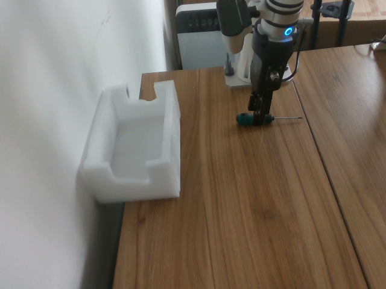

# ACT Training Log

---

## Training Objectives

The goal is to train a robotic arm with a two-finger gripper to pick up a screwdriver and place it into a white box. The setup uses two cameras: one mounted on the wrist of the robotic arm and one placed in front of the arm.


Both cameras are Intel RealSense D435 cameras:

- Name: Intel RealSense D435
- Type: RealSense
- Default stream profile:
  - Stream_type: Color
  - Format: rgb8
  - Width: 640
  - Height: 480
  - FPS: 30

The robotic arm is a [Realman RM65](https://github.com/RealManRobot/rm_models/tree/main/RM65), a six-axis robotic arm.

---

## Training Logs

### Training Log 1

#### Dataset Recording

At the beginning, the front camera used a relatively distant viewpoint, which allowed it to capture the entire robotic arm:


However, even after recording more than 150 episodes and trying different hyperparameters, the robotic arm still failed to pick up the screwdriver. A common failure case was that the gripper could not align with the screwdriver.

Therefore, I changed the front camera viewpoint so that the screwdriver and the box were closer and clearer in the image:



Then I recorded a 50-episode dataset with the white box fixed in place:

```bash
TASK_NAME=rm65_aloha_pick_screwdriver_to_fixed_box_close_front
TASK_PROMPT="pick screwdriver and put it in box"

cd /home/ubuntu/py/vla_studio/repos/lerobot
python examples/rm65/passive_record.py \
    --config-path configs/rm65_realsense.yaml \
    --repo-id local/$TASK_NAME \
    --root /home/ubuntu/py/vla_studio/runs/dataset/$TASK_NAME \
    --task "$TASK_PROMPT" \
    --fps 30 \
    --episode-time-s 30 \
    --num-episodes 50 \
    --teleop-active-io 1 \
    --record-button-io 2 \
    --record-button-mode toggle \
    --io-read-source aloha \
    --aloha-target-ip 192.168.1.100 \
    --log-path /home/ubuntu/py/vla_studio/logs/record_$TASK_NAME.log
```

#### Training script

I trained ACT with a batch size of 8, 20,000 training steps, and a chunk size of 100:

```bash
DATASET_ID=rm65_aloha_pick_screwdriver_to_fixed_box_close_front
TRAINING_ID=rm65_act_pick_screwdriver_to_fixed_box_close_front_episodes_50_steps_20000_batch_8_chunck_100

lerobot-train \
    --dataset.repo_id $DATASET_ID \
    --dataset.root /home/ubuntu/py/vla_studio/runs/dataset/$DATASET_ID \
    --policy.type act \
    --policy.device cuda \
    --policy.push_to_hub false \
    --policy.chunk_size 100 \
    --policy.n_action_steps 20 \
    --batch_size 8 \
    --steps 20000 \
    --eval_freq 0 \
    --save_freq 5000 \
    --log_freq 100 \
    --output_dir /home/ubuntu/py/vla_studio/runs/train/$TRAINING_ID \
    --wandb.enable true \
    --wandb.project rm65_lerobot \
    --job_name $TRAINING_ID \
    2>&1 | tee /home/ubuntu/py/vla_studio/logs/train_$TRAINING_ID.log
```

#### Evaluation

- Success rate: 5 / 20
- Successful trial: the robot picks up the screwdriver and places it into the box.

<video controls width="300">
  <source src="assets/act/pick_screwdriver_success_0.mp4" type="video/mp4">
</video>

- Failed trial: the robot fails to pick up the screwdriver.

<video controls width="300">
  <source src="assets/act/pick_screwdriver_fail_0.mp4" type="video/mp4">
</video>

- Experimental phenomena:

  1. The picking success rate is very low. This may indicate that the model needs more training data, better hyperparameters, or both. Most successful trials look similar to the successful video above, which suggests that the collected data may have an uneven distribution.
  2. When the gripper misses the screwdriver, the robotic arm does not react quickly. It continues moving for a while before returning and trying again. I think this may be related to ACT's temporal ensembling: previous predicted actions can still influence the actual action at time `t`. For example, the model may have predicted at time `t-10` that the screwdriver would be successfully grasped at time `t`, but in reality the grasp failed.

- Questions:

  1. In this experiment, `chunk_size=100`. At 30 FPS, this means ACT predicts more than three seconds of future actions each time. Is such a long action horizon really necessary? This is especially important when the object moves or the grasp fails, because the policy should react quickly.
  2. How many demonstrations are enough for this task?

---

### Training Log 2

#### Dataset Recording

I used the same dataset as in [Training Log 1](#training-log-1).

#### Training script

I used the same training hyperparameters as in [Training Log 1](#training-log-1), except that I set `chunk_size=20`. The purpose was to test whether ACT really needs a chunk size of 100, which corresponds to more than three seconds of future actions at 30 FPS.

#### Evaluation

- Success rate: 0 / 20
- Experimental phenomena:

  1. Regardless of the screwdriver's position or orientation, the robotic arm performs a similar movement every time it starts: the sixth axis rotates clockwise and the gripper opens.

- Thinking:

  1. `chunk_size=20` is likely too short for this task at 30 FPS. It only covers about 0.67 seconds of future actions, while picking up a screwdriver and placing it into a box is a multi-stage task: approach, align, close the gripper, lift, move to the box, and release. With such a short horizon, ACT may only learn local short-term motion instead of the full intention of the demonstration.
  2. This phenomenon suggests that the policy relies more on the dataset's average initial action pattern than on visual conditions. This can happen when the dataset is small, object variation is limited, or the visual signal is not strong enough to distinguish different screwdriver poses.
  3. Therefore, reducing `chunk_size` did not make the policy react faster. Instead, it removed useful long-horizon supervision, making the model more myopic and biased toward common short-term actions.

---

### Training Log 3

#### Dataset Recording

This time, I recorded 50 additional episodes based on the dataset from [Training Log 1](#training-log-1) to test whether the original dataset was too small. The dataset now contains 100 episodes in total. During this round of data collection, I paid more attention to balancing the distribution of the demonstrations, especially for harder screwdriver positions and orientations.

#### Training script

I trained three models on the 100-episode dataset:

1. One model used the same hyperparameters as in [Training Log 1](#training-log-1).
2. One model changed the batch size to 32.
3. One model changed the chunk size to 50.

#### Evaluation

- Success rate: 
    1. Model 1: 3 / 20
    2. Model 2: 2 / 20
    3. Model 3: 4 / 20

- Experimental phenomena:
    1. Model 1 still often fails to align the gripper with the screwdriver. In some cases, depending on the screwdriver's position and orientation, the gripper can align with the screwdriver but does not close enough. Whether the robot can pick up the screwdriver then depends on which part of the screwdriver it grasps. If it grasps the widest part, the pickup can succeed; if it grasps a narrower part, the gripper closure is insufficient and the pickup fails. In some other cases, the behavior is similar to [Training Log 2](#training-log-2): the robotic arm performs a similar initial movement every time it starts.
    2. Although Model 2 has a slightly lower success rate than Model 1, it appears better qualitatively. The repeated-start-motion phenomenon is significantly reduced. In most situations, I can see the robotic arm trying to align with the screwdriver. However, there are still many cases where the gripper fails to align accurately.
    3. Model 3 performs better than Model 1 and Model 2 in some difficult situations. However, in some easier situations where Model 1 or Model 2 can perform reasonably well, Model 3 chooses a grasp point that is too far from the screwdriver. Similar to Model 2, the repeated-start-motion phenomenon is significantly reduced compared with Model 1.
    4. Across all three models, and also in the previous training logs, the model often predicts joint angles that exceed the configured `max_relative_target` value, which was set to `5`. I wondered whether this setting was limiting the model's behavior. Therefore, I ran another experiment based on Model 2 with `max_relative_target=1000.0`, which almost completely removes this action-clipping constraint. The success rate became 4 / 20, and the behavior became similar to Model 3. This suggests that `max_relative_target` may affect rollout behavior, but the balanced distribution of the newly added 50 episodes may also be an important factor, because those episodes focused more on difficult cases.

- Thinking:
    1. Increasing the dataset from 50 to 100 episodes did not clearly improve the success rate. This suggests that the problem may not be only the number of episodes. The quality and coverage of the data distribution are likely more important. The policy still needs enough examples for each important screwdriver pose, orientation, approach direction, and grasp point.
    2. The balanced 100-episode dataset seems to reduce the repeated-start-motion failure mode. This suggests that the earlier dataset may have contained a biased initial action distribution, causing the model to learn an average initial movement instead of responding strongly to visual input.
    3. The gripper closure problem may be a separate issue from visual alignment. Even when the model aligns with the screwdriver, the predicted gripper position may not close enough for thinner parts of the screwdriver. This may require checking the gripper action labels in the dataset, verifying the gripper position range, or intentionally collecting more demonstrations that grasp thinner parts of the screwdriver.
    4. The `max_relative_target` setting appears important during rollout. If it is too small, the executed action may be clipped away from the model's intended prediction, causing slow or inaccurate movement. However, setting it too large may also be risky because it allows large joint jumps. A better next step is to log both the raw predicted action and the clipped sent action during rollout, then choose a reasonable limit based on the real action differences in successful demonstrations.
    5. A closer front camera view may help if the current image does not provide enough detail about the screwdriver and gripper alignment. However, the camera should still preserve enough context to see the box and the approach path. A useful next experiment is to compare a closer front camera view with the current wrist camera, rather than relying on only one view.
    6. The next experiments should focus on diagnosis rather than only changing ACT hyperparameters: inspect action distributions, visualize predicted versus executed actions, check gripper labels, and evaluate failures by category, such as alignment failure, insufficient gripper closure, wrong grasp point, and poor recovery after missed grasp.

---
