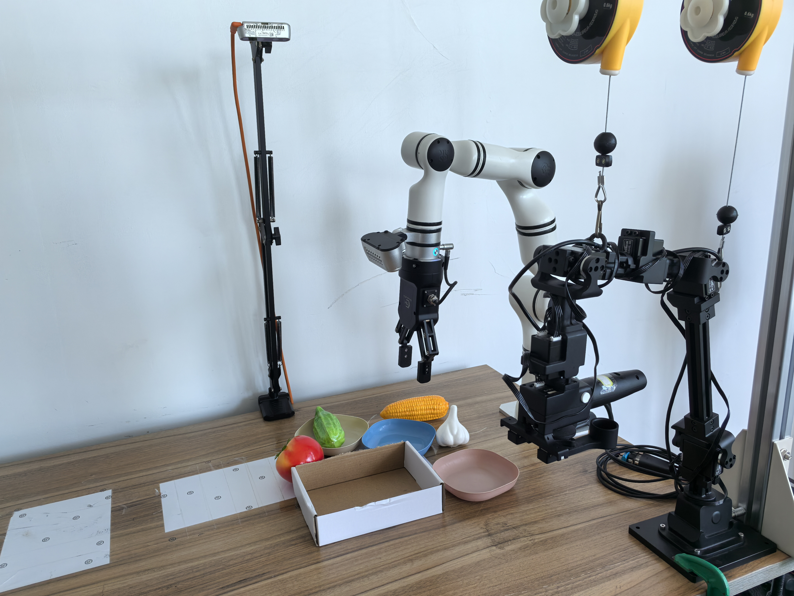
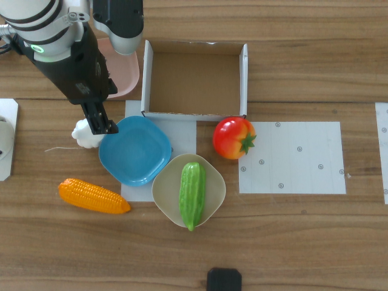
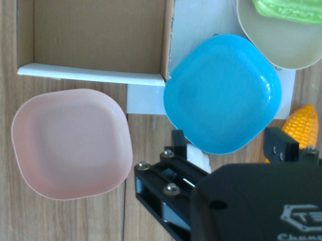

# Pi0 or Pi0-FAST Training Log

- [Pi0 paper](https://arxiv.org/abs/2410.24164)
- [Pi0-FAST paper](https://arxiv.org/abs/2501.09747)

*Last updated: July 15, 2026*

---

## Model Assets

Before training, download the base PI0 policy and the paligemma model used by the policy:

```bash
./scripts/model_download.sh lerobot/pi0_base
./scripts/model_download.sh google/paligemma-3b-pt-224
```

The local paths used in the training command are:

- SmolVLA base policy: `${STORAGE_ROOT}/models/pi0_base`
- SmolVLM model: `${STORAGE_ROOT}/models/paligemma-3b-pt-224`

---

## Training Objective 1: Single-Arm Table Preparation and Bussing

This experiment evaluates whether PI0 can use language instructions to prepare and clear a table containing small colored plates and vegetable models. Each plate can hold only one vegetable. The policy must identify the requested vegetable or plate, execute grasp-and-place actions, and leave unrelated objects untouched. All objects are placed within the reachable workspace of a single RM65 arm.

### Task Design

The complete object set contains 12 vegetable models and five plate colors, but recording every combination would make the first experiment unnecessarily large. This experiment therefore uses four visually distinct vegetables and three plate colors:

- **Vegetables:** tomato, garlic, corn, and cucumber
- **Plate colors:** pink, yellow, and blue

These vegetables differ clearly in shape, color, and texture: the tomato is red and round, the garlic is white and bulb-shaped, the corn is yellow and textured, and the cucumber is green and elongated. The selected plate colors are also reasonably distinct. Every plate can hold at most one vegetable. The remaining objects can be introduced in a later dataset after this smaller task set works reliably.

Experimental environment setup:

- Use one [Realman RM65 Robotic Arm](https://github.com/RealManRobot/rm_models/tree/main/RM65) and two Intel RealSense D435 cameras:

    - Name: Intel RealSense D435
    - Type: RealSense
    - Default stream profile:
        - Stream_type: Color
        - Format: rgb8
        - Width: 640
        - Height: 480
        - FPS: 30

- Experimental scene:

    

- camera view:

    <table>
    <tr>
        <td align="center">
        <br>
        <b>Top Camera</b><br>
        <sub>Looking down at the workspace</sub>
        </td>
        <td align="center">
        <br>
        <b>Wrist Camera</b><br>
        <sub>Mounted on the robotic arm end effector</sub>
        </td>
    </tr>
    </table>

The dataset contains four related tasks:

1. **Place one vegetable:** Select a named vegetable and place it on a named plate while leaving the distractors unchanged. This tests vegetable identity, plate-color grounding, and grasp accuracy.
2. **Arrange two vegetables:** Place two different vegetables on two different plates in the order given by the instruction. This introduces sequencing while preserving the one-vegetable-per-plate constraint.
3. **Clear a specified plate:** Move the vegetable from the named plate into the collection box while leaving vegetables on the other plates unchanged. This tests plate-color grounding and selective action.
4. **Bus the table:** Put every vegetable into the collection box while leaving the plates in place. The number of vegetables varies, so the policy must repeat the grasp-and-place behavior and recognize when the task is complete.

Plate colors should be moved among different physical positions so that the policy learns their visual appearance rather than associating each color with a fixed location. The requested vegetable should also appear with at least one distractor whenever the task permits it.

---

### Training Log 1 of Objective 1

#### Dataset Recording

Use the prompt templates exactly as written. Save only successful demonstrations, begin each episode from the same observation pose, and include a short pause after stable grasps, placements, and the completed final state. Keep the cameras, lighting, and collection-box appearance unchanged while varying object layouts within safe reachable regions.

| Task | Prompt template | Episode allocation | Episodes | Total frames |
|---|---|---|---:|---:|
| Place one vegetable | `Place the {vegetable} on the {plate_color} plate.` | Record every combination of 4 vegetables and 3 plate colors four times: `4 x 3 x 4 = 48`. Show all three plates, keep the requested plate empty, and add one to three distractor vegetables. Use a different reachable object and plate layout for each repetition. | 48 | 16,212 |
| Arrange two vegetables | `Place the {vegetable_1} on the {plate_color_1} plate, then place the {vegetable_2} on the {plate_color_2} plate.` | Record one demonstration for every combination in which tomato or corn is placed first: 2 first-vegetable choices x 3 second-vegetable choices x 6 ordered plate pairs = 36. Keep both requested plates empty and vary which requested vegetable starts closer to the arm. Reserve all 36 combinations with garlic or cucumber first for sequence-generalization evaluation. | 36 | 20,196 |
| Clear a specified plate | `Put the vegetable from the {plate_color} plate into the collection box.` | Use the same two predetermined collection-box locations used by the bussing task. At each box location, record 12 episodes for each of the 3 requested plate colors: `2 x 3 x 12 = 72`. Include at least one occupied non-target plate and leave every non-target vegetable unchanged. Vary the plate positions, vegetable identities, and layouts across episodes. | 72 | 22,149 |
| Bus the table | `Put all vegetables into the collection box.` | Use the same two predetermined collection-box locations as the selective-clearing task. At each box location, record 12 episodes with 2 vegetables and 12 episodes with 3 vegetables: `2 x 2 x 12 = 48`. Vary which vegetables begin on plates or directly on the table. Exclude all 4-vegetable demonstrations from training and use them only to evaluate object-count generalization. | 48 | 34,642 |
| **Total** | **52 language prompts** |  | **204** | **93,199** |

#### Training Configuration

The absolute joint-angle dataset was copied to a PI0-specific dataset whose action statistics were recomputed in relative space. During training, the six joint targets are represented as offsets from the current joint state, while `gripper.pos` remains absolute. The stored trajectories themselves remain unchanged.

| Category | Parameter | Value | Description |
|---|---|---|---|
| Dataset | Repository ID | `rm65_single_table_preparation_and_bussing_pi` | PI0-specific copy containing relative-action normalization statistics. |
| Dataset | Size | 204 episodes, 93,199 frames, 52 prompts | Includes all four training tasks recorded at 30 FPS. |
| Dataset | Camera inputs | `wrist`, `top` | Both RGB streams are loaded as `uint8` images and processed by PI0. |
| Model | Base policy | `${STORAGE_ROOT}/models/pi0_base` | Fine-tunes the pretrained LeRobot PI0 checkpoint. |
| Model | Language tokenizer | `${STORAGE_ROOT}/models/paligemma-3b-pt-224` | Local PaliGemma tokenizer path configured in `policy_preprocessor.json`. |
| Model | Input and output features | Inferred from dataset | Two camera observations, a 7-dimensional robot state, and a 7-dimensional action are mapped to PI0's padded dimensions. |
| Action | Action representation | Relative joint angles | For joints 1-6, `relative_action = target_angle - current_angle`. |
| Action | Excluded relative dimension | `gripper` | `gripper.pos` remains an absolute target. |
| Action | Chunk size | 50 | Predicts approximately 1.67 seconds of actions at the dataset's 30 FPS. The relative-action statistics use the same chunk size. |
| Action | Action steps | 1 | Configures rollout queue behavior; it does not change the action-chunk training target. |
| Inference | Flow-matching steps | 10 | Used during rollout rather than training-loss computation. |
| Precision | Policy dtype | `bfloat16` | Reduces GPU memory use while retaining a wide numeric range. |
| Precision | Accelerate mixed precision | `bf16` | Matches the policy dtype. |
| Fine-tuning | Train expert only | `true` | Freezes PaliGemma and trains the action expert and action/state projections. |
| Fine-tuning | Freeze vision encoder | `true` | Explicit but redundant because `train_expert_only=true` already freezes the complete PaliGemma model. |
| Memory | Gradient checkpointing | `true` | Reduces activation memory at the cost of additional computation. |
| Hardware | GPU configuration | One GPU: device `0` | `NUM_GPUS=1` and `GPU_IDS=0`. |
| Optimization | Per-device/global batch size | 2 / 2 | No gradient accumulation is used. |
| Optimization | Training steps | 80,000 | Processes 160,000 sampled frames, approximately 1.7 passes over the 93,199-frame dataset. |
| Optimization | Optimizer | AdamW | Uses the PI0 policy training preset. |
| Optimization | Learning rate | `2.5e-5` | Default PI0 peak learning rate. |
| Optimization | AdamW parameters | betas `(0.9, 0.95)`, epsilon `1e-8`, weight decay `0.01` | Inherited from the PI0 policy preset. |
| Optimization | Gradient clipping | `1.0` | Maximum gradient norm from the PI0 policy preset. |
| Scheduler | Schedule | Cosine decay with warmup | Uses 1,000 warmup steps and decays across all 80,000 training steps. |
| Scheduler | Final learning rate | `2.5e-6` | PI0 scheduler decay target. |
| Logging | Log frequency | Every 100 steps | Reports training metrics to the terminal, log file, and Weights & Biases. |
| Checkpoints | Save frequency | Every 20,000 steps | Saves checkpoints at 20k, 40k, 60k, and 80k steps. |
| Evaluation | Training-time evaluation | Disabled | `eval_freq=0`; checkpoints are evaluated on the real robot after training. |
| Tracking | Weights & Biases | Enabled, project `lerobot_pi0_rm65` | Records the training loss, learning rate, gradient norm, throughput, and GPU memory. |
| Reproducibility | Random seed | 1000 | Uses LeRobot's default training seed because no override is supplied. |
| Output | Hub upload | Disabled | Checkpoints and logs are stored locally under `${STORAGE_ROOT}`. |
