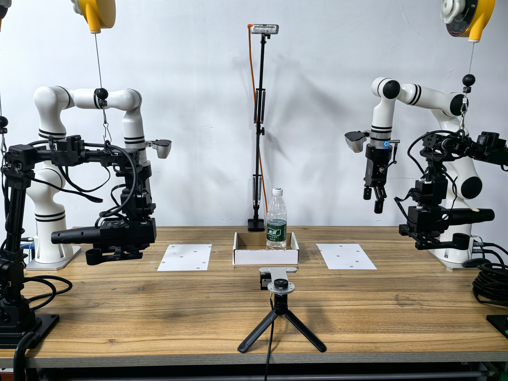
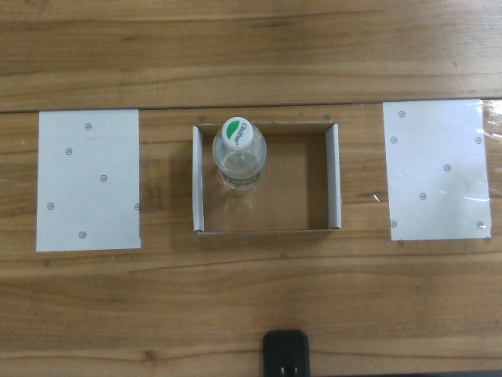
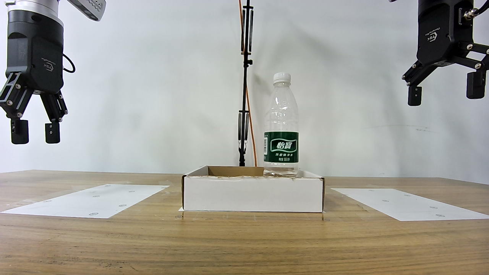
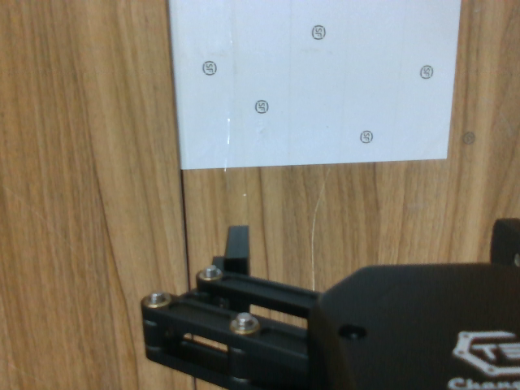
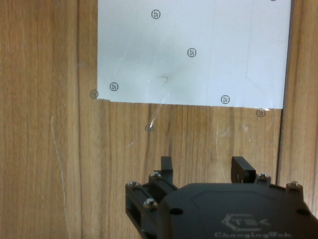

# [SmolVLA](http://arxiv.org/abs/2506.01844) Training Log

*Last updated: July 7, 2026*

---

## Model Assets

Before training, download the base SmolVLA policy and the SmolVLM model used by the policy:

```bash
./scripts/hf_download.sh lerobot/smolvla_base
./scripts/hf_download.sh HuggingFaceTB/SmolVLM2-500M-Video-Instruct
```

The local paths used in the training command are:

- SmolVLA base policy: `${STORAGE_ROOT}/models/smolvla_base`
- SmolVLM model: `${STORAGE_ROOT}/models/SmolVLM2-500M-Video-Instruct`

---

## Training Objective 1: RM65 Bimanual Bottle Multitask

The goal is to fine-tune one SmolVLA policy to control two RM65 robotic arms in the same workspace and select different behaviors from the language prompt. Unlike the previous single-task ACT experiments, this objective is designed as a prompt-conditioned multi-task setting. The policy should learn to identify the bottle, understand the requested source and target locations, and choose whether to use a single-arm pick-place motion or a bimanual handover.

The workspace contains a mineral water bottle, a top-open box, and three fixed placement regions:

- Left region
- Center region
- Right region

The bottle starts either on the left or right side. The box is fixed at one of the target regions depending on the task. For the first version, the center region is used as a direct placement target, while cross-side placement uses a handover between the two arms.



The bimanual hardware setup is the same as [ACT Training Objective 2](./act.md#training-objective-2-bimanual-assembly-part-grasping):

- Left arm: `192.168.1.18:8080`
- Right arm: `192.168.1.19:8080`

The LeRobot action and observation keys are prefixed by arm side:

- Left arm: `left_joint_1.pos` to `left_joint_6.pos`, plus `left_gripper.pos`
- Right arm: `right_joint_1.pos` to `right_joint_6.pos`, plus `right_gripper.pos`

The setup uses four cameras. The two wrist cameras observe each gripper and local grasp area, while the top and front cameras provide global workspace context:

<table>
  <tr>
    <td align="center">
      <br>
      <b>Top Camera</b><br>
      <sub>Looking down at the workspace</sub>
    </td>
    <td align="center">
      <br>
      <b>Front Camera</b><br>
      <sub>Facing the robot/task from the front</sub>
    </td>
  </tr>
  <tr>
    <td align="center">
      <br>
      <b>Right Wrist Camera</b><br>
      <sub>Mounted on the right arm end effector</sub>
    </td>
    <td align="center">
      <br>
      <b>Left Wrist Camera</b><br>
      <sub>Mounted on the left arm end effector</sub>
    </td>
  </tr>
</table>

Camera configuration:

| Camera key | Type | Resolution | FPS | Role |
| :--- | :--- | :--- | ---: | :--- |
| `left_wrist` | Intel RealSense | 640 x 480 | 30 | Mounted on the left arm end effector. |
| `right_wrist` | Intel RealSense | 640 x 480 | 30 | Mounted on the right arm end effector. |
| `front` | OpenCV camera | 640 x 480 | 30 | External front view of the task. |
| `top` | Intel RealSense | 640 x 480 | 30 | Overhead workspace view. |

The corresponding robot configuration is:

```text
configs/rm65_left_right_wrist_front_top.yaml
```

### Task Design

The first SmolVLA multi-task dataset contains four bottle manipulation tasks:

| Task name | Prompt | Main skill |
| :--- | :--- | :--- |
| `bottle_left_to_center_box` | `place the bottle from the left side into the center box` | Left-arm pick-place. |
| `bottle_right_to_center_box` | `place the bottle from the right side into the center box` | Right-arm pick-place. |
| `bottle_left_to_right_box_handover` | `transfer the bottle from the left side to the right arm and place it in the right box` | Left-to-right bimanual handover and placement. |
| `bottle_right_to_left_box_handover` | `transfer the bottle from the right side to the left arm and place it in the left box` | Right-to-left bimanual handover and placement. |

For the handover tasks, the transfer should happen near the center of the workspace. Demonstrations should keep the handover pose consistent:

- The first arm grasps the bottle and moves it to the center handover area.
- The second arm closes on the bottle only after the first arm has paused.
- The first arm releases only after the second arm has a stable grasp.
- The second arm then places the bottle into the target box.

This structure gives the prompt a meaningful role. The same objects and cameras are used across all tasks, but the requested source side, target side, and required coordination pattern differ.

### Dataset Recording

The four tasks can be recorded as separate datasets and combined before training:

| Task name | Record FPS | Total episodes | Total frames |
| :---: | :---: | :---: | :---: |
| `bottle_left_to_center_box` | 30 | 30 | 8818 |
| `bottle_right_to_center_box` | 30 | 30 | 8688 |
| `bottle_left_to_right_box_handover` | 30 | 50 | 34694 |
| `bottle_right_to_left_box_handover` | 30 | 50 | 34641 |

The first useful multi-task dataset should contain about 160-200 episodes. A stronger first training run should use about 250-300 episodes. Handover tasks need more demonstrations because they require two-arm timing, stable transfer, and correct release order.

Each task should use one fixed prompt during the first round of training. Prompt paraphrases can be added later after the basic behaviors are reliable.

The final combined dataset is named:

```text
rm65_bimanual_bottle_multitask
```

### Training Log 1 of Objective 1

#### Training Configuration

I trained SmolVLA on two GPUs with one process per GPU. The per-device batch size was 32, giving a global batch size of 64. Training used 40,000 steps and `policy.chunk_size=50`.

Dataset: `rm65_bimanual_bottle_multitask`

Base policy: `models/smolvla_base`

Output policy: `smolvla_rm65_bimanual_bottle_multitask_episodes_160_steps_40000_batch_32x2_chunk_50`

| Parameter | Configured value | Default value |
|---|---:|---:|
| `dataset.return_uint8` | `true` | `false` |
| `dataset.video_backend` | `pyav` | `torchcodec` |
| `policy.vlm_model_name` | `models/SmolVLM2-500M-Video-Instruct` | `HuggingFaceTB/SmolVLM2-500M-Video-Instruct` |
| `policy.input_features` | `null` (infer from dataset) | Pretrained feature schema |
| `policy.output_features` | `null` (infer from dataset) | Pretrained feature schema |
| `policy.push_to_hub` | `false` | `true` |
| `policy.n_action_steps` | `1` | `50` |
| `policy.scheduler_decay_steps` | `40,000` | `30,000` |
| `batch_size` | `32` per process | `8` per process |
| `steps` | `40,000` | `100,000` |
| `eval_freq` | `0` (disabled) | `20,000` |
| `save_freq` | `10,000` | `20,000` |
| `log_freq` | `500` | `200` |
| `wandb.enable` | `true` | `false` |
| `wandb.project` | `lerobot_smolvla_rm65` | `lerobot` |

> **Note:** `policy.chunk_size=50`, `policy.num_steps=10`, `policy.freeze_vision_encoder=true`, `policy.train_expert_only=true`, `policy.train_state_proj=true`, and `policy.load_vlm_weights=true` use the loaded `smolvla_base` values. All other unlisted parameters also use their default values.

---
