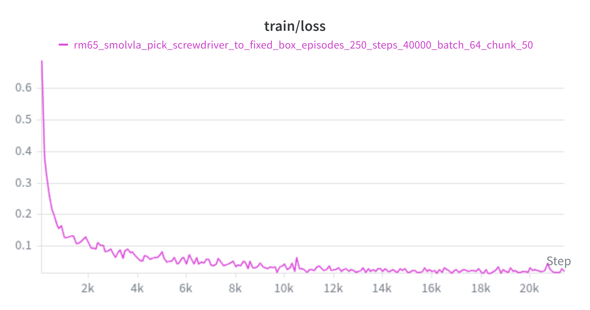
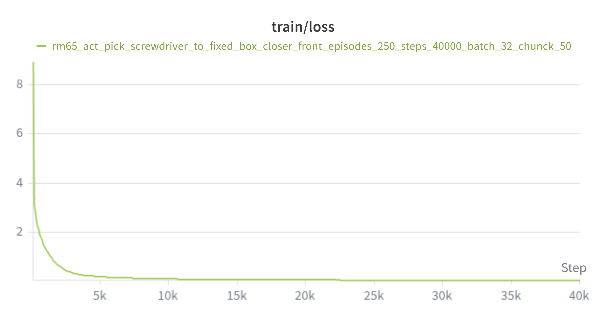

# [SmolVLA](http://arxiv.org/abs/2506.01844) Training Log

*Last updated: July 5, 2026*

---

## Model Assets

Before training, download the base SmolVLA policy and the SmolVLM model used by the policy:

```bash
./scripts/model_download.sh lerobot/smolvla_base
./scripts/model_download.sh HuggingFaceTB/SmolVLM2-500M-Video-Instruct
```

The local paths used in the training command are:

- SmolVLA base policy: `./models/smolvla_base`
- SmolVLM model: `./models/SmolVLM2-500M-Video-Instruct`

---

## Training Objective 1: RM65 Screwdriver-to-Box Task

The first SmolVLA experiment uses the same task as the ACT experiments in [ACT Training Objective](./act.md#training-objectives): train the RM65 robotic arm with a two-finger gripper to grasp a screwdriver and place it into a white box.

The scene setup uses two cameras:

- Wrist camera: mounted on the robotic arm.
- Front camera: placed in front of the robot, with a closer viewpoint for the screwdriver and box.


Both cameras are Intel RealSense D435 cameras:

- Name: Intel RealSense D435
- Type: RealSense
- Default stream profile:
  - Stream type: Color
  - Format: `rgb8`
  - Width: 640
  - Height: 480
  - FPS: 30

The robotic arm is a [Realman RM65](https://github.com/RealManRobot/rm_models/tree/main/RM65), a six-axis robotic arm.

The purpose of this experiment is to test whether SmolVLA can improve the RM65 grasping task compared with the ACT baselines, while keeping the same dataset and action interface. Unlike ACT, SmolVLA uses a vision-language-action model with a flow-matching action head, so this experiment is treated as fine-tuning from `lerobot/smolvla_base` rather than training a policy from scratch.

---

## Training Logs of Objective 1

### Training Log 1

#### Dataset

This run reuses the dataset from [ACT Training Log 6](./act.md#training-log-6). That dataset was recorded with the closer front-camera viewpoint and contains the strongest ACT baseline setup so far.

Dataset ID:

```text
rm65_aloha_pick_screwdriver_to_fixed_box_closer_front
```

#### Training Plan

The initial SmolVLA run keeps the ACT Log 6 action horizon choice:

- `chunk_size=50`
- `n_action_steps=50`
- `batch_size=64`
- `steps=20000`

The policy starts from `./models/smolvla_base`, and the VLM backbone is loaded from `./models/SmolVLM2-500M-Video-Instruct`.

#### Training Script

```bash
export HF_HOME=./.cache/huggingface
export HF_LEROBOT_HOME=./.cache/lerobot
export HF_ENDPOINT=https://hf-mirror.com

DATASET_ID=rm65_aloha_pick_screwdriver_to_fixed_box_closer_front
TRAINING_ID=rm65_smolvla_pick_screwdriver_to_fixed_box_episodes_250_steps_20000_batch_64_chunk_50

lerobot-train \
    --dataset.repo_id=$DATASET_ID \
    --dataset.root=./runs/dataset/$DATASET_ID \
    --dataset.return_uint8=true \
    --policy.path=./models/smolvla_base \
    --policy.vlm_model_name=models/SmolVLM2-500M-Video-Instruct \
    --policy.input_features=null \
    --policy.output_features=null \
    --policy.device=cuda \
    --policy.push_to_hub=false \
    --policy.chunk_size=50 \
    --policy.n_action_steps=50 \
    --batch_size=64 \
    --steps=20000 \
    --eval_freq=0 \
    --save_freq=5000 \
    --log_freq=100 \
    --wandb.enable=true \
    --wandb.project=lerobot_rm65_smolvla \
    --output_dir=./runs/train/$TRAINING_ID \
    --job_name=$TRAINING_ID \
    2>&1 | tee ./logs/train_$TRAINING_ID.log
```

#### Evaluation

For the first rollout test, I enabled `canfd_follow` and set both `n_action_steps` and `fps` to 10:

```bash
PRETRAINED_ID=rm65_smolvla_pick_screwdriver_to_fixed_box_episodes_250_steps_20000_batch_64_chunk_50

lerobot-rollout \
    --config_path=configs/rm65_wrist_front.yaml \
    --strategy.type=base \
    --inference.type=sync \
    --robot.canfd_follow=true \
    --robot.max_relative_target=1000.0 \
    --policy.path=./runs/train/$PRETRAINED_ID/checkpoints/last/pretrained_model \
    --policy.n_action_steps=10 \
    --device=cuda \
    --fps=10 \
    --duration=20 \
    --task="pick screwdriver and put it in box" \
    --return_to_initial_position=false \
    2>&1 | tee ./logs/rollout_$PRETRAINED_ID.log
```

- Success rate: 0 / 5

- Failure statistics:

  | Failure situation | Times | Notes |
  | :--- | ---: | :--- |
  | Gripper fails to align with the screwdriver | 5 | The grasp point is far from the screwdriver, or the gripper approaches with an incorrect rotation angle. |

- Thinking:

  1. With `canfd_follow` enabled, the robotic arm showed obvious lag. The actual running frequency was only about 5 Hz, so control commands could not be sent continuously enough for smooth motion. This likely made the rollout behavior worse, especially during the approach and alignment phase.

     Rollout video:

     <video controls width="300">
       <source src="assets/smolvla/grasp_0.mp4" type="video/mp4">
     </video>

     Since all five tests failed at the alignment stage, I stopped the evaluation early instead of continuing with more trials.

  2. With `canfd_follow` disabled, the robotic arm moved more smoothly, but the task performance did not improve. The policy still failed to align the gripper with the screwdriver and often predicted an incorrect gripper orientation. This suggests that the main issue is not only the robot control mode, but also the quality of the learned policy.

  3. I also applied ACT temporal ensembling to SmolVLA, but it did not improve the result. This suggests that the failure is not mainly caused by noisy single-step actions. Temporal ensembling can smooth actions, but it cannot fix a policy that predicts the wrong grasp pose.

  4. The most likely reason for the poor performance is that the SmolVLA fine-tuning did not converge well. The loss curve is still unstable:

     

     Compared with the [ACT Training Log 6](./act.md#training-log-6) loss curve, the SmolVLA loss is much less stable:

     

  5.  The rollout setting may also be too hard for this first SmolVLA test. The policy was trained with `chunk_size=50` and `n_action_steps=50`, but the rollout overrides `n_action_steps=10`. So I also evaluate `n_action_steps=50`, but aside from faster movement speed, other performance aspects did not improve. 

  6. Another possible reason is that this dataset is still small for SmolVLA fine-tuning. ACT can sometimes work reasonably well from scratch on a narrow task, but SmolVLA has a much larger vision-language-action model and may need more training steps, a smaller learning rate, or more task-specific demonstrations to adapt reliably to the RM65 camera/action distribution.

### Training Log 2

Considering unconverged training of smolvla, I resume training of [log 1](#training-log-1) to train more 20,000 steps:

```bash
export HF_HOME=./.cache/huggingface
export HF_LEROBOT_HOME=./.cache/lerobot
export HF_ENDPOINT=https://hf-mirror.com

DATASET_ID=rm65_aloha_pick_screwdriver_to_fixed_box_closer_front
TRAINING_ID=rm65_smolvla_pick_screwdriver_to_fixed_box_episodes_250_steps_20000_batch_64_chunk_50

lerobot-train \
    --dataset.repo_id=$DATASET_ID \
    --dataset.root=./runs/dataset/$DATASET_ID \
    --dataset.return_uint8=true \
    --policy.path=./models/smolvla_base \
    --policy.vlm_model_name=models/SmolVLM2-500M-Video-Instruct \
    --policy.input_features=null \
    --policy.output_features=null \
    --policy.device=cuda \
    --policy.push_to_hub=false \
    --policy.chunk_size=50 \
    --policy.n_action_steps=50 \
    --batch_size=64 \
    --steps=20000 \
    --eval_freq=0 \
    --save_freq=5000 \
    --log_freq=100 \
    --wandb.enable=true \
    --wandb.project=lerobot_rm65_smolvla \
    --output_dir=./runs/train/$TRAINING_ID \
    --job_name=$TRAINING_ID \
    2>&1 | tee ./logs/train_$TRAINING_ID.log
```
