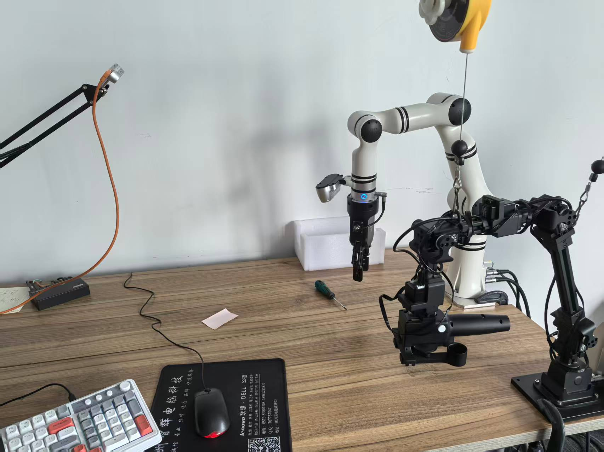

# [SmolVLA](http://arxiv.org/abs/2506.01844) Training Log

*Last updated: July 5, 2026*

---

## Training Objective 1

First training objective is same as [ACT](./act.md).

The goal is to train a robotic arm with a two-finger gripper to grasp a screwdriver and place it into a white box. The setup uses two cameras: one mounted on the wrist of the robotic arm and one placed in front of the arm. 



Both cameras are Intel RealSense D435 cameras:

- Name: Intel RealSense D435
- Type: RealSense
- Default stream profile:
  - Stream_type: Color
  - Format: rgb8
  - Width: 640
  - Height: 480
  - FPS: 30

The robotic arm is a [Realman RM65](https://github.com/RealManRobot/rm_models/tree/main/RM65), a six-axis robotic arm.

---

### Training Logs

#### Training Log 1

##### Dataset Recording

Use [ACT log 6](./act.md#training-log-6) recording dataset.

##### Training script

```bash
export HF_HOME=./.cache/huggingface
export HF_LEROBOT_HOME=./.cache/lerobot
export HF_ENDPOINT=https://hf-mirror.com

DATASET_ID=rm65_aloha_pick_screwdriver_to_fixed_box_closer_front
TRAINING_ID=rm65_smolvla_pick_screwdriver_to_fixed_box_episodes_250_steps_20000_batch_64_chunk_50

lerobot-train \
    --dataset.repo_id=$DATASET_ID \
    --dataset.root=./runs/dataset/$DATASET_ID \
    --dataset.return_uint8=true \
    --policy.path=./models/smolvla_base \
    --policy.vlm_model_name=models/SmolVLM2-500M-Video-Instruct \
    --policy.input_features=null \
    --policy.output_features=null \
    --policy.device=cuda \
    --policy.push_to_hub=false \
    --policy.chunk_size=50 \
    --policy.n_action_steps=50 \
    --batch_size=64 \
    --steps=20000 \
    --eval_freq=0 \
    --save_freq=5000 \
    --log_freq=100 \
    --wandb.enable=true \
    --wandb.project=lerobot_rm65_smolvla \
    --output_dir=./runs/train/$TRAINING_ID \
    --job_name=$TRAINING_ID \
    2>&1 | tee ./logs/train_$TRAINING_ID.log
```

##### Evaluation