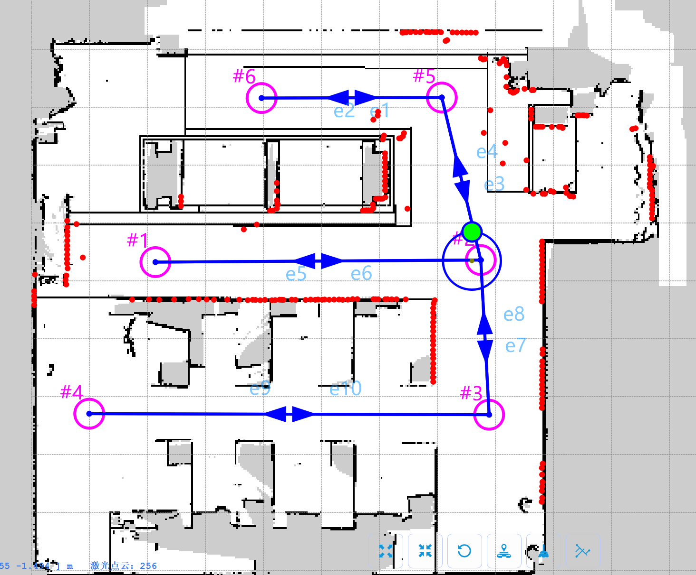

# PLNS Python (暨科创平台底盘) SDK Client API 中文文档

本文档说明 `chassis_sdk/client.py` 中实现的公开 `PLNSClient` API。

本 SDK 基于 PLNS 协议文档编写：`asset/科创平台_灵童L1_资料_v0502/PLNS网络通信协议V2.1.pdf`。所有 PLNS 协议接口含义都可以在该文档中查阅。所有协议消息、枚举、请求、响应、命令和通知的实际定义可以在 `chassis_sdk/proto/main.proto` 中查阅。

本文档采用 SDK 参考文档风格：每个方法包含方法原型、功能说明、对应的 PLNS 协议接口、参数说明、返回值和使用示例。

`chassis_sdk/client.py` 中受固件限制或尚未验证的方法，本文档不作为正式 API 说明。这些方法是为了协议完整性保留的，但当前固件可能未实现或未验证。

## 目录

- [基础导入](#基础导入)
- [连接与会话](#连接与会话)
  - [初始化客户端 `__init__()`](#初始化客户端-__init__)
  - [连接 `connect()`](#连接-connect)
  - [关闭 `close()`](#关闭-close)
  - [异步上下文进入 `__aenter__()`](#异步上下文进入-__aenter__)
  - [异步上下文退出 `__aexit__()`](#异步上下文退出-__aexit__)
  - [登录 `login()`](#登录-login)
  - [登出 `logout()`](#登出-logout)
- [通用协议接口](#通用协议接口)
  - [通用请求 `request()`](#通用请求-request)
  - [通用命令 `command()`](#通用命令-command)
- [状态查询接口](#状态查询接口)
  - [获取车辆信息 `get_info()`](#获取车辆信息-get_info)
  - [获取系统状态 `get_system_state()`](#获取系统状态-get_system_state)
  - [获取硬件状态 `get_hardware_state()`](#获取硬件状态-get_hardware_state)
  - [获取地图列表 `get_map_list()`](#获取地图列表-get_map_list)
  - [获取雷达点云 `get_laser_points()`](#获取雷达点云-get_laser_points)
  - [订阅状态 `subscribe_state()`](#订阅状态-subscribe_state)
- [手动控制接口](#手动控制接口)
  - [开启手动模式 `enable_manual()`](#开启手动模式-enable_manual)
  - [退出手动模式 `disable_manual()`](#退出手动模式-disable_manual)
  - [准备手动控制 `prepare_manual_control()`](#准备手动控制-prepare_manual_control)
  - [设置手动速度 `set_manual_velocity()`](#设置手动速度-set_manual_velocity)
  - [持续发送手动速度 `start_manual_velocity()`](#持续发送手动速度-start_manual_velocity)
  - [停止手动速度 `stop_manual_velocity()`](#停止手动速度-stop_manual_velocity)
- [避障与速度接口](#避障与速度接口)
  - [开启避障 `enable_obstacle_avoid()`](#开启避障-enable_obstacle_avoid)
  - [关闭避障 `disable_obstacle_avoid()`](#关闭避障-disable_obstacle_avoid)
  - [设置速度等级 `set_speed_level()`](#设置速度等级-set_speed_level)
- [定位与建图接口](#定位与建图接口)
  - [启动定位 `start_localization()`](#启动定位-start_localization)
  - [停止定位 `stop_localization()`](#停止定位-stop_localization)
  - [设置定位模式 `set_location_mode()`](#设置定位模式-set_location_mode)
  - [设置初始位姿 `set_initial_pose()`](#设置初始位姿-set_initial_pose)
  - [准备建图 `prepare_mapping()`](#准备建图-prepare_mapping)
  - [启动建图 `start_mapping()`](#启动建图-start_mapping)
  - [停止并保存建图 `stop_mapping()`](#停止并保存建图-stop_mapping)
  - [取消建图 `cancel_mapping()`](#取消建图-cancel_mapping)
  - [获取当前地图 `get_current_map()`](#获取当前地图-get_current_map)
  - [获取建图数据 `get_mapping_data()`](#获取建图数据-get_mapping_data)
  - [获取建图轨迹 `get_mapping_track()`](#获取建图轨迹-get_mapping_track)
  - [同步地图文件 `sync_maps()`](#同步地图文件-sync_maps)
  - [加载本地地图 `load_local_map()`](#加载本地地图-load_local_map)
  - [同步时间 `sync_time()`](#同步时间-sync_time)
- [移动任务接口](#移动任务接口)
  - [暂停移动 `pause_movement()`](#暂停移动-pause_movement)
  - [继续移动 `continue_movement()`](#继续移动-continue_movement)
  - [取消移动任务 `cancel_movement_task()`](#取消移动任务-cancel_movement_task)
  - [准备导航 `prepare_navigation()`](#准备导航-prepare_navigation)
  - [导航到站点 `go_station()`](#导航到站点-go_station)
  - [导航到位姿 `go_pose()`](#导航到位姿-go_pose)
- [设备命令接口](#设备命令接口)
  - [设置扬声器音量 `set_speaker_volume()`](#设置扬声器音量-set_speaker_volume)
  - [触发急停 `trigger_emergency()`](#触发急停-trigger_emergency)
  - [解除急停 `cancel_emergency()`](#解除急停-cancel_emergency)
  - [重启 PLNS `reboot_plns()`](#重启-plns-reboot_plns)

## 基础导入

```python
import asyncio

from chassis_sdk import PLNSClient, PLNSConfig
from chassis_sdk.models import Pose2D
```

## 连接与会话

### 初始化客户端 `__init__()`

#### 方法原型

```python
PLNSClient(
    config: PLNSConfig | None = None,
    *,
    pb2_path: str | Path | None = None,
    raw_log_path: str | Path | None = None,
) -> None
```

#### 功能说明

创建一个异步 PLNS 客户端。该方法只创建 SDK 本地对象和运行状态，不会连接底盘。

对应 PLNS 协议接口：无。

初始化的部件包括：

- TCP 配置：保存底盘 IP、Cmd 端口、登录账号、心跳周期、帧大小限制、建图 File 通道心跳和超时设置。
- Protobuf 模块：提供由 PLNS 协议生成的消息、枚举、请求、响应、命令和通知类，用于编码和解码协议消息。
- 消息工厂：根据 Python 方法参数构造常用的 PLNS 请求和命令 protobuf 消息。
- Cmd 通道 transport：实现 PLNS 协议文档 `1. 通信机制` 中描述的 Cmd 通道 TCP 通信机制，用于登录、状态请求、命令、移动任务和普通响应。
- File 通道 transport：管理 `config.port + 1` 的第二条 TCP 通道，用于 File 通道登录、建图数据、建图轨迹和 File 通道心跳。File 通道必须在 Cmd 通道登录成功后使用 Cmd session ID 登录。建图时 File 通道心跳周期为 1 秒。File 通道普通帧和 Cmd 通道一样使用长度前缀 protobuf 帧，但建图点云帧使用特殊格式：`AA 55 BB 66` 魔数、4 字节大端 protobuf body size、protobuf 消息体。该 File 通道建图行为由厂商工程师提供，当前 PLNS 协议 PDF 中未描述。
- 会话状态：记录 Cmd 登录状态、File 通道登录状态、session ID 和是否正在建图。
- 缓存状态字段：保存最近一次系统状态、硬件状态、车辆信息、任务状态、建图点云和建图轨迹。
- 通知队列：缓存异步 PLNS 通知，例如移动任务完成通知。
- 建图数据队列：缓存 File 通道建图点云和建图轨迹更新，应用可以在不阻塞接收循环的情况下消费实时建图数据。
- 后台任务句柄：跟踪 Cmd/File 接收循环、Cmd/File 心跳循环和持续手动速度发送任务，便于关闭客户端时清理。

#### 参数说明

| 参数 | 类型 | 说明 |
| --- | --- | --- |
| `config` | `PLNSConfig \| None` | PLNS 连接、登录、心跳、帧大小、建图 File 心跳和超时配置。省略时使用 `PLNSConfig.from_env()`。通常用户不需要修改默认配置。 |
| `pb2_path` | `str \| Path \| None` | 可选的 protobuf Python 模块路径。省略时使用内置模块 `chassis_sdk/proto/PlnsProto_pb2.py`。该文件由 `chassis_sdk/proto/main.proto` 生成，也可以使用 `examples/generate_plns_proto.py` 重新生成。 |
| `raw_log_path` | `str \| Path \| None` | 可选 `.bin` 文件路径，用于记录 Cmd 和 File 两个通道发送、接收的原始 PLNS 帧。该文件包含帧头和序列化 protobuf 消息体，可用于协议调试和回放分析。 |

#### 返回值

| 类型 | 说明 |
| --- | --- |
| `None` | 构造函数本身返回初始化后的客户端实例。 |

#### 使用示例

```python
import asyncio

from chassis_sdk import PLNSClient, PLNSConfig


async def main():
    config = PLNSConfig.from_env()
    raw_log_path = "logs/example_client_frames.bin"
    client = PLNSClient(config, raw_log_path=raw_log_path)
    try:
        print(f"Client target: {client.config.host}:{client.config.port}")
        print(f"Raw frame log: {raw_log_path}")
    finally:
        await client.close()


if __name__ == "__main__":
    asyncio.run(main())
```

### 连接 `connect()`

#### 方法原型

```python
async def connect(self, *, login: bool = True) -> None
```

#### 功能说明

连接 PLNS Cmd TCP 通道并启动 Cmd 通道后台接收循环。当 `login=True` 时，还会登录 Cmd 通道、连接 `config.port + 1` 的 File 通道、使用 Cmd session ID 登录 File 通道，并启动心跳循环。

对应 PLNS 协议接口：启用登录时发送 Cmd 通道 `REQUEST_LOGIN`；Cmd 登录成功后发送 File 通道 `REQUEST_LOGIN`；随后周期性发送 `CMD_HEARTBEATS_UPDATE`。建图期间 File 通道使用 `PLNSConfig.mapping_file_heartbeat_interval_s` 作为心跳周期。

#### 参数说明

| 参数 | 类型 | 说明 |
| --- | --- | --- |
| `login` | `bool` | 是否在 Cmd TCP 连接后登录、连接 File 通道并启动心跳。若为 `False`，只建立 Cmd TCP 连接并启动接收循环。 |

#### 返回值

| 类型 | 说明 |
| --- | --- |
| `None` | 无返回值。 |

#### 使用示例

```python
import asyncio

from chassis_sdk import PLNSClient


async def main():
    client = PLNSClient()
    try:
        await client.connect(login=True)
        print(f"Connected and logged in, session_id={client.session_id}")
        print(f"File channel logged in: {client.is_file_logged_in}")
    finally:
        await client.close()


if __name__ == "__main__":
    asyncio.run(main())
```

### 关闭 `close()`

#### 方法原型

```python
async def close(self) -> None
```

#### 功能说明

关闭 PLNS 客户端并释放 Cmd 和 File TCP 连接。

对应 PLNS 协议接口：如果客户端已登录，SDK 先发送 `REQUEST_SYSTEM_STATE` 获取系统状态；当底盘处于手动模式时，发送 `CMD_SET_MANUAL_SPEED` 零速度；当检测到活动导航移动任务时，发送 `CMD_CANCEL_MOVEMENT_TASK`；运动清理后发送 `REQUEST_LOGOUT`。最后关闭 File 通道，取消本地 Cmd/File 接收与心跳任务，清理本地 session 和建图状态，并关闭 Cmd transport。

#### 参数说明

| 参数 | 类型 | 说明 |
| --- | --- | --- |
| None | - | 该方法没有用户参数。 |

#### 返回值

| 类型 | 说明 |
| --- | --- |
| `None` | 无返回值。 |

#### 使用示例

```python
import asyncio

from chassis_sdk import PLNSClient


async def main():
    client = PLNSClient()
    try:
        await client.connect(login=True)
        await client.get_system_state()
        print("Client is connected. Closing now.")
    finally:
        await client.close()
        print("Client closed.")


if __name__ == "__main__":
    asyncio.run(main())
```

### 异步上下文进入 `__aenter__()`

#### 方法原型

```python
async def __aenter__(self) -> PLNSClient
```

#### 功能说明

进入 `async with` 代码块时连接 PLNS 并登录。

对应 PLNS 协议接口：调用 `connect()`，该方法会登录 Cmd 通道、连接并登录 File 通道，并启动心跳命令。

#### 参数说明

| 参数 | 类型 | 说明 |
| --- | --- | --- |
| None | - | 该方法没有用户参数。 |

#### 返回值

| 类型 | 说明 |
| --- | --- |
| `PLNSClient` | 已连接的客户端实例。 |

#### 使用示例

```python
import asyncio

from chassis_sdk import PLNSClient


async def main():
    async with PLNSClient() as client:
        response = await client.get_info()
        print(f"Login session: {client.session_id}")
        print(f"File channel logged in: {client.is_file_logged_in}")
        print(f"Vehicle serial: {response.response.info.vehicle_serial_no}")


if __name__ == "__main__":
    asyncio.run(main())
```

### 异步上下文退出 `__aexit__()`

#### 方法原型

```python
async def __aexit__(self, exc_type: object, exc: object, tb: object) -> None
```

#### 功能说明

离开 `async with` 代码块时调用 `close()` 关闭客户端。

对应 PLNS 协议接口：实际命令与 `close()` 相同。若客户端已登录，`close()` 先发送 `REQUEST_SYSTEM_STATE` 获取系统状态；手动模式下发送零速度 `CMD_SET_MANUAL_SPEED`；若存在活动导航任务则发送 `CMD_CANCEL_MOVEMENT_TASK`；之后发送 `REQUEST_LOGOUT`，关闭 File 通道，取消本地 Cmd/File 后台任务，清理本地 session 和建图状态，并关闭 Cmd transport。

#### 参数说明

| 参数 | 类型 | 说明 |
| --- | --- | --- |
| `exc_type` | `object` | 上下文中的异常类型；没有异常时为 `None`。 |
| `exc` | `object` | 上下文中的异常实例；没有异常时为 `None`。 |
| `tb` | `object` | 上下文中的异常 traceback；没有异常时为 `None`。 |

#### 返回值

| 类型 | 说明 |
| --- | --- |
| `None` | 无返回值。 |

#### 使用示例

```python
import asyncio

from chassis_sdk import PLNSClient


async def main():
    async with PLNSClient() as client:
        state = await client.get_system_state()
        print(f"Session before exit: {client.session_id}")
        print(f"System state value: {int(state.response.system_state.sys_state)}")
    print("Client closed by __aexit__().")


if __name__ == "__main__":
    asyncio.run(main())
```

### 登录 `login()`

#### 方法原型

```python
async def login(self, username: str = "admin", password: str = "admin") -> Any
```

#### 功能说明

发送 PLNS Cmd 通道登录请求，并将返回的 session ID 保存到客户端中。明文密码会在发送前转换为 MD5。

对应 PLNS 协议接口：`REQUEST_LOGIN`。

注意：该方法只执行 Cmd 通道登录，不会自动连接 File 通道，也不会自动启动心跳任务。常规使用建议调用 `connect(login=True)` 或使用 `async with PLNSClient()`。

#### 参数说明

| 参数 | 类型 | 说明 |
| --- | --- | --- |
| `username` | `str` | PLNS 登录用户名。 |
| `password` | `str` | PLNS 明文登录密码，SDK 会在发送前转换为 MD5。 |

#### 返回值

| 类型 | 说明 |
| --- | --- |
| `Any` | PLNS `RESPONSE_LOGIN` protobuf 消息。 |

#### 使用示例

```python
import asyncio

from chassis_sdk import PLNSClient


async def main():
    client = PLNSClient()
    try:
        await client.connect(login=False)
        response = await client.login("admin", "admin")
        print(f"Login session_id: {response.response.login_info.session_id}")
        print(f"Login result: {response.response.login_info.result_str}")
        print(f"File channel logged in: {client.is_file_logged_in}")
    finally:
        await client.close()


if __name__ == "__main__":
    asyncio.run(main())
```

### 登出 `logout()`

#### 方法原型

```python
async def logout(self) -> Any
```

#### 功能说明

发送 PLNS Cmd 通道登出请求，关闭 File 通道，并清理本地登录和建图状态。

对应 PLNS 协议接口：`REQUEST_LOGOUT`。

#### 参数说明

| 参数 | 类型 | 说明 |
| --- | --- | --- |
| None | - | 该方法没有用户参数。 |

#### 返回值

| 类型 | 说明 |
| --- | --- |
| `Any` | PLNS `RESPONSE_LOGOUT` protobuf 消息。 |

#### 使用示例

```python
import asyncio

from chassis_sdk import PLNSClient


async def main():
    client = PLNSClient()
    try:
        await client.connect(login=True)
        response = await client.logout()
        print(f"Logout response type: {int(response.response.response_type)}")
    finally:
        await client.close()


if __name__ == "__main__":
    asyncio.run(main())
```

## 通用协议接口

### 通用请求 `request()`

#### 方法原型

```python
async def request(self, request_name: str, *, wait: bool = True) -> Any | None
```

#### 功能说明

按枚举名称发送通用 PLNS `Request` 消息。

对应 PLNS 协议接口：`chassis_sdk/proto/main.proto` 中定义的任意 `Request.RequestType` 名称；各类型含义可查阅协议文档 `asset/科创平台_灵童L1_资料_v0502/PLNS网络通信协议V2.1.pdf` 的 `3. 请求消息说明`，例如 `REQUEST_INFO` 或 `REQUEST_SYSTEM_STATE`。

#### 参数说明

| 参数 | 类型 | 说明 |
| --- | --- | --- |
| `request_name` | `str` | `main.proto` 中定义的 `RequestType` 名称。 |
| `wait` | `bool` | 是否等待并返回匹配的响应。 |

#### 返回值

| 类型 | 说明 |
| --- | --- |
| `Any \| None` | `wait=True` 时返回 PLNS 响应消息；否则返回 `None`。响应消息类型的具体含义可查阅协议文档 `asset/科创平台_灵童L1_资料_v0502/PLNS网络通信协议V2.1.pdf` 的 `4. 响应消息说明`。 |

#### 使用示例

```python
import asyncio

from chassis_sdk import PLNSClient


async def main():
    async with PLNSClient() as client:
        response = await client.request("REQUEST_INFO")
        print(f"Response type: {int(response.response.response_type)}")
        print(f"Vehicle serial: {response.response.info.vehicle_serial_no}")


if __name__ == "__main__":
    asyncio.run(main())
```

### 通用命令 `command()`

#### 方法原型

```python
async def command(self, command_name: str, *, wait: bool = True) -> Any | None
```

#### 功能说明

按枚举名称发送不带额外参数的通用 PLNS `Command` 消息。

对应 PLNS 协议接口：`chassis_sdk/proto/main.proto` 中定义的任意无参数 `CommandType` 名称；各类型含义可查阅协议文档 `asset/科创平台_灵童L1_资料_v0502/PLNS网络通信协议V2.1.pdf` 的 `5. 命令消息说明`，例如 `CMD_ENABLE_MANUAL_CONTROL`。

#### 参数说明

| 参数 | 类型 | 说明 |
| --- | --- | --- |
| `command_name` | `str` | `main.proto` 中定义的 `CommandType` 名称。 |
| `wait` | `bool` | 是否等待并返回匹配的响应。 |

#### 返回值

| 类型 | 说明 |
| --- | --- |
| `Any \| None` | `wait=True` 时返回 PLNS 响应消息；否则返回 `None`。响应消息类型的具体含义可查阅协议文档 `asset/科创平台_灵童L1_资料_v0502/PLNS网络通信协议V2.1.pdf` 的 `4. 响应消息说明`。 |

#### 使用示例

```python
import asyncio

from chassis_sdk import PLNSClient


async def main():
    async with PLNSClient() as client:
        response = await client.command("CMD_ENABLE_MANUAL_CONTROL")
        print(f"Enable manual result: {int(response.response.result.result_state)}")
        await client.command("CMD_DISABLE_MANUAL_CONTROL")
        print("Manual control disabled.")


if __name__ == "__main__":
    asyncio.run(main())
```

## 状态查询接口

### 获取车辆信息 `get_info()`

#### 方法原型

```python
async def get_info(self) -> Any
```

#### 功能说明

请求车辆或固件信息，并缓存到 `client.info`。

对应 PLNS 协议接口：`REQUEST_INFO`。

#### 参数说明

| 参数 | 类型 | 说明 |
| --- | --- | --- |
| None | - | 该方法没有用户参数。 |

#### 返回值

| 类型 | 说明 |
| --- | --- |
| `Any` | PLNS `RESPONSE_INFO` protobuf 消息。 |

#### 使用示例

```python
import asyncio

from chassis_sdk import PLNSClient


async def main():
    async with PLNSClient() as client:
        response = await client.get_info()
        info = response.response.info
        print(f"PLNS serial: {info.plns_serial_no}")
        print(f"Vehicle serial: {info.vehicle_serial_no}")
        print(f"Hardware version: {info.hardware_version}")
        print(f"TC version: {info.tc_version}")
        print(f"Base version: {info.base_version}")
        print(f"Licence valid: {info.licence_valid}")


if __name__ == "__main__":
    asyncio.run(main())
```

### 获取系统状态 `get_system_state()`

#### 方法原型

```python
async def get_system_state(self) -> Any
```

#### 功能说明

请求一次 PLNS 系统状态快照，并缓存到 `client.system_state`。

对应 PLNS 协议接口：`REQUEST_SYSTEM_STATE`。

注意：工程师确认当前固件里的 `state.map_name` 是写死的，不一定反映实际使用的地图；地图文件信息应通过 `get_map_list()` 或 SFTP 地图文件流程获取。

#### 参数说明

| 参数 | 类型 | 说明 |
| --- | --- | --- |
| None | - | 该方法没有用户参数。 |

#### 返回值

| 类型 | 说明 |
| --- | --- |
| `Any` | PLNS `RESPONSE_SYSTEM_STATE` protobuf 消息。 |

#### 使用示例

```python
import asyncio

from chassis_sdk import PLNSClient


async def main():
    async with PLNSClient() as client:
        response = await client.get_system_state()
        state = response.response.system_state
        pose = state.location_pose
        print(f"System state: {client.pb2.SystemState.SysState.Name(int(state.sys_state))}")
        print(f"Location state: {client.pb2.SystemState.LocationState.Name(int(state.location_state))}")
        print(f"Operation state: {client.pb2.SystemState.OperationState.Name(int(state.operation_state))}")
        # 注意：
        # 当前固件中 `state.map_name` 是写死的，
        # 不反映实际正在使用的地图；
        # 地图信息可以通过 get_map_list() 获取。
        print(f"Map name: {state.map_name}")
        print(f"Pose: x={pose.x} mm, y={pose.y} mm, yaw={pose.yaw} mrad")
        print(f"Station no: {state.station_no}")


if __name__ == "__main__":
    asyncio.run(main())
```

### 获取硬件状态 `get_hardware_state()`

#### 方法原型

```python
async def get_hardware_state(self) -> Any
```

#### 功能说明

请求一次 PLNS 硬件状态快照，并缓存到 `client.hardware_state`。

对应 PLNS 协议接口：`REQUEST_HARDWARE_STATE`。

#### 参数说明

| 参数 | 类型 | 说明 |
| --- | --- | --- |
| None | - | 该方法没有用户参数。 |

#### 返回值

| 类型 | 说明 |
| --- | --- |
| `Any` | PLNS `RESPONSE_HARDWARE_STATE` protobuf 消息。 |

#### 使用示例

```python
import asyncio

from chassis_sdk import PLNSClient


async def main():
    async with PLNSClient() as client:
        response = await client.get_hardware_state()
        state = response.response.hardware_state
        print(f"Hardware state: {client.pb2.HardwareState.HState.Name(int(state.hardware_state))}")
        print(f"Battery: {state.battery_percentage}%")
        print(f"Battery voltage: {state.battery_voltage}")
        print(f"Battery current: {state.battery_current}")
        print(f"Laser state: {client.pb2.HardwareState.LaserState.Name(int(state.laser_state))}")
        print(f"WiFi state: {client.pb2.HardwareState.WiFiState.Name(int(state.wifi_state))}")
        print(f"Disk usage: {state.disk_usage}%")
        print(f"Remain disk space: {state.remain_disk_space}")


if __name__ == "__main__":
    asyncio.run(main())
```

### 获取地图列表 `get_map_list()`

#### 方法原型

```python
async def get_map_list(self) -> Any
```

#### 功能说明

请求 PLNS 已知的地图文件列表。

对应 PLNS 协议接口：`REQUEST_MAP_LIST`。

实机测试发现，该请求可能只返回 `map.pgm` 和 `map.yaml`；`map.json` 仍可能存在，应通过 `sync_maps()` 的 SFTP 地图文件流程处理。

地图文件含义：

- `map.pgm`：栅格地图图像文件，保存用于地图可视化和激光定位的二维地图像素。每个像素对应真实世界中的一块区域，通常表示占用、空闲或未知空间。
- `map.yaml`：地图元数据文件，保存地图图像路径、分辨率、原点、占用阈值、空闲阈值和 negate 等参数。
- `map.json`：路网文件。测试过的地图文件中，它保存 `edge`、`node`、`station` 数据，包括站点位姿、道路连接、速度限制、加减速度限制、旋转限制和 `obst_stop` 等停障阈值。

更详细的地图文件信息可查阅协议文档 `asset/科创平台_灵童L1_资料_v0502/PLNS网络通信协议V2.1.pdf` 的 `8. 文件 SFTP 服务通信协议`。

#### 参数说明

| 参数 | 类型 | 说明 |
| --- | --- | --- |
| None | - | 该方法没有用户参数。 |

#### 返回值

| 类型 | 说明 |
| --- | --- |
| `Any` | PLNS `RESPONSE_MAP_LIST` protobuf 消息。 |

#### 使用示例

```python
import asyncio

from chassis_sdk import PLNSClient


async def main():
    async with PLNSClient() as client:
        response = await client.get_map_list()
        files = response.response.map_list.list
        print(f"Map file count from REQUEST_MAP_LIST: {len(files)}")
        for item in files:
            print(f"name={item.name}, size={item.size}, md5={item.md5sum}")
        print("Note: map.json may exist on SFTP even when it is not listed here.")


if __name__ == "__main__":
    asyncio.run(main())
```

### 获取雷达点云 `get_laser_points()`

#### 方法原型

```python
async def get_laser_points(self) -> Any
```

#### 功能说明

请求一次雷达点云快照。

对应 PLNS 协议接口：`REQUEST_LASER_POINTS`。

#### 参数说明

| 参数 | 类型 | 说明 |
| --- | --- | --- |
| None | - | 该方法没有用户参数。 |

#### 返回值

| 类型 | 说明 |
| --- | --- |
| `Any` | PLNS `RESPONSE_LASER_POINTS` protobuf 消息。 |

#### 使用示例

```python
import asyncio

from chassis_sdk import PLNSClient


async def main():
    async with PLNSClient() as client:
        response = await client.get_laser_points()
        points = response.response.laser_points
        print(f"Laser point count: {len(points.xs)}")
        # 获取当前 5 个激光点信息。
        for index, xyz in enumerate(zip(points.xs[:5], points.ys[:5], points.zs[:5])):
            x, y, z = xyz
            print(f"point[{index}]: x={x}, y={y}, z={z}")


if __name__ == "__main__":
    asyncio.run(main())
```

### 订阅状态 `subscribe_state()`

#### 方法原型

```python
async def subscribe_state(self) -> None
```

#### 功能说明

订阅 PLNS 10 Hz 状态流。

对应 PLNS 协议接口：发送 `REQUEST_STATE` 且不等待响应。收到的 `RESPONSE_STATE` 帧会缓存到 `client.system_state` 和 `client.hardware_state`。

#### 参数说明

| 参数 | 类型 | 说明 |
| --- | --- | --- |
| None | - | 该方法没有用户参数。 |

#### 返回值

| 类型 | 说明 |
| --- | --- |
| `None` | 无返回值。 |

#### 使用示例

```python
import asyncio

from chassis_sdk import PLNSClient


async def main():
    async with PLNSClient() as client:
        await client.subscribe_state()
        await asyncio.sleep(0.5)
        system = client.system_state
        hardware = client.hardware_state
        if system is not None:
            print(f"Cached system state: {client.pb2.SystemState.SysState.Name(int(system.sys_state))}")
            # 注意：
            # 当前固件中 `system.map_name` 是写死的，
            # 不反映实际正在使用的地图；
            # 地图信息可以通过 get_map_list() 获取。
            print(f"Cached map name: {system.map_name}")
        if hardware is not None:
            print(f"Cached battery: {hardware.battery_percentage}%")
            print(f"Cached disk usage: {hardware.disk_usage}%")


if __name__ == "__main__":
    asyncio.run(main())
```

## 手动控制接口

### 开启手动模式 `enable_manual()`

#### 方法原型

```python
async def enable_manual(self) -> Any
```

#### 功能说明

将 PLNS 切换到手动控制模式。

对应 PLNS 协议接口：`CMD_ENABLE_MANUAL_CONTROL`。

PLNS 常用三种操作状态，对应 `SystemState.operation_state`：

- `OPERATION_MANUAL`：手动控制模式。SDK 直接发送速度命令控制底盘前进、后退、旋转和停止。
- `OPERATION_AUTO`：自动导航模式。底盘基于定位、地图和避障状态，自主执行导航任务，例如导航到目标位姿或站点。
- `OPERATION_NONE`：没有明确操作模式，通常表示底盘空闲或尚未选择操作模式。

#### 参数说明

| 参数 | 类型 | 说明 |
| --- | --- | --- |
| None | - | 该方法没有用户参数。 |

#### 返回值

| 类型 | 说明 |
| --- | --- |
| `Any` | PLNS 命令响应消息。 |

#### 使用示例

```python
import asyncio

from chassis_sdk import PLNSClient


async def main():
    async with PLNSClient() as client:
        response = await client.enable_manual()
        print(f"Enable manual result: {int(response.response.result.result_state)}")


if __name__ == "__main__":
    asyncio.run(main())
```

### 退出手动模式 `disable_manual()`

#### 方法原型

```python
async def disable_manual(self) -> Any
```

#### 功能说明

退出手动控制模式，使 PLNS 回到自动操作模式，也就是自动导航模式。导航任务如 `go_pose()` 和 `go_station()` 需要在自动导航模式下执行。

对应 PLNS 协议接口：`CMD_DISABLE_MANUAL_CONTROL`。

#### 参数说明

| 参数 | 类型 | 说明 |
| --- | --- | --- |
| None | - | 该方法没有用户参数。 |

#### 返回值

| 类型 | 说明 |
| --- | --- |
| `Any` | PLNS 命令响应消息。 |

#### 使用示例

```python
import asyncio

from chassis_sdk import PLNSClient


async def main():
    async with PLNSClient() as client:
        response = await client.disable_manual()
        print(f"Disable manual result: {int(response.response.result.result_state)}")


if __name__ == "__main__":
    asyncio.run(main())
```

### 准备手动控制 `prepare_manual_control()`

#### 方法原型

```python
async def prepare_manual_control(self, *, cancel_existing: bool = True) -> None
```

#### 功能说明

在手动控制模式下进行手动速度控制前准备 PLNS。该方法会读取系统状态，可选地取消活动或失败的移动任务，并在底盘尚未处于手动控制模式时切换到手动控制模式。

对应 PLNS 协议接口：`REQUEST_SYSTEM_STATE`、需要清理任务时的 `CMD_CANCEL_MOVEMENT_TASK`，以及操作模式不是手动控制模式时的 `CMD_ENABLE_MANUAL_CONTROL`。

#### 参数说明

| 参数 | 类型 | 说明 |
| --- | --- | --- |
| `cancel_existing` | `bool` | 是否在切换手动模式前取消活动或异常的移动任务。 |

#### 返回值

| 类型 | 说明 |
| --- | --- |
| `None` | 无返回值。 |

#### 使用示例

```python
import asyncio

from chassis_sdk import PLNSClient


def print_manual_state(client: PLNSClient, label: str, response) -> None:
    state = response.response.system_state
    sys_state = client.pb2.SystemState.SysState.Name(int(state.sys_state))
    operation = client.pb2.SystemState.OperationState.Name(int(state.operation_state))
    movement = client.pb2.MovementTask.TaskState.Name(int(state.movement_state.state))
    print(f"{label}: sys={sys_state}, operation={operation}, movement={movement}")


async def main():
    async with PLNSClient() as client:
        before = await client.get_system_state()
        print_manual_state(client, "Before prepare_manual_control", before)

        await client.prepare_manual_control()

        after = await client.get_system_state()
        print_manual_state(client, "After prepare_manual_control", after)
        await client.disable_manual()


if __name__ == "__main__":
    asyncio.run(main())
```

### 设置手动速度 `set_manual_velocity()`

#### 方法原型

```python
async def set_manual_velocity(
    self,
    vx_mm_s: int,
    w_mrad_s: int = 0,
    vy_mm_s: int = 0,
    *,
    wait: bool = False,
    prepare: bool = False,
) -> Any | None
```

#### 功能说明

发送一次手动速度命令。

对应 PLNS 协议接口：`CMD_SET_MANUAL_SPEED`。

协议要求速度命令需要以小于 200 ms 的周期连续发送，底盘才会连续运动。因此单次调用通常只适合停止或短时测试；需要连续运动时，应使用循环重复调用，或使用 `start_manual_velocity()`。

该命令会将 `vx_mm_s` 写入 `Command.param_int`，将 `w_mrad_s` 写入 `Command.param_int1`，将 `vy_mm_s` 写入 `Command.param_int2`。当 `prepare=True` 时，会先调用 `prepare_manual_control()`。在高频发送循环中请保持 `prepare=False`。

#### 参数说明

| 参数 | 类型 | 说明 |
| --- | --- | --- |
| `vx_mm_s` | `int` | X 方向线速度，单位 mm/s。 |
| `w_mrad_s` | `int` | 角速度，单位 0.001 rad/s。 |
| `vy_mm_s` | `int` | Y 方向线速度，单位 mm/s。 |
| `wait` | `bool` | 是否等待并返回速度命令响应。 |
| `prepare` | `bool` | 是否在发送前准备手动模式。高频循环中应保持 `False`。 |

#### 返回值

| 类型 | 说明 |
| --- | --- |
| `Any \| None` | `wait=True` 时返回 PLNS 响应消息；否则返回 `None`。 |

#### 使用示例

```python
import asyncio

from chassis_sdk import PLNSClient


async def send_velocity_for(
    client: PLNSClient,
    vx_mm_s: int,
    w_mrad_s: int,
    duration_s: float,
    period_s: float = 0.1,
) -> None:
    end_time = asyncio.get_running_loop().time() + duration_s
    while asyncio.get_running_loop().time() < end_time:
        await client.set_manual_velocity(vx_mm_s, w_mrad_s)

        # 发送间隔不要超过 200 ms，才能保持连续运动。
        await asyncio.sleep(period_s)


async def main():
    async with PLNSClient() as client:
        await client.prepare_manual_control()
        try:
            # 以 120 mm/s 连续前进 1 秒。
            await send_velocity_for(client, 120, 0, duration_s=1.0)

            # 以 300 mrad/s 连续左转 1 秒。
            await send_velocity_for(client, 0, 300, duration_s=1.0)

            # 停止底盘。
            await client.set_manual_velocity(0, 0)
        finally:
            await client.stop_manual_velocity(disable_manual=True)


if __name__ == "__main__":
    asyncio.run(main())
```

#### 实际效果


### 持续发送手动速度 `start_manual_velocity()`

#### 方法原型

```python
async def start_manual_velocity(
    self,
    vx_mm_s: int,
    w_mrad_s: int = 0,
    vy_mm_s: int = 0,
    *,
    period_s: float = 0.1,
    prepare: bool = False,
) -> None
```

#### 功能说明

启动一个后台循环，持续发送手动速度命令 `CMD_SET_MANUAL_SPEED`。

对应 PLNS 协议接口：重复发送 `CMD_SET_MANUAL_SPEED`。如果 `prepare=True`，会先准备手动控制模式。刷新周期必须小于 0.2 秒。

#### 参数说明

| 参数 | 类型 | 说明 |
| --- | --- | --- |
| `vx_mm_s` | `int` | X 方向线速度，单位 mm/s。 |
| `w_mrad_s` | `int` | 角速度，单位 0.001 rad/s。 |
| `vy_mm_s` | `int` | Y 方向线速度，单位 mm/s。 |
| `period_s` | `float` | 速度命令发送周期，必须小于 0.2 秒。 |
| `prepare` | `bool` | 是否在开始前准备手动模式。 |

#### 返回值

| 类型 | 说明 |
| --- | --- |
| `None` | 无返回值。 |

#### 使用示例

```python
import asyncio

from chassis_sdk import PLNSClient


async def main():
    async with PLNSClient() as client:
        try:
            # 以 120 mm/s 连续后退 2 秒。
            await client.start_manual_velocity(-120, 0, period_s=0.1, prepare=True)
            await asyncio.sleep(2.0)
            await client.stop_manual_velocity(disable_manual=False)

            # 以 300 mrad/s 连续右转 2 秒。
            await client.start_manual_velocity(0, -300, period_s=0.1, prepare=False)
            await asyncio.sleep(2.0)
        finally:
            # 停止运动并退出手动模式。
            await client.stop_manual_velocity(disable_manual=True)


if __name__ == "__main__":
    asyncio.run(main())
```

#### 实际效果


### 停止手动速度 `stop_manual_velocity()`

#### 方法原型

```python
async def stop_manual_velocity(self, *, disable_manual: bool = True) -> None
```

#### 功能说明

停止后台手动速度循环，发送零速度，并可选地退出手动控制模式。

对应 PLNS 协议接口：零速度 `CMD_SET_MANUAL_SPEED`，以及可选的 `CMD_DISABLE_MANUAL_CONTROL`。

#### 参数说明

| 参数 | 类型 | 说明 |
| --- | --- | --- |
| `disable_manual` | `bool` | 停止后是否切换回自动导航模式。 |

#### 返回值

| 类型 | 说明 |
| --- | --- |
| `None` | 无返回值。 |

#### 使用示例

```python
import asyncio

from chassis_sdk import PLNSClient


async def main():
    async with PLNSClient() as client:
        try:
            # 以 120 mm/s 连续后退 2 秒。
            await client.start_manual_velocity(-120, 0, period_s=0.1, prepare=True)
            await asyncio.sleep(2.0)
            await client.stop_manual_velocity(disable_manual=False)

            # 以 300 mrad/s 连续右转 2 秒。
            await client.start_manual_velocity(0, -300, period_s=0.1, prepare=False)
            await asyncio.sleep(2.0)
        finally:
            # 停止运动并退出手动模式。
            await client.stop_manual_velocity(disable_manual=True)


if __name__ == "__main__":
    asyncio.run(main())
```

#### 实际效果


## 避障与速度接口

### 开启避障 `enable_obstacle_avoid()`

#### 方法原型

```python
async def enable_obstacle_avoid(self) -> Any
```

#### 功能说明

发送开启避障命令。

对应 PLNS 协议接口：`CMD_ENABLE_OBSTACLE_AVOID`。

实机重要行为：测试发现该方法会将 `movement_state.avoid_policy` 切换为 `OBSTACLE_AVOID_REPLAN`。当前固件尚未实现 `OBSTACLE_AVOID_REPLAN`，因此目前导航可用模式应使用停障模式 `OBSTACLE_AVOID_WAIT`。

避障模式区别：

- `OBSTACLE_AVOID_WAIT`：遇到障碍物后等待/停止，当前固件可用。
- `OBSTACLE_AVOID_REPLAN`：遇到障碍物后重新规划路径，当前固件尚未实现。

#### 参数说明

| 参数 | 类型 | 说明 |
| --- | --- | --- |
| None | - | 该方法没有用户参数。 |

#### 返回值

| 类型 | 说明 |
| --- | --- |
| `Any` | PLNS 命令响应消息。 |

#### 使用示例

```python
import asyncio

from chassis_sdk import PLNSClient


async def main():
    async with PLNSClient() as client:
        response = await client.enable_obstacle_avoid()
        print(f"Enable obstacle avoid result: {int(response.response.result.result_state)}")


if __name__ == "__main__":
    asyncio.run(main())
```

### 关闭避障 `disable_obstacle_avoid()`

#### 方法原型

```python
async def disable_obstacle_avoid(self) -> Any
```

#### 功能说明

发送关闭避障命令。

对应 PLNS 协议接口：`CMD_DISABLE_OBSTACLE_AVOID`。

实机重要行为：测试发现该方法实际会将 `movement_state.avoid_policy` 切换为 `OBSTACLE_AVOID_WAIT`，也就是当前可用的停障模式。导航前通常需要使用该方法确保底盘处于 `OBSTACLE_AVOID_WAIT`。

#### 参数说明

| 参数 | 类型 | 说明 |
| --- | --- | --- |
| None | - | 该方法没有用户参数。 |

#### 返回值

| 类型 | 说明 |
| --- | --- |
| `Any` | PLNS 命令响应消息。 |

#### 使用示例

```python
import asyncio

from chassis_sdk import PLNSClient


async def main():
    async with PLNSClient() as client:
        response = await client.disable_obstacle_avoid()
        print(f"Obstacle wait result: {int(response.response.result.result_state)}")


if __name__ == "__main__":
    asyncio.run(main())
```

### 设置速度等级 `set_speed_level()`

#### 方法原型

```python
async def set_speed_level(self, level: int) -> Any
```

#### 功能说明

设置 PLNS 速度等级。

对应 PLNS 协议接口：`CMD_SET_SPEED_LEVEL`，使用 `Command.param_int` 携带速度等级。

#### 参数说明

| 参数 | 类型 | 说明 |
| --- | --- | --- |
| `level` | `int` | 速度等级。 |

#### 返回值

| 类型 | 说明 |
| --- | --- |
| `Any` | PLNS 命令响应消息。 |

#### 使用示例

```python
import asyncio

from chassis_sdk import PLNSClient


async def main():
    async with PLNSClient() as client:
        response = await client.set_speed_level(50)
        print(f"Set speed level result: {int(response.response.result.result_state)}")


if __name__ == "__main__":
    asyncio.run(main())
```

## 定位与建图接口

### 启动定位 `start_localization()`

#### 方法原型

```python
async def start_localization(self) -> Any
```

#### 功能说明

启动 PLNS 定位。

对应 PLNS 协议接口：`CMD_START_LOCATION`。

自动导航模式必须先启动定位，例如 `go_pose()` 和 `go_station()` 都需要底盘知道自己在地图中的当前位置，才能规划和执行导航任务。

#### 参数说明

| 参数 | 类型 | 说明 |
| --- | --- | --- |
| None | - | 该方法没有用户参数。 |

#### 返回值

| 类型 | 说明 |
| --- | --- |
| `Any` | PLNS 命令响应消息。 |

#### 使用示例

```python
import asyncio

from chassis_sdk import PLNSClient


async def main():
    async with PLNSClient() as client:
        await client.start_localization()
        state = await client.get_system_state()
        print(f"Location state: {int(state.response.system_state.location_state)}")


if __name__ == "__main__":
    asyncio.run(main())
```

### 停止定位 `stop_localization()`

#### 方法原型

```python
async def stop_localization(self) -> Any
```

#### 功能说明

停止 PLNS 定位。

对应 PLNS 协议接口：`CMD_STOP_LOCATION`。

#### 参数说明

| 参数 | 类型 | 说明 |
| --- | --- | --- |
| None | - | 该方法没有用户参数。 |

#### 返回值

| 类型 | 说明 |
| --- | --- |
| `Any` | PLNS 命令响应消息。 |

#### 使用示例

```python
import asyncio

from chassis_sdk import PLNSClient


async def main():
    async with PLNSClient() as client:
        await client.stop_localization()
        state = await client.get_system_state()
        print(f"Location state after stop: {int(state.response.system_state.location_state)}")


if __name__ == "__main__":
    asyncio.run(main())
```

### 设置定位模式 `set_location_mode()`

#### 方法原型

```python
async def set_location_mode(self, mode: int | str) -> Any
```

#### 功能说明

设置 PLNS 定位模式。

对应 PLNS 协议接口：`CMD_SET_LOCATION_MODE`，使用 `Command.location_mode` 设置选中的模式。

可选模式包括 `LOCATION_MODE_NONE`、`LOCATION_MODE_LIDAR`、`LOCATION_MODE_GNSS`、`LOCATION_MODE_MIX2` 和 `LOCATION_MODE_INS`。

一般在定位失败或底盘位姿跳变到错误位置时，先使用 `set_initial_pose()` 手动设置初始位姿，再重新启动定位。

#### 参数说明

| 参数 | 类型 | 说明 |
| --- | --- | --- |
| `mode` | `int \| str` | 定位模式整数值或枚举名，例如 `LOCATION_MODE_LIDAR`。 |

#### 返回值

| 类型 | 说明 |
| --- | --- |
| `Any` | PLNS 命令响应消息。 |

#### 使用示例

```python
import asyncio

from chassis_sdk import PLNSClient


async def main():
    async with PLNSClient() as client:
        response = await client.set_location_mode("LOCATION_MODE_LIDAR")
        print(f"Set location mode result: {int(response.response.result.result_state)}")


if __name__ == "__main__":
    asyncio.run(main())
```

### 设置初始位姿 `set_initial_pose()`

#### 方法原型

```python
async def set_initial_pose(self, pose: Pose2D) -> Any
```

#### 功能说明

设置 PLNS 定位初始位姿。通常用于定位失败、重定位或定位位置明显错误时。

对应 PLNS 协议接口：`CMD_SET_LOCATION_INITIAL_POSE`，使用由 `Pose2D` 转换得到的 `Command.pose`。SDK 会将米转换为毫米，将弧度转换为 0.001 rad 单位。

#### 参数说明

| 参数 | 类型 | 说明 |
| --- | --- | --- |
| `pose` | `Pose2D` | 初始二维位姿，单位为米和弧度。 |

#### 返回值

| 类型 | 说明 |
| --- | --- |
| `Any` | PLNS 命令响应消息。 |

#### 使用示例

```python
import asyncio

from chassis_sdk import PLNSClient
from chassis_sdk.models import Pose2D


async def main():
    async with PLNSClient() as client:
        initial_pose = Pose2D(0.0, 0.0, 0.0)
        response = await client.set_initial_pose(initial_pose)
        print(f"Set initial pose result: {int(response.response.result.result_state)}")


if __name__ == "__main__":
    asyncio.run(main())
```

### 准备建图 `prepare_mapping()`

#### 方法原型

```python
async def prepare_mapping(self, *, stop_localization: bool = True) -> None
```

#### 功能说明

启动建图前准备 PLNS 状态。

实机建图要求底盘处于手动控制模式，并且定位停止。该方法先调用 `prepare_manual_control()`，然后在定位仍运行且 `stop_localization=True` 时调用 `stop_localization()`。

对应 PLNS 协议接口：根据当前状态，可能调用 `REQUEST_SYSTEM_STATE`、`CMD_CANCEL_MOVEMENT_TASK`、`CMD_ENABLE_MANUAL_CONTROL` 和 `CMD_STOP_LOCATION`。

具体建图使用示例可参考 `examples/mapping_keyboard.py`。

#### 参数说明

| 参数 | 类型 | 说明 |
| --- | --- | --- |
| `stop_localization` | `bool` | 建图前是否停止定位。实机建图建议保持 `True`，除非厂商流程明确要求其它方式。 |

#### 返回值

| 类型 | 说明 |
| --- | --- |
| `None` | 无返回值。 |

#### 使用示例

```python
import asyncio

from chassis_sdk import PLNSClient


async def main():
    async with PLNSClient() as client:
        await client.prepare_mapping()
        state = await client.get_system_state()
        print(f"Operation state: {int(state.response.system_state.operation_state)}")
        print(f"Location state: {int(state.response.system_state.location_state)}")


if __name__ == "__main__":
    asyncio.run(main())
```

### 启动建图 `start_mapping()`

#### 方法原型

```python
async def start_mapping(self, *, prepare: bool = True) -> Any
```

#### 功能说明

开始绘制新地图。

对应 PLNS 协议接口：`CMD_NEW_MAP_START`。

默认会先调用 `prepare_mapping()` 准备建图状态。`CMD_NEW_MAP_START` 成功后，SDK 将客户端标记为建图模式，并立即发送一次 File 通道心跳。建图期间 File 通道心跳使用 `PLNSConfig.mapping_file_heartbeat_interval_s`。

具体建图使用示例可参考 `examples/mapping_keyboard.py`。虽然 SDK 提供了建图示例脚本 `examples/mapping_keyboard.py`，实际建图仍推荐使用厂商 CassieOne 程序：`asset/科创平台_灵童L1_资料_v0502/CassieOne_V3.0.23d/CassieOne_V3.0.23d.exe`。厂商程序可视化更清晰，功能更完整，例如可视化修图、添加站点、添加路网信息、修改站点导航停障阈值等。

CassieOne 建图使用说明可参考 `asset/科创平台_灵童L1_资料_v0502/灵童-L1 用户手册（单手遥控器版）.pdf` 中的 `4.4 建图` 和 `4.5 修图`。

#### 参数说明

| 参数 | 类型 | 说明 |
| --- | --- | --- |
| `prepare` | `bool` | 是否在发送 `CMD_NEW_MAP_START` 前进入手动控制模式并停止定位。 |

#### 返回值

| 类型 | 说明 |
| --- | --- |
| `Any` | PLNS 命令响应消息。 |

#### 使用示例

```python
import asyncio

from chassis_sdk import PLNSClient


async def main():
    async with PLNSClient() as client:
        try:
            response = await client.start_mapping()
            print(f"Start mapping result: {int(response.response.result.result_state)}")
            await asyncio.sleep(1.0)
        finally:
            await client.cancel_mapping()


if __name__ == "__main__":
    asyncio.run(main())
```

### 停止并保存建图 `stop_mapping()`

#### 方法原型

```python
async def stop_mapping(self) -> Any
```

#### 功能说明

停止当前新地图绘制任务并保存地图。

对应 PLNS 协议接口：`CMD_NEW_MAP_STOP`。

具体建图使用示例可参考 `examples/mapping_keyboard.py`。

#### 参数说明

| 参数 | 类型 | 说明 |
| --- | --- | --- |
| None | - | 该方法没有用户参数。 |

#### 返回值

| 类型 | 说明 |
| --- | --- |
| `Any` | PLNS 命令响应消息。 |

#### 使用示例

```python
import asyncio

from chassis_sdk import PLNSClient


async def main():
    async with PLNSClient() as client:
        await client.start_mapping()
        print("Mapping started. Move the chassis manually if needed.")
        await asyncio.sleep(2.0)
        response = await client.stop_mapping()
        print(f"Stop and save mapping result: {int(response.response.result.result_state)}")


if __name__ == "__main__":
    asyncio.run(main())
```

### 取消建图 `cancel_mapping()`

#### 方法原型

```python
async def cancel_mapping(self) -> Any
```

#### 功能说明

取消当前新地图绘制任务，不保存地图。

对应 PLNS 协议接口：`CMD_NEW_MAP_CANCEL`。

具体建图使用示例可参考 `examples/mapping_keyboard.py`。

#### 参数说明

| 参数 | 类型 | 说明 |
| --- | --- | --- |
| None | - | 该方法没有用户参数。 |

#### 返回值

| 类型 | 说明 |
| --- | --- |
| `Any` | PLNS 命令响应消息。 |

#### 使用示例

```python
import asyncio

from chassis_sdk import PLNSClient


async def main():
    async with PLNSClient() as client:
        await client.start_mapping()
        print("Mapping started for cancel test.")
        await asyncio.sleep(1.0)
        response = await client.cancel_mapping()
        print(f"Cancel mapping result: {int(response.response.result.result_state)}")


if __name__ == "__main__":
    asyncio.run(main())
```

### 获取当前地图 `get_current_map()`

#### 方法原型

```python
async def get_current_map(self) -> Any
```

#### 功能说明

通过 Cmd 通道请求当前地图。

对应 PLNS 协议接口：`REQUEST_GET_CUR_MAP`。

实机重要行为：在已验证的建图流程中，该请求不是获取实时建图点云的常规方式。建图时，下位机会通过 File 通道发送 `MSG_REQUEST`，其中 `Request.request_type = REQUEST_GET_CUR_MAP`，用于通知有新的地图数据可用。SDK 收到该通知后会自动调用 `get_mapping_data(wait=False)`，通过 File 通道请求 `REQUEST_GET_MAPPING_DATA`。

实时建图可视化应使用 `get_mapping_data()`、`get_mapping_track()`、`client.mapping_cloud_updates`、`client.mapping_cloud_points`、`client.mapping_track_updates` 和 `client.mapping_track_points`。

具体建图使用示例可参考 `examples/mapping_keyboard.py`。

#### 参数说明

| 参数 | 类型 | 说明 |
| --- | --- | --- |
| None | - | 该方法没有用户参数。 |

#### 返回值

| 类型 | 说明 |
| --- | --- |
| `Any` | PLNS `RESPONSE_GET_CUR_MAP` protobuf 消息。 |

#### 使用示例

```python
import asyncio

from chassis_sdk import PLNSClient


async def main():
    async with PLNSClient() as client:
        response = await client.get_current_map()
        print(f"Response type: {int(response.response.response_type)}")


if __name__ == "__main__":
    asyncio.run(main())
```

### 获取建图数据 `get_mapping_data()`

#### 方法原型

```python
async def get_mapping_data(self, *, wait: bool = True) -> Any | None
```

#### 功能说明

建图过程中通过 File 通道请求实时建图点云数据。

对应 PLNS 协议接口：File 通道 `REQUEST_GET_MAPPING_DATA`，响应为 `RESPONSE_GET_MAPPING_DATA`。

实机重要行为：建图期间，底盘会先发送 File 通道 `REQUEST_GET_CUR_MAP` 通知。SDK 自动处理该通知并调用 `get_mapping_data(wait=False)`。File 通道响应到达后，SDK 使用 zlib 解压 `CloudMap` 数据，并更新：

- `client.mapping_cloud`：原始 protobuf `CloudMap`。
- `client.mapping_cloud_points`：解码后的 `(x, y, z)` 点，单位为米。
- `client.mapping_cloud_updates`：异步队列，包含每次 `RESPONSE_GET_MAPPING_DATA` 消息。

File 通道会在 Cmd 通道登录后连接。建图期间，SDK 每隔 `PLNSConfig.mapping_file_heartbeat_interval_s` 秒发送一次 File 通道心跳。

具体建图使用示例可参考 `examples/mapping_keyboard.py`。

#### 参数说明

| 参数 | 类型 | 说明 |
| --- | --- | --- |
| `wait` | `bool` | 是否等待并返回匹配的 File 通道响应。通知处理代码中通常使用 `False`。 |

#### 返回值

| 类型 | 说明 |
| --- | --- |
| `Any \| None` | `wait=True` 时返回 PLNS `RESPONSE_GET_MAPPING_DATA` protobuf 消息；否则返回 `None`。 |

#### 使用示例

```python
import asyncio

from chassis_sdk import PLNSClient


async def main():
    async with PLNSClient() as client:
        await client.start_mapping()
        try:
            response = await client.get_mapping_data()
            cloud = response.response.mapping_cloud
            print(f"Cloud size from response: {cloud.cloud_size}")
            print(f"Decoded point count: {len(client.mapping_cloud_points)}")
            print(f"First point: {client.mapping_cloud_points[:1]}")
        finally:
            await client.cancel_mapping()


if __name__ == "__main__":
    asyncio.run(main())
```

### 获取建图轨迹 `get_mapping_track()`

#### 方法原型

```python
async def get_mapping_track(self, timeout_s: float = 5.0) -> Any
```

#### 功能说明

等待下一条 File 通道实时建图轨迹消息。

对应 PLNS 协议接口：File 通道主动推送的 `RESPONSE_GET_MAPPING_TRACK`。

实机重要行为：上位机不需要请求建图轨迹。底盘会在建图过程中主动推送 `RESPONSE_GET_MAPPING_TRACK`。SDK 将最新轨迹数据缓存到：

- `client.mapping_track`：原始 protobuf `LaserPoints`。
- `client.mapping_track_points`：解码后的 `(x, y, z)` 点，单位为米。
- `client.mapping_track_updates`：异步队列，包含每条推送的 `RESPONSE_GET_MAPPING_TRACK` 消息。

具体建图使用示例可参考 `examples/mapping_keyboard.py`。

#### 参数说明

| 参数 | 类型 | 说明 |
| --- | --- | --- |
| `timeout_s` | `float` | 等待下一条建图轨迹响应的最长时间。 |

#### 返回值

| 类型 | 说明 |
| --- | --- |
| `Any` | PLNS `RESPONSE_GET_MAPPING_TRACK` protobuf 消息。 |

#### 使用示例

```python
import asyncio

from chassis_sdk import PLNSClient


async def main():
    async with PLNSClient() as client:
        await client.start_mapping()
        try:
            response = await client.get_mapping_track(timeout_s=5.0)
            track = response.response.mapping_trajectory
            print(f"Track point count from response: {len(track.xs)}")
            print(f"Decoded track point count: {len(client.mapping_track_points)}")
        finally:
            await client.cancel_mapping()


if __name__ == "__main__":
    asyncio.run(main())
```

### 同步地图文件 `sync_maps()`

#### 方法原型

```python
def sync_maps(self, config: SFTPConfig | None = None) -> None
```

#### 功能说明

通过 SFTP 从 PLNS 同步地图文件到本地存储，包括 `map.pgm`、`map.yaml` 和 `map.json`。

对应 PLNS 协议接口：TCP Cmd 通道中无对应接口。该方法通过 `sync_maps_via_sftp()` 使用 SFTP 地图文件流程。

地图文件含义：
- `map.pgm`：栅格地图图像文件。它保存用于地图可视化和激光雷达定位的二维地图像素；每个像素表示现实世界中的一块区域，通常对应占用、空闲或未知空间。
- `map.yaml`：地图元数据文件。它保存地图图像路径、分辨率、原点、占用阈值、空闲阈值和 negate 标志等参数。
- `map.json`：路网文件。实测地图文件中，它保存 `edge`、`node` 和 `station` 数据，包括站点位姿、道路连接、速度限制、加减速限制、旋转限制，以及 `obst_stop` 等停障阈值。

更详细的地图文件信息可查阅协议文档 `asset/科创平台_灵童L1_资料_v0502/PLNS网络通信协议V2.1.pdf` 的 `8. 文件 SFTP 服务通信协议`。

#### 参数说明

| 参数 | 类型 | 说明 |
| --- | --- | --- |
| `config` | `SFTPConfig \| None` | SFTP 连接和本地/远程目录配置。省略时使用 `SFTPConfig.from_env()`。 |

#### 返回值

| 类型 | 说明 |
| --- | --- |
| `None` | 无返回值。 |

#### 使用示例

```python
from chassis_sdk import PLNSClient, SFTPConfig


def main():
    client = PLNSClient()
    config = SFTPConfig.from_env()
    client.sync_maps(config)
    print(f"Map files synced to: {config.local_dir}")


if __name__ == "__main__":
    main()
```

### 加载本地地图 `load_local_map()`

#### 方法原型

```python
def load_local_map(self, directory: str | Path) -> MapBundle
```

#### 功能说明

从磁盘加载本地地图文件集合。

对应 PLNS 协议接口：无。该方法是本地工具函数，会调用 `load_map_bundle()`。

该目录应包含 `map.json`，也可以包含 `map.yaml` 和 `map.pgm`。

#### 参数说明

| 参数 | 类型 | 说明 |
| --- | --- | --- |
| `directory` | `str \| Path` | 包含 `map.json` 以及可选 `map.yaml`、`map.pgm` 文件的目录。 |

#### 返回值

| 类型 | 说明 |
| --- | --- |
| `MapBundle` | 解析后的本地地图集合。 |

#### 使用示例

```python
from pathlib import Path

from chassis_sdk import PLNSClient


def main():
    client = PLNSClient()
    map_dir = Path("maps")
    bundle = client.load_local_map(map_dir)
    print(f"Nodes: {len(bundle.road_map.nodes)}")
    print(f"Stations: {len(bundle.road_map.stations)}")
    print(f"Edges: {len(bundle.road_map.edges)}")
    if bundle.metadata:
        print(f"Resolution: {bundle.metadata.resolution_m}")
        print(f"Image path: {bundle.image_path}")


if __name__ == "__main__":
    main()
```

### 同步时间 `sync_time()`

#### 方法原型

```python
async def sync_time(self, time_value: datetime | str | None = None) -> Any
```

#### 功能说明

同步 PLNS 系统时间。

实机重要行为：当前固件期望 `Command.param_str` 使用 `yyyy-MM-dd HH:mm:ss` 格式。该行为与 PLNS 协议文档中使用整数时间戳的描述不同。

对应 PLNS 协议接口：`CMD_SYNC_TIME`。

#### 参数说明

| 参数 | 类型 | 说明 |
| --- | --- | --- |
| `time_value` | `datetime \| str \| None` | 要同步的时间。省略时使用当前本地时间；字符串必须已经是 `yyyy-MM-dd HH:mm:ss` 格式。 |

#### 返回值

| 类型 | 说明 |
| --- | --- |
| `Any` | PLNS 命令响应消息。 |

#### 使用示例

```python
import asyncio
from datetime import datetime

from chassis_sdk import PLNSClient


async def main():
    async with PLNSClient() as client:
        response = await client.sync_time(datetime.now())
        print(f"Sync time result: {int(response.response.result.result_state)}")


if __name__ == "__main__":
    asyncio.run(main())
```

## 移动任务接口

移动任务接口用于自动导航模式。实际导航前通常需要定位运行、自动模式、停障模式 `OBSTACLE_AVOID_WAIT`，并确保没有其它活动任务。`prepare_navigation()` 会完成这些准备工作。

### 暂停移动 `pause_movement()`

#### 方法原型

```python
async def pause_movement(self) -> Any
```

#### 功能说明

暂停当前移动任务。

对应 PLNS 协议接口：`CMD_PAUSE_MOVEMENT`。

#### 参数说明

| 参数 | 类型 | 说明 |
| --- | --- | --- |
| None | - | 该方法没有用户参数。 |

#### 返回值

| 类型 | 说明 |
| --- | --- |
| `Any` | PLNS 命令响应消息。 |

#### 使用示例

```python
import asyncio

from chassis_sdk import PLNSClient
from chassis_sdk.models import Pose2D


async def main():
    async with PLNSClient() as client:
        try:
            await client.go_pose(Pose2D(1.0, 0.0, 0.0))
            await asyncio.sleep(1.0)
            response = await client.pause_movement()
            print(f"Pause movement result: {int(response.response.result.result_state)}")
        finally:
            await client.cancel_movement_task()


if __name__ == "__main__":
    asyncio.run(main())
```

### 继续移动 `continue_movement()`

#### 方法原型

```python
async def continue_movement(self) -> Any
```

#### 功能说明

继续当前暂停的移动任务。

对应 PLNS 协议接口：`CMD_CONTINUE_MOVEMENT`。

#### 参数说明

| 参数 | 类型 | 说明 |
| --- | --- | --- |
| None | - | 该方法没有用户参数。 |

#### 返回值

| 类型 | 说明 |
| --- | --- |
| `Any` | PLNS 命令响应消息。 |

#### 使用示例

```python
import asyncio

from chassis_sdk import PLNSClient
from chassis_sdk.models import Pose2D


async def main():
    async with PLNSClient() as client:
        try:
            await client.go_pose(Pose2D(1.0, 0.0, 0.0))
            await asyncio.sleep(1.0)
            await client.pause_movement()
            await asyncio.sleep(0.5)
            response = await client.continue_movement()
            print(f"Continue movement result: {int(response.response.result.result_state)}")
        finally:
            await client.cancel_movement_task()


if __name__ == "__main__":
    asyncio.run(main())
```

### 取消移动任务 `cancel_movement_task()`

#### 方法原型

```python
async def cancel_movement_task(self) -> Any
```

#### 功能说明

取消当前移动任务。

对应 PLNS 协议接口：`CMD_CANCEL_MOVEMENT_TASK`。

#### 参数说明

| 参数 | 类型 | 说明 |
| --- | --- | --- |
| None | - | 该方法没有用户参数。 |

#### 返回值

| 类型 | 说明 |
| --- | --- |
| `Any` | PLNS 命令响应消息。 |

#### 使用示例

```python
import asyncio

from chassis_sdk import PLNSClient
from chassis_sdk.models import Pose2D


async def main():
    async with PLNSClient() as client:
        await client.go_pose(Pose2D(1.0, 0.0, 0.0))
        await asyncio.sleep(1.0)
        response = await client.cancel_movement_task()
        print(f"Cancel movement task result: {int(response.response.result.result_state)}")


if __name__ == "__main__":
    asyncio.run(main())
```

### 准备导航 `prepare_navigation()`

#### 方法原型

```python
async def prepare_navigation(
    self,
    *,
    location_mode: int | str | None = "LOCATION_MODE_LIDAR",
    cancel_existing: bool = True,
    enable_localization: bool = True,
    switch_to_auto: bool = True,
    use_obstacle_wait: bool = True,
) -> None
```

#### 功能说明

在发送 go-pose 或 go-station 移动任务前准备 PLNS 状态。

对应 PLNS 协议接口：`REQUEST_SYSTEM_STATE`、需要清理任务时的 `CMD_CANCEL_MOVEMENT_TASK`、`CMD_START_LOCATION`、`CMD_SET_LOCATION_MODE`、`CMD_DISABLE_MANUAL_CONTROL` 和 `CMD_DISABLE_OBSTACLE_AVOID`。

重要实机行为：当前固件中，导航需要定位运行、自动操作模式、没有活动移动任务，并且避障策略为 `OBSTACLE_AVOID_WAIT`。SDK 使用 `CMD_DISABLE_OBSTACLE_AVOID` 选择 `OBSTACLE_AVOID_WAIT`。

#### 参数说明

| 参数 | 类型 | 说明 |
| --- | --- | --- |
| `location_mode` | `int \| str \| None` | 可选定位模式。 |
| `cancel_existing` | `bool` | 是否取消活动或失败的移动任务。 |
| `enable_localization` | `bool` | 定位未运行时是否启动定位。 |
| `switch_to_auto` | `bool` | 是否切换到自动导航模式。 |
| `use_obstacle_wait` | `bool` | 是否发送 `CMD_DISABLE_OBSTACLE_AVOID` 以选择 `OBSTACLE_AVOID_WAIT`。 |

#### 返回值

| 类型 | 说明 |
| --- | --- |
| `None` | 无返回值。 |

#### 使用示例

```python
import asyncio

from chassis_sdk import PLNSClient


async def main():
    async with PLNSClient() as client:
        await client.prepare_navigation()
        state = await client.get_system_state()
        print(f"Operation state: {int(state.response.system_state.operation_state)}")
        print(f"Location state: {int(state.response.system_state.location_state)}")
        print(f"Avoid policy: {int(state.response.system_state.movement_state.avoid_policy)}")


if __name__ == "__main__":
    asyncio.run(main())
```

### 导航到站点 `go_station()`

#### 方法原型

```python
async def go_station(
    self,
    station_id: int,
    road_map: RoadMap | None = None,
    *,
    prepare: bool = True,
) -> Any
```

#### 功能说明

创建一个导航到指定站点的移动任务。

对应 PLNS 协议接口：`CMD_NEW_MOVEMENT_TASK`，其中 `MovementTask.type = MT_MOVE_TO_STATION`。

Go-station 可以使用路网中站点或边配置的停障阈值。可以通过使用厂商提供的 CassieOne 程序 `asset/科创平台_灵童L1_资料_v0502/CassieOne_V3.0.23d/CassieOne_V3.0.23d.exe` 配置。CassieOne 中停障阈值的配置说明可查阅用户手册 `asset/科创平台_灵童L1_资料_v0502/灵童-L1 用户手册（单手遥控器版）.pdf` 的 `4.7 常见问题`。 或者可以修改 PLNS 系统目录 `/home/nvidia/maps/` 中的路网文件 `map.json`，更多关于路网文件的详细内容你可以参考协议文档`asset/科创平台_灵童L1_资料_v0502/PLNS网络通信协议V2.1.pdf`的章节`8. 文件 SFTP 服务通信协议`.

实机导航必须运行在自动导航模式和 `OBSTACLE_AVOID_WAIT`；默认 `prepare=True` 会通过 `prepare_navigation()` 完成这些准备。

#### 参数说明

| 参数 | 类型 | 说明 |
| --- | --- | --- |
| `station_id` | `int` | 目标站点 ID。如果目标 `station_id` 不存在于提供的路网中，SDK 会报错，而不是向底盘发送无效导航任务。 |
| `road_map` | `RoadMap \| None` | 可选本地路网，用于站点校验。提供 `road_map` 时，SDK 会在发送任务前检查从 `map.json` 加载的本地路网数据。 |
| `prepare` | `bool` | 是否在发送任务前运行 `prepare_navigation()`。 |

#### 返回值

| 类型 | 说明 |
| --- | --- |
| `Any` | PLNS 命令响应消息。 |

#### 使用示例

```python
import asyncio

from chassis_sdk import PLNSClient


async def wait_for_movement_finished(client: PLNSClient, timeout_s: float = 120.0) -> None:
    deadline = asyncio.get_running_loop().time() + timeout_s
    while True:
        remaining = deadline - asyncio.get_running_loop().time()
        if remaining <= 0:
            raise TimeoutError(f"Movement did not finish within {timeout_s} seconds.")

        notification = await asyncio.wait_for(client.notifications.get(), timeout=remaining)
        notify_type = int(notification.notify_type)
        notify_name = client.pb2.Notification.NotifyType.Name(notify_type)
        print(f"Navigation notification: {notify_name}")

        # notify 消息类型的具体含义可查阅协议文档
        # `asset/科创平台_灵童L1_资料_v0502/PLNS网络通信协议V2.1.pdf`
        # 的 `6. 通知消息说明`。
        if notify_name == "NOTIFY_MOVE_PATH_SENT":
            # 部分固件在路径规划完成后会等待继续移动命令。
            await client.continue_movement()

        if notify_name == "NOTIFY_MOVE_TASK_FINISHED":
            result = notification.task_result
            result_state = client.pb2.Result.ResultState.Name(int(result.result_state))
            result_code = client.pb2.Result.ResultCode.Name(int(result.result_code))
            print(f"Movement finished: {result_state}/{result_code}")
            return


async def main():
    # 从站点 2 导航到站点 3。
    station_id = 3
    async with PLNSClient() as client:
        finished = False
        try:
            response = await client.go_station(station_id)
            print(f"Go station result: {int(response.response.result.result_state)}")
            await wait_for_movement_finished(client)
            finished = True
        finally:
            if not finished:
                await client.cancel_movement_task()


if __name__ == "__main__":
    asyncio.run(main())
```

#### 实际效果




### 导航到位姿 `go_pose()`

#### 方法原型

```python
async def go_pose(self, pose: Pose2D, *, prepare: bool = True) -> Any
```

#### 功能说明

创建一个导航到地图位姿的移动任务。

对应 PLNS 协议接口：`CMD_NEW_MOVEMENT_TASK`，其中 `MovementTask.type = MT_MOVE_TO_POSE`。

重要实机行为：当前固件没有为 go-pose 任务开放可配置的停障阈值。实机导航必须运行在自动导航模式和停障模式 `OBSTACLE_AVOID_WAIT`；默认 `prepare=True` 会完成这些准备。

#### 参数说明

| 参数 | 类型 | 说明 |
| --- | --- | --- |
| `pose` | `Pose2D` | 目标二维位姿，单位为米和弧度。 |
| `prepare` | `bool` | 是否在发送任务前运行 `prepare_navigation()`。 |

#### 返回值

| 类型 | 说明 |
| --- | --- |
| `Any` | PLNS 命令响应消息。 |

#### 使用示例

```python
import asyncio

from chassis_sdk import PLNSClient
from chassis_sdk.models import Pose2D


async def wait_for_movement_finished(client: PLNSClient, timeout_s: float = 120.0) -> None:
    deadline = asyncio.get_running_loop().time() + timeout_s
    while True:
        remaining = deadline - asyncio.get_running_loop().time()
        if remaining <= 0:
            raise TimeoutError(f"Movement did not finish within {timeout_s} seconds.")

        notification = await asyncio.wait_for(client.notifications.get(), timeout=remaining)
        notify_type = int(notification.notify_type)
        notify_name = client.pb2.Notification.NotifyType.Name(notify_type)
        print(f"Navigation notification: {notify_name}")

        # notify 消息类型的具体含义可查阅协议文档
        # `asset/科创平台_灵童L1_资料_v0502/PLNS网络通信协议V2.1.pdf`
        # 的 `6. 通知消息说明`。
        if notify_name == "NOTIFY_MOVE_PATH_SENT":
            # 部分固件在路径规划完成后会等待继续移动命令。
            await client.continue_movement()

        if notify_name == "NOTIFY_MOVE_TASK_FINISHED":
            result = notification.task_result
            result_state = client.pb2.Result.ResultState.Name(int(result.result_state))
            result_code = client.pb2.Result.ResultCode.Name(int(result.result_code))
            print(f"Movement finished: {result_state}/{result_code}")
            return


async def main():
    # 从站点 3 导航到目标位姿（x=6.5 m，y=-0.1 m，yaw=0.0 rad）。
    target_pose = Pose2D(6.5, -0.1, 0.0)
    async with PLNSClient() as client:
        finished = False
        try:
            response = await client.go_pose(target_pose)
            print(f"Go pose result: {int(response.response.result.result_state)}")
            await wait_for_movement_finished(client)
            finished = True
        finally:
            if not finished:
                await client.cancel_movement_task()


if __name__ == "__main__":
    asyncio.run(main())
```

#### 实际效果


## 设备命令接口

### 设置扬声器音量 `set_speaker_volume()`

#### 方法原型

```python
async def set_speaker_volume(self, volume: int) -> Any
```

#### 功能说明

设置 VSC 扬声器音量。

对应 PLNS 协议接口：`CMD_SET_SPEAKER_VOLUME`，使用 `Command.param_int` 携带音量值。

#### 参数说明

| 参数 | 类型 | 说明 |
| --- | --- | --- |
| `volume` | `int` | 扬声器音量，范围 0 到 100。超出范围会抛出 `ValueError`。 |

#### 返回值

| 类型 | 说明 |
| --- | --- |
| `Any` | PLNS 命令响应消息。 |

#### 使用示例

```python
import asyncio

from chassis_sdk import PLNSClient


async def main():
    async with PLNSClient() as client:
        response = await client.set_speaker_volume(50)
        print(f"Set speaker volume result: {int(response.response.result.result_state)}")


if __name__ == "__main__":
    asyncio.run(main())
```

### 触发急停 `trigger_emergency()`

#### 方法原型

```python
async def trigger_emergency(self) -> Any
```

#### 功能说明

触发 PLNS 急停。

对应 PLNS 协议接口：`CMD_TRIGGER_EMERGENCY`。

#### 参数说明

| 参数 | 类型 | 说明 |
| --- | --- | --- |
| None | - | 该方法没有用户参数。 |

#### 返回值

| 类型 | 说明 |
| --- | --- |
| `Any` | PLNS 命令响应消息。 |

#### 使用示例

```python
import asyncio

from chassis_sdk import PLNSClient


async def main():
    async with PLNSClient() as client:
        response = await client.trigger_emergency()
        print(f"Trigger emergency result: {int(response.response.result.result_state)}")
        await asyncio.sleep(0.5)
        await client.cancel_emergency()
        print("Emergency state cleared.")


if __name__ == "__main__":
    asyncio.run(main())
```

### 解除急停 `cancel_emergency()`

#### 方法原型

```python
async def cancel_emergency(self) -> Any
```

#### 功能说明

解除 PLNS 急停状态。

对应 PLNS 协议接口：`CMD_CANCEL_EMERGENCY`。

#### 参数说明

| 参数 | 类型 | 说明 |
| --- | --- | --- |
| None | - | 该方法没有用户参数。 |

#### 返回值

| 类型 | 说明 |
| --- | --- |
| `Any` | PLNS 命令响应消息。 |

#### 使用示例

```python
import asyncio

from chassis_sdk import PLNSClient


async def main():
    async with PLNSClient() as client:
        response = await client.cancel_emergency()
        print(f"Cancel emergency result: {int(response.response.result.result_state)}")


if __name__ == "__main__":
    asyncio.run(main())
```

### 重启 PLNS `reboot_plns()`

#### 方法原型

```python
async def reboot_plns(self) -> Any
```

#### 功能说明

请求重启 PLNS。

对应 PLNS 协议接口：`CMD_REBOOT_PLNS`。

#### 参数说明

| 参数 | 类型 | 说明 |
| --- | --- | --- |
| None | - | 该方法没有用户参数。 |

#### 返回值

| 类型 | 说明 |
| --- | --- |
| `Any` | PLNS 命令响应消息。 |

#### 使用示例

```python
import asyncio

from chassis_sdk import PLNSClient


async def main():
    confirm = input("Type REBOOT to reboot PLNS: ")
    if confirm != "REBOOT":
        print("Reboot skipped.")
        return

    async with PLNSClient() as client:
        response = await client.reboot_plns()
        print(f"Reboot PLNS result: {int(response.response.result.result_state)}")


if __name__ == "__main__":
    asyncio.run(main())
```
